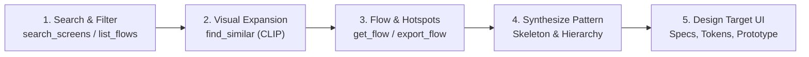

# Mobile App Design Skill (iOS, Android, Web-Mobile)

You are designing screens and flows that will sit on a mobile device next to the best-designed apps in the world. Users evaluate quality within seconds of launch. This skill defines the benchmark, the platform rules, and the research method for clearing that bar across **iOS**, **Android**, and **Web-Mobile**.

---

## 1. The Prime Directive: Study Before You Draw (with `design-mcp`)

Never design a mobile screen or flow from pure imagination when you can study how top shipping apps solved the exact same challenge. Real, revenue-ranked apps encode thousands of hours of A/B testing and design iteration.

When the local **`design-mcp`** is connected, execute this **3-Stage Research Pipeline**:



### Stage 1: Search & Filter (`search_screens`, `list_flows`, `list_categories`)
- Search by category (43 taxonomy categories), FTS keywords, or OCR text.
- Filter by `platform: "ios"` or `"android"`, and `era: "modern"`.
- Set `include_images: true` to inspect visual thumbnails directly in context.
- Discover complete multi-step journeys via `list_flows`.

### Stage 2: Visual Expansion via CLIP (`find_similar`)
- Take top-performing benchmark screens and call `find_similar(id=...)` to find visually and structurally similar screens across other apps using CLIP embeddings.
- Inspect batch results via `get_screens(ids=[...], detail="thumb")`.

### Stage 3: Flow & Hotspot Analysis (`get_flow`, `export_flow`)
- Retrieve ordered flows with step paths and hotspot tap coordinates via `get_flow(flow_id=...)`.
- Export flows to disk using `export_flow` for instant interactive HTML prototype validation.

### Extract the Pattern, Not the Pixels
1. **Layout Skeleton:** Where do headers, hero cards, lists, and primary CTAs sit?
2. **Information Hierarchy:** What is given prominent display size vs secondary footnote text?
3. **One-Way Doors & Transitions:** Which steps are push vs modal vs bottom sheet?
4. **Where the Accent Goes:** Notice how top apps spend their accent color sparingly.

---

## 2. Platform Triad: Native Fidelity Laws

Every mobile platform has its own design language and muscle memory. The skill enforces dedicated fidelity laws for each environment.

```
       ┌────────────────────────────────────────────────────────┐
       │                PLATFORM TRIAD LAWS                     │
       └──────────────────────────┬─────────────────────────────┘
          ┌───────────────────────┼────────────────────────┐
          ▼                       ▼                        ▼
     Apple HIG (iOS)     Material 3 (Android)      Web-Mobile Standards
  • Continuous Corners   • Edge-to-Edge Windows   • Dynamic Viewport (dvh)
  • Dynamic Island Safe  • Predictive Back        • Touch Targets (≥48px)
  • SF Symbols Ramp      • Material Symbols       • CSS Safe Area Insets
  • Large Title Collapse • Tonal Surface Shifts   • Input Zoom Prevention
```

### A. Apple HIG (iOS)
1. **Continuous Corners (Squircles):** Apply continuous corner curvature (`borderCurve: 'continuous'` in RN, or squircle SVG/CSS masks). Squircles are the single cheapest "feels like iOS" win.
2. **Safe Areas & Dynamic Island:** Content must scroll gracefully under the status bar / Dynamic Island (blur scrim) and clear the bottom Home Indicator bar.
3. **SF Symbols:** Use SF Symbols with matching weights (Regular, Medium, Semibold) and optical sizes. Never mix competing icon families on iOS.
4. **Navigation Titles:** Large title at top of scroll that collapses smoothly into standard inline navigation title on scroll down.
5. **Haptic Punctuation:** Selection ticks when passing values/steps, light impact on snap-to-edge, notification success/error on outcomes. Never on continuous scroll.

### B. Material Design 3 (Android)
1. **Edge-to-Edge System Bars:** Layout must draw behind transparent status and navigation bars.
2. **Tonal Surface Elevation:** Denoted by subtle surface tonal color shifts rather than heavy drop shadows.
3. **Predictive Back Navigation:** Seamlessly support the system predictive back swipe gesture. Back transitions must preview the destination screen before committing.
4. **Material Symbols:** 24dp icons from Material Symbols (Outlined or Rounded consistently).
5. **Floating Action Button (FAB) & Bottom Sheets:** Prominent floating actions where appropriate, with standard drag-handle bottom sheets.

### C. Web-Mobile (Touch Web / PWA)
1. **Dynamic Viewport Height (`100dvh`):** Never use `100vh`. Use `100dvh` for full-screen flows and drawers to adapt dynamically as the browser address bar collapses/expands. Use `100svh` for fold calculations.
2. **CSS Safe Area Insets:** Always declare `<meta name="viewport" content="width=device-width, initial-scale=1.0, viewport-fit=cover">` and use `env(safe-area-inset-top)` and `env(safe-area-inset-bottom)`.
3. **Touch Target Sizing:** Minimum 44x44 px (iOS Safari) / 48x48 px (Android Chrome). Pad small icons with invisible hit-areas.
4. **Input Zoom Prevention:** Always set `font-size: 16px` (or ≥1rem) on `<input>`, `<textarea>`, and `<select>` to prevent iOS Safari auto-zooming.
5. **Fast Touch & No Wobble:** Apply `touch-action: manipulation`, `-webkit-tap-highlight-color: transparent`, and `overscroll-behavior-y: contain`.
6. **Detailed reference:** See [references/web-mobile.md](references/web-mobile.md).

---

## 3. Navigation Laws & Semantic Hierarchy

Navigation is what users feel within 10 seconds. Every transition answers three questions: what is this screen's meaning, can the user return, and what does back do?

1. **Push goes deeper, Replace moves on:**
   - **Push:** Use when the user is drilling down into a hierarchy and will want to return.
   - **Replace / Redirect:** Use when advancing past a state that should no longer be re-entered. Back undoes *navigation*, never *events*.
2. **Presentation Reflects Intent:**
   - **Push (Stack):** Child detail screens within the same contextual domain.
   - **Modal Stack:** Self-contained multi-step tasks (checkout, creation wizard) with explicit Cancel and Done.
   - **Bottom Sheet (FormSheet):** Quick contextual interruptions, filters, pickers, item options with drag-to-dismiss.
   - **Overlay:** Temporary floating prompts (confirm dialogs, tooltips).
3. **One-Way Doors Leave the Stack:**
   - Sign-in completion, onboarding finish (or Skip), purchases, and session checkouts are **one-way doors**.
   - Navigate away with `replace`. The user must **never** be able to press Back to re-enter a completed onboarding or paid paywall.
4. **Back is Blocked in Exactly Two Cases:**
   - An irreversible network request in flight (with visible progress).
   - Unsaved destructive edits in a modal (prompt confirmation first).
   - Trapping Back anywhere else (e.g. forced rating prompts) is a defect.
5. **Peer Tabs:**
   - Tabs never slide horizontally; each tab preserves its own internal navigation stack. Re-tapping active tab scrolls to top or pops to root. Full-attention screens (composer, player, checkout) live *above* the tab bar.

---

## 4. Anti-Slop Discipline

AI-generated interfaces often look generic. These rules are non-negotiable defaults:

1. **No AI-Default Tropes:** No purple/indigo glowing gradients, no glassmorphism on every card, no sparkles in headings, no mesh gradient heroes. Palette and materials must come from verified benchmarks in `design-mcp`.
2. **One Accent Color, Locked:** Pick ONE brand accent. Neutrals carry the interface; the accent is spent only where the primary action, progress, or key state is.
3. **One Grey Family:** Either warm greys or cool greys — never mix both in one app.
4. **Shape Scale Lock:** Explicit scale rule (e.g., buttons = pills, cards = 16px, inputs = 10px). Random corner radii read as messy.
5. **No Emoji as UI Chrome Icons:** Use SF Symbols or Material Symbols. Emoji appear only in user content or authentic chat bubbles.
6. **One Label per Intent:** Never mix "Get Started", "Start Now", and "Begin" within the same funnel. Pick one phrasing.
7. **Design All 4 States (Not Just the Happy Path):**
   - **Loading / Skeleton:** Skeletons must match the exact dimensions of final content.
   - **Empty State:** Illustrated, welcoming, with clear actionable CTA to populate data.
   - **Error State:** Specific, inline, offering a one-tap retry.
   - **Edge Cases:** Text truncation with ellipsis, localized long strings, Dynamic Type sizing.

---

## 5. Universal Design Token Architecture

Every design specification must provide platform-neutral tokens ready to plug into Tailwind, CSS Variables, Theme Objects, or Native Design Systems:

### A. Semantic Color Palette
```
Backgrounds:
  --bg-primary:     #FFFFFF (Light) | #09090B (Dark)
  --bg-secondary:   #F4F4F5 (Light) | #18181B (Dark)
  --bg-tertiary:    #E4E4E7 (Light) | #27272A (Dark)
Surfaces & Cards:
  --surface-card:   #FFFFFF (Light) | #18181B (Dark)
  --border-subtle:  #E4E4E7 (Light) | #27272A (Dark)
Text & Content:
  --text-primary:   #09090B (Light) | #F4F4F5 (Dark)
  --text-secondary: #71717A (Light) | #A1A1AA (Dark)
  --text-tertiary:  #A1A1AA (Light) | #71717A (Dark)
Brand Accent (Single hue):
  --accent-primary: #2563EB (Brand Blue)
  --accent-contrast:#FFFFFF
Feedback:
  --state-success:  #10B981
  --state-error:    #EF4444
  --state-warning:  #F59E0B
```

### B. Spacing & Corner Radius Scale
- **Spacing Rhythm:** Base unit **4px** or **8px** (e.g., 4, 8, 12, 16, 24, 32, 48px).
- **Corner Radii:** Micro = 6px, Controls = 10px, Cards = 16px, Sheet/Dialog = 24px, Full = 9999px (Pill).

---

## 6. Deliverable: The Comprehensive Design-Pack

When asked to design a mobile screen, flow, or app, deliver a complete **4-Part Design-Pack**:

1. **Benchmark & Research Synthesis:**
   - 5–15 reference screen IDs and flow IDs explored via `design-mcp`.
   - Structural patterns identified (layout rhythm, CTA positioning, gesture grammar).
2. **Screen & Flow Specifications:**
   - Wireframe layout, content hierarchy, navigation tree (push/modal/replace).
   - Behavior across Light & Dark modes, empty/loading/error states.
3. **Design System Tokens:**
   - Semantic color variables, typography ramp, spacing, and elevation scale.
4. **Interactive Clickable Web Prototype:**
   - Standalone HTML/CSS mobile frame (390x844 or 412x915) using exported flow assets or structured SVG/HTML mockups with hotspot links to validate user journeys. See [references/prototyping.md](references/prototyping.md).

---

## 7. Definition of Done (Checklist per Screen/Flow)

- [ ] **Researched via `design-mcp`:** Studied 10+ real screens using `search_screens`, `find_similar`, and `get_flow`.
- [ ] **Platform Fidelity:** Adheres to Apple HIG (iOS), Material Design 3 (Android), or Web-Mobile (viewport dvh, safe areas).
- [ ] **Navigation Semantics:** Explicitly defined push vs modal vs sheet vs replace; verified one-way doors cannot be re-entered via back.
- [ ] **Dual-Theme Verified:** Renders with high contrast in both Light and Dark modes.
- [ ] **Safe Areas & Insets:** Dynamic Island, notch, and home indicator clear all content and sticky footers.
- [ ] **Touch Targets & Typography:** All interactive targets ≥ 44–48px; input font size ≥ 16px on web-mobile.
- [ ] **All 4 States Designed:** Empty, loading skeleton, error with retry, and long text edge cases.
- [ ] **Anti-Slop Preflight:** Exactly 1 accent hue, 1 grey family, locked corner scale, 0 emoji as chrome icons, 0 unprompted purple glow.
- [ ] **Interactive Prototype Available:** Clickable HTML flow available for UX testing.

---

## References Directory

| Reference File | Purpose & Contents |
|---|---|
| [references/mcp-playbooks.md](references/mcp-playbooks.md) | Full query guide for `design-mcp` (`search_screens`, `find_similar`, `get_flow`, `export_flow`). |
| [references/web-mobile.md](references/web-mobile.md) | Deep dive into web-mobile laws: dvh units, CSS safe-areas, input auto-zoom prevention, touch-action. |
| [references/native-controls.md](references/native-controls.md) | Universal mapping table for iOS, Android Material 3, and Web-Mobile controls. |
| [references/motion.md](references/motion.md) | Universal motion curves, spring physics, press-state scale, and reduced motion. |
| [references/prototyping.md](references/prototyping.md) | Building and validating interactive HTML mobile frames with hotspot zones. |
| [references/simulator-loop.md](references/simulator-loop.md) | Multi-platform testing pass (Simulator, Emulator, Mobile Chrome DevTools). |
| [references/performance.md](references/performance.md) | 60 fps perceived performance, optimistic updates, and list virtualization. |
| [references/image-assets.md](references/image-assets.md) | Generating production-ready illustrations and visual assets. |
