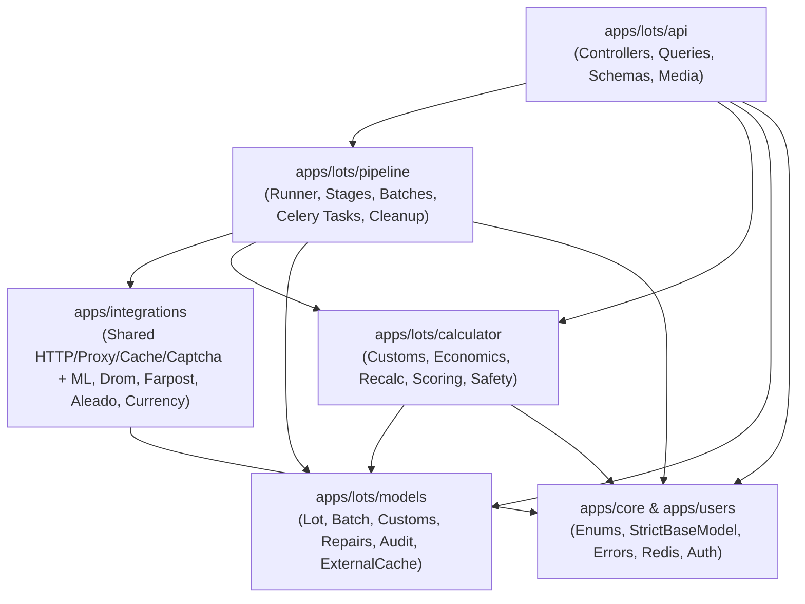

# План оптимизации архитектуры, конфигов, документации и AI-процессов Yuzu

> **Цель:** Перевести кодовую базу из режима быстрого хакатона в предсказуемую, модульную архитектуру с жёсткими границами слоёв, единым источником правды для контрактов/конфигов и чёткими правилами для AI-агентов.
> **Статус:** Утверждено через `/grill-me`; зафиксировано в ветке `refactor/architecture-prep` (от `origin/main` после мержа PR #36).
> **Порядок выполнения:** Сначала — небольшой функциональный предрефактор (исправление логически/функционально сомнительных мест до переноса модулей), затем — поэтапный архитектурный рефакторинг по плану ниже.

---

## 1. Сводка утверждённых решений

| Область | Принятое решение | Зачем |
| :--- | :--- | :--- |
| **База данных и Compose** | Удалить `USE_SQLITE` / ветки `sqlite3` из настроек и удалить устаревшие `backend/docker-compose*.yml` | Один стек (`./docker-compose.yml` и `./docker-compose.prod.yml`), одна БД PostgreSQL везде. |
| **Конфигурация и секреты** | `config.toml` внутри `backend/` и `ml_service/` (через встроенный `tomllib` + Pydantic Settings) + тонкий корневой `.env` + минимальный `ml_service/.env.example` | В `.env` остаются ~10–15 строк секретов/хостов; ~70% таймаутов/лимитов уезжают в версионируемый TOML с типами и комментариями. |
| **Документация (`docs/`)** | Объединить `docs/`, `planning/`, `research/` в единый `docs/` (`architecture/`, `product/`, `archive/`), перевести контракты на живой `OpenAPI -> api.generated.ts` + короткий `CONTRACTS.md` | Убирает 122 КБ устаревшего `API_DATA_CONTRACTS.md`; фронт и бэк перестают расходиться. |
| **Архитектура `backend`** | Вынести внешние шлюзы в `apps/integrations/`, а внутри `apps/lots/` разделить 4 слоя: `models/`, `calculator/`, `pipeline/`, `api/` | Файлы 500–760 строк режутся до ~150–300 строк с одной зоной ответственности и без ломки миграций `app_label="lots"`. |
| **AI-дисциплина и проверки** | Корневой `AGENTS.md` + `ruff` (сложность и запрет анти-паттернов) + `import-linter` + мягкий лимит ~300–350 строк на модуль | Предотвращает повторное появление "god files" и циклических импортов между слоями. |

---

## 2. Инфраструктурная чистка: SQLite и старые Compose

### 2.1. Удаление `USE_SQLITE` и `sqlite3`
Убрать из:
- [config.py](backend/config/settings/config.py#L36) (`USE_SQLITE: bool = False`)
- [base.py](backend/config/settings/base.py#L93-L116) (удалить ветку `parsed.scheme.startswith("sqlite")` и `if settings_obj.USE_SQLITE`)
- [backend/Dockerfile](backend/Dockerfile#L79-L82) (`USE_SQLITE=True` при `collectstatic --noinput` заменить на стандартную сборку без SQLite, т.к. `collectstatic` не открывает соединение с БД)
- [docker-compose.yml](docker-compose.yml), [docker-compose.prod.yml](docker-compose.prod.yml), [backend/.env.example](backend/.env.example), [backend/AGENTS.md](backend/AGENTS.md)

### 2.2. Удаление дублирующихся Docker Compose
- Удалить устаревшие [backend/docker-compose.yml](backend/docker-compose.yml), [backend/docker-compose.dev.yml](backend/docker-compose.dev.yml), [backend/docker-compose.prod.yml](backend/docker-compose.prod.yml).
- В [backend/Makefile](backend/Makefile#L44-L60) перенаправить `up` / `up-db` / `down` / `prod-up` / `logs` на корневой `../docker-compose.yml` (и `../docker-compose.prod.yml`).
- [ml_service/docker-compose.yml](ml_service/docker-compose.yml) оставить как автономный шаблон на случай выноса ML на отдельный GPU-сервер.

---

## 3. Конфигурация: `config.toml` + тонкий `.env`

Приоритет загрузки настроек в Pydantic `BaseSettings` (через `settings_customise_sources` + встроенный `TomlConfigSettingsSource`):
`Переменные окружения (Docker/OS)` → `.env` (локальные секреты/переопределения) → `config.toml` (настройки в git) → `Дефолт в Python-классе`.

### Что где живёт

| Файл | Хранится в git | Что внутри |
| :--- | :---: | :--- |
| `.env.example` / `.env` (корень) | шаблон да, `.env` нет | **Только секреты и хост-настройки (~10–15 строк):** `POSTGRES_*`, `SECRET_KEY`, `ML_SERVICE_API_KEY`, `GEMINI_API_KEYS`, `SCRAPER_PROXY_URLS`, `ALEADO_USERNAME/PASSWORD`, `TRAEFIK_HOST`, `ALLOWED_HOSTS`, `CORS_ALLOWED_ORIGINS`, `CBRF_FALLBACK_RATES`. |
| `ml_service/.env.example` | да | **Минимальный шаблон под отдельный GPU-сервер (~4 строки):** `ML_SERVICE_API_KEY`, `GEMINI_API_KEYS`, `PORT`. |
| `backend/config.toml` | да | `[scraper]` (`timeout_sec`, `request_interval_sec`, `proxy_ban_sec`), `[farpost]` (`budget_sec`, `cooldown_sec`, `cache_ttl_hours`, `captcha_*`), `[aleado]` (`base_url`, `timeout_sec`, `verify_candidates`), `[currency]` (`cbrf_api_url`, `timeout_sec`, `jpy_spread`), `[media]` (`purge_*`). |
| `ml_service/config.toml` | да | `[gemini]` (модели, fallback-список, RPM/таймауты, gatekeeper пороги), `[batch]` (`max_items`, `concurrency`, `ttl`), `[crop]` (`format`, `quality`, `min_px`, `max_px`). |

Отдельные копипастные `backend/.env.example` и `frontend/.env.example` удаляются: локально Vite и сервисы читают корневой `.env` (или минимальные Compose defaults), а точечный override в проде (например, `FARPOST_CAPTCHA_OCR_ENABLED=true` в `docker-compose.prod.yml`) всё так же перекрывает `config.toml`.

---

## 4. Единая документация `docs/` и контракты для AI-разработки

### 4.1. Целевая структура `docs/`
Объединяем разрозненные `docs/`, `planning/`, `research/`:

```text
docs/
├── README.md                  # Карта всего проекта и входная точка (1 экран)
├── architecture/
│   ├── SYSTEM_OVERVIEW.md     # Контейнеры, сети (Traefik -> Caddy -> API -> ML/Worker), БД/Redis
│   ├── BACKEND_LAYERS.md      # Карта модулей apps/, границы слоёв, правила import-linter
│   ├── CONTRACTS.md           # Короткий (~150 строк) свод инвариантов (int RUB/JPY, RFC 7807, коды дефектов, статусы)
│   ├── openapi.json           # Автогенерируемый снимок из Django Ninja (проверяется в CI)
│   └── specs/                 # Короткие 1-страничные RFC/ADR для новых фич (до написания кода)
├── product/                   # Перенесённые актуальные продуктовые и дизайн-доки
│   ├── PRODUCT_SPECIFICATION.md
│   ├── DESIGN.md
│   ├── BENCHMARK_CASE_COROLLA_TOURING.md
│   ├── showcase.html / showcase.png
│   └── UX_RESEARCH.md         # (отчёты UX + паттерны)
└── archive/                   # Перенесённые planning/, research/, старые auction_pipeline.md и API_DATA_CONTRACTS.md
```

### 4.2. Как работают контракты без ручного блоата (`API_DATA_CONTRACTS.md`)
1. **При проектировании новой фичи (Contract-First):** пишется компактный RFC на 1 страницу в `docs/architecture/specs/NNN-feature.md` (цель, инварианты, граничные случаи) и сразу обновляются/добавляются Pydantic-схемы на бэке (или stub-роуты).
2. **Единый машинный источник правды (SSOT):** команда `make openapi` экспортирует `docs/architecture/openapi.json`, а на фронтенде `openapi-typescript` генерирует `frontend/src/types/api.generated.ts`. Параллельные backend/frontend-агенты работают от **реальных сгенерированных TS/Python-типов**.
3. **Защита от рассинхрона:** проверка `make check-contracts` (в CI / pre-commit) проверяет, что `openapi.json` и `api.generated.ts` совпадают с текущим кодом Django Ninja. Ручной `API_DATA_CONTRACTS.md` (1678 строк) уезжает в `docs/archive/`.

---

## 5. Долгосрочная архитектура `backend`

### 5.1. Схема слоёв и зависимостей



Модели остаются в пакете `apps/lots/models/` (с реэкспортом в `models/__init__.py`), поэтому `app_label = "lots"` и все существующие миграции PostgreSQL сохраняются на 100% без переименования таблиц и без риска потери данных.

### 5.2. Конкретный план нарезки гигантских модулей

| Текущий файл (строк) | Целевые модули (~120–280 строк каждый) | Зона ответственности |
| :--- | :--- | :--- |
| `apps/lots/customs.py` (763) | `calculator/customs/{tariffs.py, recycling.py, calculator.py, bid_solver.py}` | Тарифные таблицы ЕАЭС; утильсбор (льготный/коммерческий); расчёт пошлины; подбор ставки `derive_start_bid`. |
| `apps/lots/pipeline.py` (747) | `lots/pipeline/{runner.py, stages.py, parallel.py, recovery.py}` | Состояние пайплайна и переходы; OCR-стадия; параллельный сбор Drom/Aleado/Farpost; recovery зависших батчей. |
| `apps/lots/models.py` (617) | `lots/models/{lot.py, batch.py, customs.py, repairs.py, audit.py, cache.py}` | Доменные модели по сущностям вместо одного файла-простыни. |
| `integrations/http_client.py` (601) | `integrations/shared/http/{client.py, redirects.py, transport.py, throttle.py}` | Публичный `ResilientHttpSession`; ручная проверка редиректов; адаптеры `curl_cffi`/`httpx`; rate/budget throttle. |
| `integrations/aleado/service.py` (584) | `integrations/aleado/{matcher.py, comparator.py, service.py}` | Подбор кандидатов и сверка номера кузова; правила регрессии (пробег/оценка); фасад `audit_lot`. |
| `apps/lots/schemas.py` (512) | `lots/api/schemas/{lot.py, batch.py, economics.py, audit.py}` | Схемы ответа и запроса разнесены по эндпоинтам. |
| `apps/lots/economics.py` (495) + `recalc.py` + `scoring.py` + `safety.py` | `lots/calculator/{economics.py, recalc.py, scoring.py, safety.py}` | Единый расчётный движок (без HTTP и без Celery). |
| `apps/lots/queries.py` (486) | `lots/api/queries/{list.py, detail.py, batches.py, helpers.py}` | Read-проекции и санитайзинг вывода для контроллеров. |
| `integrations/drom/*` (service 461 + slugs 482) | `integrations/drom/{cascade.py, service.py, slugs/resolver.py, slugs/aliases.py}` | Каскад перебора регионов/параметров вынесен из `DromMarketService`. |

---

## 6. Правила для AI-агента и автоматические «шлагбаумы»

### 6.1. Иерархия `AGENTS.md`
1. **Корневой `AGENTS.md`** (~60–80 строк): общая карта репозитория, политика конфигов (`config.toml` vs `.env`), правило работы с контрактами (`OpenAPI` + `specs/`), требование не плодить дубли документов и всегда чистить временные артефакты.
2. **Обновлённый [backend/AGENTS.md](backend/AGENTS.md)**:
   - Ссылка на карту слоёв `docs/architecture/BACKEND_LAYERS.md`.
   - Обязательное разделение: бизнес-математика → `calculator/`, внешний I/O → `integrations/`, HTTP → `api/`, оркестрация → `pipeline/`.
   - Мягкий порог размера модуля: **~300–350 строк максимум** (при правке файла >350 строк сначала вынести подмодуль, не дописывать «простыню»).
   - Запрет голого `except Exception:` (только конкретные исключения или явно задокументированный boundary-fallback с логированием), обязательная типизация вход/выход DTO.
3. **[frontend/AGENTS.md](frontend/AGENTS.md)**: опора на `api.generated.ts`, запрет парсинга локализованных русских строк вместо enum-полей (`PartSourceKind` и аналоги).

### 6.2. Автоматический контроль (`pyproject.toml` + `lefthook.yml`)
1. **`import-linter` (dev-зависимость + шаг в `make check` / `lefthook`)** — контракты импортов:
   - `apps.lots.calculator` не импортирует `apps.lots.api`, `apps.lots.pipeline`, `apps.integrations`.
   - `apps.integrations` не импортирует `apps.lots.api`, `apps.lots.pipeline`, `apps.lots.calculator`.
   - `apps.core` не импортирует `apps.lots`, `apps.users`, `apps.integrations`.
2. **Усиление `ruff` в [pyproject.toml](backend/pyproject.toml)**:
   - `C90` (`mccabe`, `max-complexity = 12`), `PLR0912` (ветвления), `BLE001` (blind-except), `TRY` / `PERF` базовые правила, требования docstrings/типов.
3. **Мягкая проверка размера изменённых файлов в Lefthook**: предупреждение при коммите нового/изменённого `.py`/`.ts`/`.vue` файла >350 строк (исключая миграции и generated-файлы).

---

## 7. Безопасная пошаговая дорожная карта (малыми PR)

0. **PR 0 — Предрефактор (функционально/логически сомнительные решения в текущей кодовой базе):**
   - Исправление логических нестыковок, багов граничных случаев и противоречий между расчётами/интеграциями/фронтом ДО переноса модулей.
1. **PR 1 — Инфраструктура и чистка (SQLite, Compose, конфиги):**
   - Убрать `USE_SQLITE`, `sqlite3`, `backend/docker-compose*.yml`; обновить [backend/Makefile](backend/Makefile) и [backend/Dockerfile](backend/Dockerfile).
   - Ввести `backend/config.toml` и `ml_service/config.toml`, упростить корневой `.env.example` и `ml_service/.env.example`, удалить дублирующие `backend/.env.example` и `frontend/.env.example`.
2. **PR 2 — Документация, OpenAPI-генерация и `AGENTS.md`:**
   - Консолидировать `docs/`, `planning/`, `research/` под единый `docs/` (+ перенести устаревший `API_DATA_CONTRACTS.md` в `docs/archive/`).
   - Добавить `make openapi` (`docs/architecture/openapi.json`) + `openapi-typescript` на фронте (`api.generated.ts`) + `CONTRACTS.md`.
   - Обновить корневой `AGENTS.md`, `backend/AGENTS.md`, `frontend/AGENTS.md` и добавить `import-linter` + правила `ruff`.
3. **PR 3 — Выделение `apps/integrations/`:**
   - Перенести `apps/lots/integrations/` → `apps/integrations/` (с временными реэкспортами при необходимости на 1 PR).
   - Разрезать `http_client.py` (601), `aleado/service.py` (584) и `drom/service.py` + `slugs.py` (461/482) на подмодули ≤300 строк.
4. **PR 4 — Нарезка `apps/lots/` на `{models, calculator, pipeline, api}`:**
   - Разделить `models.py` в пакет `apps/lots/models/` (проверить `makemigrations --check --dry-run` → ноль новых миграций).
   - Собрать `calculator/` (разрезать `customs.py` на 4 файла + перенести `economics.py`, `recalc.py`, `scoring.py`, `safety.py`).
   - Разрезать `pipeline.py` (747), `queries.py` (486), `schemas.py` (512) на `pipeline/` и `api/`, включить строгий `import-linter`.
