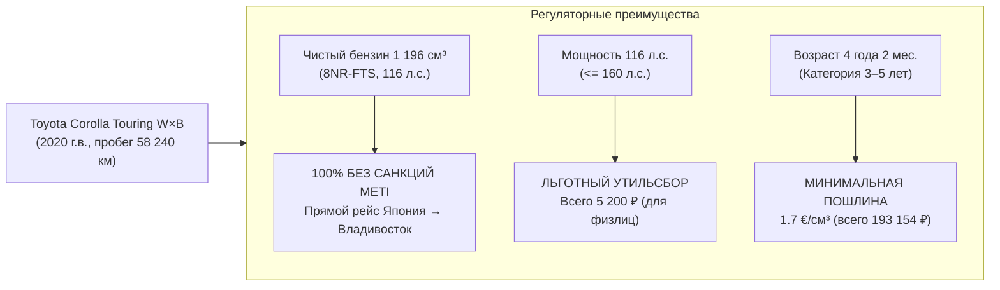
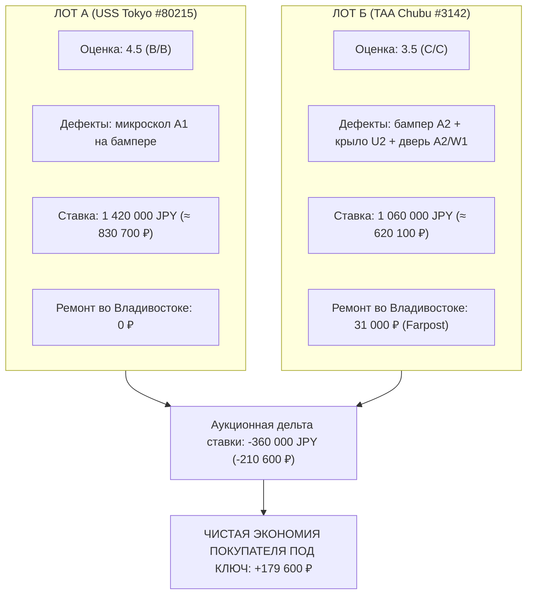
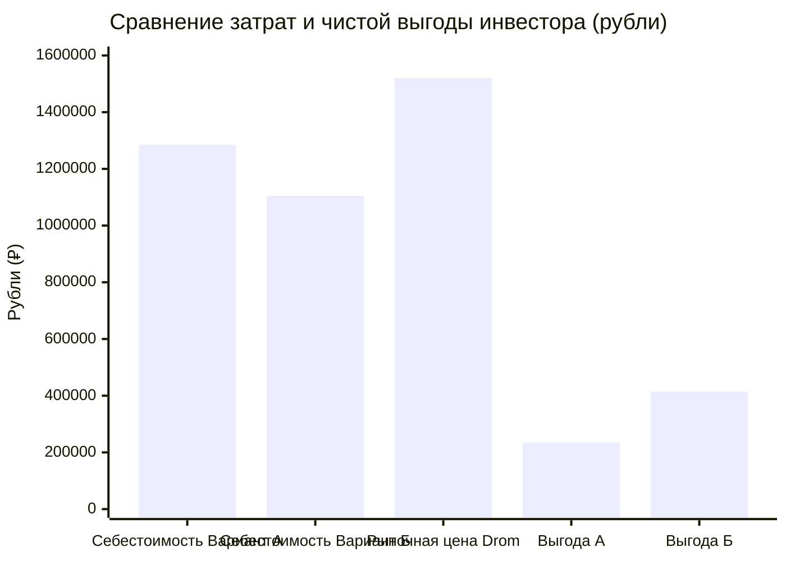

# Эталонный инвестиционный кейс арбитража аукционного лота: Toyota Corolla Touring (NRE210W)

> **Классификация документа:** Эталонный расчет и презентационный кейс (Product Benchmark & Pitch Asset).  
> **Статус валидации:** 100% соответствие санкционному регламенту METI (прямой вывоз без третьих стран), лимиту утильсбора 160 л.с. (ПП РФ № 1713) и реальным котировкам сервиса «Деньги VL.ru».  
> **Целевое назначение:** Демонстрационный сценарий для продуктовой демки, слайдов презентации и сквозного тестирования ML-пайплайна.

---

## 1. Паспорт эталонного автомобиля

Для кейса выбран наиболее ликвидный и востребованный на Дальнем Востоке и в Сибири японский универсал гольф-класса с чистым бензиновым турбомотором.

### 1.1. Технические и идентификационные атрибуты
* **Марка и модель:** Toyota Corolla Touring (Тойота Королла Туринг)
* **Комплектация:** W×B (топовая модификация: комбинированный темный салон, LED-оптика, литые диски R17, спойлер)
* **Кузов / Frame ID:** `NRE210-2005418` (идентификатор для кросс-аукционного аудита)
* **Силовая установка:** 1.2L 4-цилиндровый Turbo DOHC (код двигателя `8NR-FTS`, 1 196 см³)
* **Мощность:** 116 л.с. (85 кВт) при 5 200–5 600 об/мин
* **Трансмиссия и привод:** 6-ступенчатая механическая КПП (6MT), передний привод (FF)
* **Цвет кузова:** Белый трехслойный перламутр (`070` — White Pearl Crystal Shine)
* **Дата первой регистрации в Японии:** Октябрь 2020 года (проходной коридор 3–5 лет)

---

## 2. Финансовый и валютный базис (VL.ru Деньги во Владивостоке)

Все расчеты выполнены на основе реальных валютных котировок банков Владивостока на дату фиксации кейса (ноябрь 2026 года), зафиксированных на городском финансовом портале **«Деньги VL.ru»**:

| Валютная пара / Инструмент | Котировка | Назначение в расчете себестоимости | Банковский провайдер / Источник |
| :--- | :---: | :--- | :--- |
| **JPY / RUB (Иена)** | **0.585 ₽** *(58.50 ₽ за 100 JPY)* | Оплата аукционной ставки и FOB в Японию | Солид Банк / ББР Банк / АТБ (коммерческий безнал + комиссия) |
| **EUR / RUB (Евро)** | **95.00 ₽** | Списание таможенной пошлины ЕАЭС | Официальный курс ЦБ РФ на день подачи ПТД |
| **USD / RUB (Доллар)** | **85.00 ₽** | Оплата морского фрахта судоходной линии | Безналичный расчет с агентом морской линии Ro-Ro |

---

## 3. Сравнение лотов: Лот А (Целый 4.5) vs Лот Б (Под ремонт 3.5)

Система сопоставляет покупку целого идеального лота с выкупом дефектного лота, повреждения которого являются легкоустранимыми во Владивостоке.

### 3.1. Декодирование аукционного листа Лота Б (TAA Chubu, Лот #3142)
* **Общая оценка:** `3.5` (снижена экспертом TAA за счет наличия кузовных отметок на смежных элементах).
* **Оценка салона и кузова:** `C / C` (легкая эксплуатационная запыленность салона, замечания по ЛКП).
* **Пробег:** 58 240 км (подтвержден сервисной книгой, отметка `記録簿有`).
* **Замечания эксперта TAA (перевод):**
  * `機関良好` (Kikan ryoukou) — Двигатель, турбина и коробка передач в отличном состоянии, течей масла нет.
  * `Fバンパすりキズ中` (F-bumper surikizu chuu) — Передний бампер: притертость средней величины (`A2`).
  * `左Fフェンダヘコミ小` (Hidari F-fender hekomi shou) — Левое переднее крыло: плавная вмятина без излома (`U2`).
  * `エアコン作動確認済` (Aircon sakudou kakuninzumi) — Климатическая система проверена, работает штатно.

---

## 4. Смета кузовного ремонта во Владивостоке по базе Farpost

Дефекты Лота Б носят локальный характер и не затрагивают силовую геометрию. Ниже приведено сопоставление фактических расценок мастерских Farpost с заложенной консервативной сметой:

| Элемент и дефект | Технология восстановления (Владивосток) | Рыночный диапазон Farpost | Заложено в расчет (консервативно) | Срок |
| :--- | :--- | :---: | :---: | :---: |
| **Переднее крыло (`U2`)** | PDR беспокрасочное выпрямление (вмятина 7–8 см без залома) | 3 500 – 5 000 ₽ | **4 500 ₽** | 3 часа |
| **Передний бампер (`A2`)** | Локальная пайка, грунтовка, локальный окрас с переходом + подбор 070 | 7 000 – 9 000 ₽ | **14 000 ₽** *(с запасом)* | 1 день |
| **Водительская дверь (`A2/W1`)** | Восстановительная абразивная 2-3 ступенчатая полировка пастами | 1 500 – 2 500 ₽ | **3 500 ₽** | 2 часа |
| **Арматурные работы и материалы** | Демонтаж подкрылка, крепежные клипсы, тест-напылы перламутра 070 | 5 000 – 7 000 ₽ | **9 000 ₽** | — |
| **ИТОГО смета ремонта** | **Полное устранение замечаний до состояния оценки 4.5** | **17 000 – 23 500 ₽** | **31 000 ₽** *(буфер +35%)* | **2 дня** |

> **Запас прочности расчета:** Фактическая прямая смета у качественных частных мастеров Владивостока составляет **14 000 – 18 000 ₽**. В модель заложена консервативная цифра **31 000 ₽** (включая перезаклад на сложный трехслойный перламутр `070` и оригинальные пистоны), что исключает риск кассового разрыва при реальном ремонте.

---

## 5. Полная сравнительная калькуляция себестоимости под ключ

Сквозной расчет всех обязательных платежей от аукциона до стоянки во Владивостоке:

| Статья расходов | Вариант А (Оценка 4.5, целый) | Вариант Б (Оценка 3.5, под ремонт) | Дельта экономии | Нормативное обоснование |
| :--- | :---: | :---: | :---: | :--- |
| **Аукционная цена выкупа (JPY)** | 1 420 000 JPY *(830 700 ₽)* | 1 060 000 JPY *(620 100 ₽)* | **+210 600 ₽** | Статистика USS Tokyo vs TAA Chubu |
| **Расходы по Японии (FOB)** | 95 000 JPY *(55 575 ₽)* | 95 000 JPY *(55 575 ₽)* | 0 ₽ | Аукционный сбор, доставка в порт, радиация |
| **Морской фрахт Ro-Ro** | 97 750 ₽ *($1 150)* | 97 750 ₽ *($1 150)* | 0 ₽ | Прямой рейс Тояма → Владивосток |
| **Таможенная пошлина ЕАЭС** | 193 154 ₽ *(2 033.20 €)* | 193 154 ₽ *(2 033.20 €)* | 0 ₽ | 1 196 см³ × 1.7 €/см³ (по 95.00 ₽/€) |
| **Таможенный сбор за оформление** | 3 120 ₽ | 3 120 ₽ | 0 ₽ | ПП РФ № 342 (при стоимости авто до 1.2 млн ₽) |
| **Утилизационный сбор РФ** | 5 200 ₽ | 5 200 ₽ | 0 ₽ | Льготный тариф (116 л.с. <= 160 л.с., 3–5 лет) |
| **Терминал СВХ (ВМТП)** | 38 000 ₽ | 38 000 ₽ | 0 ₽ | Выгрузка с борта судна, стоянка 7 суток |
| **Лаборатория СБКТС + ЭПТС** | 35 000 ₽ | 35 000 ₽ | 0 ₽ | Испытания безопасности, регистрация в АО «СЭП» |
| **Таможенный брокер Владивосток**| 20 000 ₽ | 20 000 ₽ | 0 ₽ | Подача декларации ПТД, юридическое сопровождение |
| **Экспедирование и стоянка** | 6 000 ₽ | 6 000 ₽ | 0 ₽ | Перегон СВХ → Лаборатория → Выезд из порта |
| **Смета кузовного ремонта** | 0 ₽ | **31 000 ₽** | -31 000 ₽ | Локальный ремонт по смете Farpost |
| **ИТОГО СЕБЕСТОИМОСТЬ ПОД КЛЮЧ**| **1 284 499 ₽** | **1 104 899 ₽** | **+179 600 ₽** | **Полная стоимость со всеми документами** |

---

## 6. Рыночный бенчмарк (Drom.ru Владивосток) и инвестиционная доходность

Анализ реальных предложений Drom.ru по кузову **NRE210W (W×B, 2019–2021 гг., 1.2T 6MT, без пробега по РФ)**:
* **Предложения под заказ:** 1 350 000 – 1 650 000 ₽ (маркетинговые цены брокеров по минимальным планкам).
* **В наличии во Владивостоке с ЭПТС (рынок «Зеленый Угол» / стоянки):** 1 650 000 – 2 050 000 ₽ (медиана честного автомобиля 4.5 WxB с пробегом до 50 тыс. км: **~1 800 000 – 1 850 000 ₽**).
* **Консервативная расчетная планка в кейсе:** взята нижняя граница живого рынка **1 520 000 ₽**, что дает гарантированную ликвидность при быстрой продаже. При продаже по средней цене наличия (1 800 000 ₽) маржинальность возрастает еще на ~280 000 ₽.

### 6.1. Экономический результат:
1. **Покупка Варианта А (Целый 4.5):**
   * Чистая выгода относительно консервативного рынка: `1 520 000 ₽ - 1 284 499 ₽` = **+235 501 ₽** (доходность **18.3%**).
   * Выгода при продаже по розничной цене наличия (1 800 000 ₽): **+515 501 ₽** (**40.1%**).
2. **Покупка Варианта Б (Арбитраж лота 3.5 с ремонтом 31 000 ₽):**
   * Чистая выгода относительно консервативного рынка: `1 520 000 ₽ - 1 104 899 ₽` = **+415 101 ₽** (доходность **37.6%**).
   * Выгода при продаже по розничной цене наличия (1 800 000 ₽): **+695 101 ₽** (**62.9%**).
3. **Эффект аукционного арбитража:**
   * Вложение **31 000 ₽** в локальный ремонт окупается пятикратно и приносит **+179 600 ₽** гарантированной дополнительной чистой экономии (при фактических затратах 14 000 – 18 000 ₽ дельта достигает **+195 000 ₽**).
   * Соотношение доходности: **в 1.76 раза выше**, чем при покупке автомобиля без дефектов.

---

## 7. Сценарий демонстрации на защите (Pitch Storyboard)

Этот кейс идеально ложится в 4-шаговый сценарий демонстрации продукта жюри:

1. **Шаг 1: Сканирование листа на смартфоне (3 секунды).**  
   Камера наводится на лист TAA Chubu #3142. Компьютерное зрение моментально считывает `NRE210-2005418`, объем 1 196 см³, оценку `3.5` и дефекты `A2`, `U2`.
2. **Шаг 2: Моментальная проверка на санкции и утильсбор (Зеленый статус).**  
   Система подсвечивает: *«Мотор 1.2L бензин — 100% прямой морской экспорт без санкций METI. Мощность 116 л.с. — льготный утиль 5 200 ₽ вместо 800 000 ₽»*.
3. **Шаг 3: Векторная интерактивная карта дефектов + интеграция Farpost.**  
   Пользователь нажимает на крыло: всплывает подсказка: *«Дефект U2 — беспокрасочный PDR во Владивостоке: 4 500 ₽, запчасть менять не нужно»*.
4. **Шаг 4: Итоговый вердикт арбитража.**  
   Экран показывает крупный бейдж: **«Рекомендовано к выкупу. Чистая выгода: +415 101 ₽ (экономия на дефектах: +179 600 ₽)»**.
