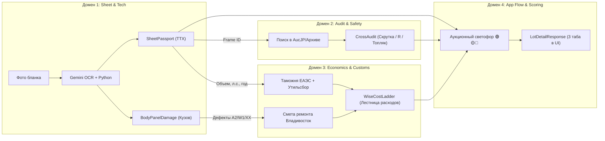

# Архитектура данных AuctionCalc (Data Architecture Index)

> **Статус:** Канонический документ (Single Source of Truth)  
> **Версия:** 1.0.0  
> **Формат:** Доменная Markdown-спецификация с таблицами полей, ERD-диаграммами и привязкой к UI

---

## 1. Концепция и Единственный Источник Правды (SSOT)

Вся информация о данных, сущностях, типах, источниках и экранах зафиксирована строго в директории `docs/domains/`. Любые будущие реализации в кодовой базе (бэкенд-эндпоинты, таблицы БД, клиентские интерфейсы мобильного приложения) обязаны соответствовать этим доменным спецификациям.

```
docs/
├── DATA_ARCHITECTURE.md           # [Этот файл] Системная карта и навигация по доменам
└── domains/
    ├── 01_sheet_and_tech.md       # Домен 1: Аукционный лист, ТТХ, схема дефектов кузова
    ├── 02_audit_and_safety.md     # Домен 2: Кросс-аудит по Frame ID, скрутка, аварии R
    ├── 03_economics_and_customs.md# Домен 3: Пошлины ЕАЭС, утильсбор, смета Farpost, Wise
    └── 04_app_flow_and_api.md     # Домен 4: Очереди обработки, скоринг светофора, API
```

---

## 2. Верхнеуровневая карта доменов и сквозной поток данных



---

## 3. Реестр доменов и зоны ответственности

| № | Файл спецификации | Что покрывает | Ключевые сущности | Экраны мобильного приложения |
| :-: | :--- | :--- | :--- | :--- |
| **1** | [01_sheet_and_tech.md](./domains/01_sheet_and_tech.md) | Аукционный лист: сырые японские поля, нормализованный паспорт, ТТХ, векторная схема дефектов кузова (16 панелей), замечания инспектора. | `RawAuctionSheet`, `NormalizedSheet`, `BodyPanelDamage`, `RiskFlags` | Экран 4 (Таб «Общий»), Экран 5 (Таб «Тех» — проекция кузова) |
| **2** | [02_audit_and_safety.md](./domains/02_audit_and_safety.md) | Проверка безопасности: история торгов по каноническому `Frame ID`, детекция скрученного пробега, завышения оценок, скрытых аварий `R`, топляка и коррозии. | `CrossAuditReport`, `PastAuctionRecord`, `AnomalyAlert` | Экран 4 (Липкий Sticky Danger Alert), плашка истории лота |
| **3** | [03_economics_and_customs.md](./domains/03_economics_and_customs.md) | Финансовая модель: ввоз во Владивосток, пошлина ЕАЭС, утильсбор РФ (5 200 ₽ vs 528 000 ₽), смета деталей Farpost в цвет `070`, пошаговая лестница Wise. | `CustomsCalculation`, `FarpostRepairSummary`, `WiseCostLadder` | Экран 6 (Таб «Эконом» — интерактивный слайдер ставки и свитчи) |
| **4** | [04_app_flow_and_api.md](./domains/04_app_flow_and_api.md) | Пользовательские сценарии: пакетная загрузка до 10 листов, очередь и опрос статуса (маскот 3/4), скоринг светофора, карточки дашборда, API. | `BatchCreate`, `BatchProgress`, `LotSummary`, `TrafficLightVerdict` | Экран 1 (Дашборд), Экран 2 (Модалка), Экран 3 (Очередь) |

---

## 4. Интерактивные каркасы интерфейсов и User Flow

Визуальная архитектура интерфейсов спроектирована в Excalidraw и отражает 3 ключевых пользовательских сценария и 6 канонических экранов мобильного приложения:

- **Исходник Excalidraw:** [`docs/assets/wireframes_and_flows.excalidraw`](./assets/wireframes_and_flows.excalidraw)
- **Экспорт в высоком разрешении:** [`docs/assets/wireframes_and_flows.png`](./assets/wireframes_and_flows.png)
- **Живой сервер холста:** `http://127.0.0.1:3000` (снапшот: `final_flow_and_wireframes_v1`)

```
[ User Flow: 3 сквозных маршрута ]
├── Сценарий 1: Основной успешный путь (Happy Path: 1..10 листов -> DAG 3/4 -> Зеленый светофор +415k)
├── Сценарий 2: Риск-контроль (Sheet OCR -> Кросс-аудит Frame ID -> Sticky Danger Alert -> Красный стоп-фактор)
└── Сценарий 3: Интерактивная экономика (Таб «Экономика» -> Слайдер ставки 0ms -> Farpost в цвет 070 -> Wise PDF)

[ Low-Fi Wireframes: 6 мобильных экранов ]
├── Часть 1: Сбор пачки и Главный дашборд
│   ├── Экран 1: Главный Дашборд (Поиск, фильтр ⚙, чипсы моделей, плашка «⏳ В обработке ▾», LIFO-лента, FAB)
│   ├── Экран 2: Модалка добавления (Bottom Sheet, Камера/Галерея, авто-роутинг без выбора режимов)
│   └── Экран 3: Очередь и маскот (Live Polling 1.5с, робот «3 из 4», кнопка «+ Еще листы», кликабельные строки)
└── Часть 2: Детальный экран лота (3 сегментированных таба)
    ├── Экран 4: Таб «Общий» (Светофор + аргументы, выгода к рынку, паспорт ТТХ, алерт скрутки, скан листа)
    ├── Экран 5: Таб «Техника» (2D схема 16 панелей кузова A/U/W/XX, замечания инспектора, силовой каркас/SRS)
    └── Экран 6: Таб «Экономика» (Слайдер ставки 0ms, утильсбор физ/комм, смета Farpost в цвет 070, итог под ключ, экспорт PDF)
```

