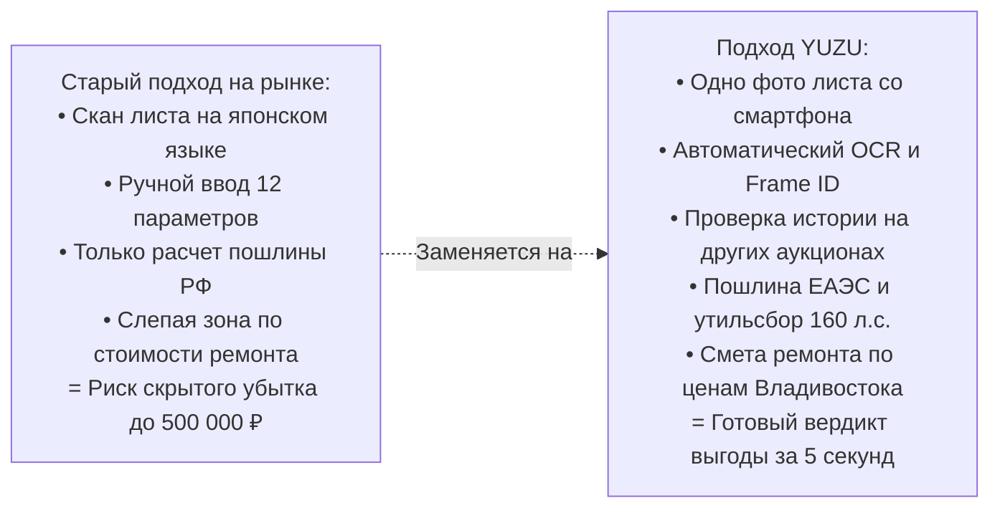
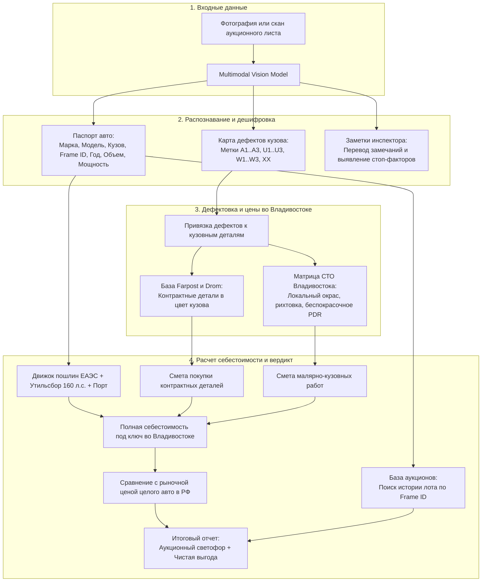
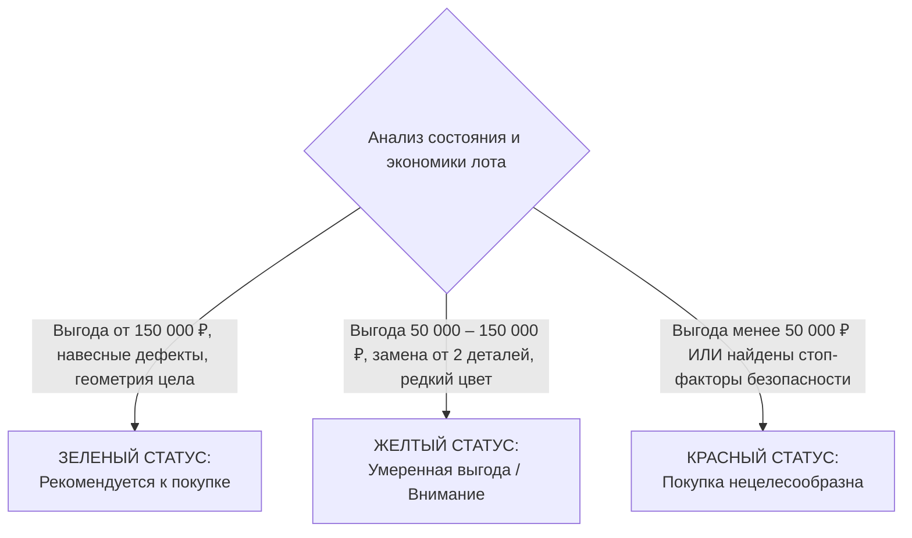

# Продуктовая спецификация: УТП, архитектура решений, скоринг и монетизация

> **Классификация документа:** Продуктовая спецификация и функциональные требования (Product Requirements & Specification).  
> **Проект:** Интеллектуальный сервис дефектоскопии японских аукционных листов и расчета себестоимости автомобилей YUZU (ранее AuctionCalc).  
> **Связанные документы:**
> - [Сводный каталог документации](./README.md)
> - [Дизайн-система Clean Light](./DESIGN.md)
> - [UX-исследование болей пользователей](./UX_COMPETITOR_RESEARCH.md)
> - [Интерактивная витрина компонентов](./showcase.html)
> - [Методология скоростной разработки](../planning/02_RAPID_DEVELOPMENT_METHODOLOGY.md)
> - [Кросс-аукционная дефектоскопия](../planning/01_CROSS_AUCTION_ANOMALY_DETECTION.md)
> - [Номенклатура и бренд YUZU](../planning/03_PRODUCT_NOMENCLATURE_ANALYSIS.md)
> 
> **Суть (BLUF):** Сервис YUZU превращает фото аукционного листа в инвестиционный расчет покупки автомобиля за 5 секунд. Система автоматически считывает номер кузова (`Frame ID`), проверяет историю прошлых торгов на скрытый ремонт, рассчитывает таможенную пошлину ЕАЭС с учетом порога мощности 160 л.с., оценивает смету ремонта во Владивостоке и выносит понятный вердикт («Аукционный светофор» с маскотом Капибарой Юдзу).

---

## 1. От ручного перевода листа к инвестиционному вердикту за 5 секунд

Существующие сервисы либо делают машинный перевод текста листа без оценки кузова (Aleado, боты импортеров), либо считают только таможенную пошлину при ручном вводе десятка параметров (калькулятор Drom).

YUZU объединяет расшифровку повреждений с экономикой ремонта во Владивостоке. Продукт превращается из простого переводчика в инвестиционный калькулятор целесообразности сделки.



### Ключевые преимущества продукта:
1. **Один снимок вместо ручного ввода (Zero Friction):** Пользователь фотографирует бланк листа. Система сама извлекает номер кузова, объем двигателя, мощность, пробег, общую оценку и координаты повреждений.
2. **Интерактивная развертка кузова (Damage Map):** Сервис переносит плоские японские значки на векторную проекцию автомобиля с цветовой подсветкой дефектов (`A`, `U`, `W`, `XX`).
3. **Распознавание скрытых угроз безопасности:** Модель анализирует рукописные заметки инспектора и выявляет следы затопления, деформацию лонжеронов, сварку стоек и сработавшие подушки безопасности.
4. **Кросс-аукционный аудит по номеру кузова (`Frame ID`):** Проверка автомобиля по базе других аукционных домов вскрывает скрученный пробег и перепродажу аварийного лота (покупка лота `R` на TAA с перепродажей под видом `4.0` на USS).
5. **Прозрачная лестница расходов (Cost Ladder):** Пошаговая детализация затрат от цены лота в иенах на аукционе до выдачи автомобиля со склада временного хранения во Владивостоке.

---

## 2. Сквозной конвейер обработки лота

Конвейер преобразует сырое изображение листа в готовое финансовое решение:



---

## 3. Скоринг целесообразности сделки: «Аукционный светофор»

Сервис рассчитывает чистую экономическую выгоду покупателя по формуле:

```
Чистая выгода = Рыночная цена аналога в РФ - Полная себестоимость во Владивостоке под ключ с ремонтом
```

Полная себестоимость включает: выкуп на аукционе + расходы по Японии FOB + морской фрахт + таможенную пошлину ЕАЭС + утилизационный сбор РФ + портовые услуги СВХ и лаборатории СБКТС + смету ремонта кузова во Владивостоке + вознаграждение брокера.



### Критерии присвоения цветового статуса

- 🟢 **ЗЕЛЕНЫЙ СТАТУС (Рекомендуется к покупке):**
  - **Экономика:** чистая выгода от 150 000 до 250 000 ₽ относительно рыночной цены в РФ.
  - **Состояние кузова:** дефекты затронули только съемные элементы (бамперы, крылья, царапины `A1..A2`, вмятины `U1..U2`, перекрас `W1`).
  - **Безопасность:** силовая структура кузова без повреждений, подушки безопасности не срабатывали, мотор и трансмиссия исправны.
  - **Доступность запчастей:** во Владивостоке доступны контрактные детали в цвет кузова без необходимости перекраса.

- 🟡 **ЖЕЛТЫЙ СТАТУС (Умеренная выгода, повышенное внимание):**
  - **Экономика:** чистая выгода составляет от 50 000 до 150 000 ₽.
  - **Состояние кузова:** требуется замена двух и более навесных элементов либо рихтовка и окрас трех и более деталей.
  - **Сложность ремонта:** дефицит деталей в цвет на авторазборках или сложный трехслойный перламутр, требующий подбора колера на СТО.

- 🔴 **КРАСНЫЙ СТАТУС (Покупка нецелесообразна, критический риск):**
  - **Экономический барьер:** чистая выгода ниже 50 000 ₽. Затраты на восстановительный ремонт превышают аукционную скидку.
  - **Технический стоп-фактор:** заметки инспектора указывают на нарушение геометрии лонжеронов, деформацию центральных стоек кузова, следы затопления (`冠水車`), сквозную ржавчину (`C2..C3`) или сработавшие подушки безопасности.
  - **Кросс-аукционный стоп-фактор:** по номеру кузова (`Frame ID`) обнаружена прошлая продажа на другом аукционе с аварийной оценкой `R` и замаскированными повреждениями.

---

## 4. Бизнес-модель и тарифная сетка

Монетизация продукта распределена между розничными пользователями (B2C), профессиональными клиентами (B2B) и сервисной комиссией (CPA):

| Тарифный план | Целевая аудитория | Стоимость | Входящий функционал |
| :--- | :--- | :--- | :--- |
| **B2C: Базовый (Freemium)** | Автолюбители, первичное знакомство | **Бесплатно** (до 3 расчетов) | Базовое считывание ТТХ, расчет таможенной пошлины ЕАЭС и утильсбора, общая сумма себестоимости под ключ. |
| **B2C: Разовый PRO-расчет** | Покупатели перед реальной ставкой на аукционе | **290 – 490 ₽** за лот | Полная дешифровка листа, интерактивная карта дефектов кузова, смета ремонта во Владивостоке, кросс-аудит истории по `Frame ID`, инвестиционный вердикт. |
| **B2B: Пакет «Подборщик»** | Частные автоподборщики, перекупщики | **2 990 ₽ / месяц** (до 50 расчетов) | Пакетный анализ лотов, экспорт брендированного PDF-отчета для клиентов с контактами подборщика, мониторинг торгов. |
| **B2B: Тариф «Дилер / Pro»** | Компании по импорту авто из Японии | **9 900 – 19 900 ₽ / месяц** | White-Label виджет для сайта импортера, неограниченные расчеты, API-доступ, генерация коммерческих предложений клиентам. |
| **CPA: Партнерство с автосервисами** | Кузовные цеха и авторазборки Владивостока | **5–10% комиссия** от сметы ремонта | Кнопка в отчете: «Заказать кузовной ремонт во Владивостоке под ключ в проверенном сервисе» с гарантией цены и сроков. |

---

## 5. Дорожная карта внедрения требований

1. **Фаза 0 (Базовые контракты):** фиксация состава входных параметров распознавания и эталонного кейса Toyota Corolla Touring (`NRE210-2005418`) по плану [planning/02_RAPID_DEVELOPMENT_METHODOLOGY.md](../planning/02_RAPID_DEVELOPMENT_METHODOLOGY.md).
2. **Фазы 1–2 (Движки и интеграция):** сборка калькулятора пошлин ЕАЭС, подключение базы кросс-аудита и верстка карточек по дизайн-системе [docs/DESIGN.md](./DESIGN.md).
3. **Фаза 3 (Валидация скоринга):** калибровка пороговых правил «Аукционного светофора» на контрольных лотах и стабилизация перед демонстрацией.
