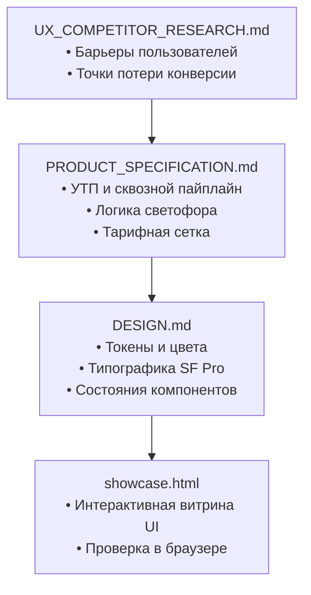

# Документация продукта, интерфейса и пользовательского опыта

> **Суть раздела (BLUF):** Каталог содержит продуктовую спецификацию сервиса AuctionCalc, правила светлой дизайн-системы, интерактивную витрину компонентов и отчеты по UX-исследованиям. Материалы определяют, как расчеты таможенных пошлин и дефектовка кузова транслируются в понятный пользовательский интерфейс на смартфонах и компьютерах.
>
> **Проект:** AuctionCalc  
> **Связанные разделы:** [research/](../research/README.md), [planning/](../planning/README.md)

---

## 1. Карта документов раздела

| Документ | Режим (Diátaxis) | Что содержит |
| :--- | :--- | :--- |
| **[PRODUCT_SPECIFICATION.md](./PRODUCT_SPECIFICATION.md)** | Spec / Product Plan | УТП продукта, сквозной конвейер обработки лота, правила скоринга («Аукционный светофор») и тарифная сетка монетизации. |
| **[DESIGN.md](./DESIGN.md)** | Design System / Guide | Стандарт светлой дизайн-системы Clean Light: цветовая палитра, типографика SF Pro, токены отступов, правила контраста и иконки Lucide. |
| **[showcase.html](./showcase.html)** | Interactive UI Sandbox | Интерактивная веб-витрина готовых компонентов: карточки лотов, шкала пошлин, свитчи и переключатели. |
| **[UX_COMPETITOR_RESEARCH.md](./UX_COMPETITOR_RESEARCH.md)** | Research / Analysis | Анализ барьеров пользователей (UX Friction) и аудит интерфейсов 12 действующих сервисов автоимпорта. |
| **[LOCAL_DESIGN_PATTERNS_REPORT.md](./LOCAL_DESIGN_PATTERNS_REPORT.md)** | Research / Patterns | Анализ паттернов мобильных и веб-приложений (Telegram, Авто.ру, Авито, Wise) для адаптации в продукте. |
| **[WEB_LAYOUT_PRINCIPLES_REPORT.md](./WEB_LAYOUT_PRINCIPLES_REPORT.md)** | Architectural Guide | Принципы адаптивной верстки современных веб-приложений (Twitter/X, Linear, Telegram Web). |

---

## 2. Как связаны документы внутри продукта

---

## 3. Связанные разделы репозитория

- **[research/](../research/README.md) — Отраслевое исследование:** макроэкономика импорта, нормативная база ЕАЭС, правила утильсбора 160 л.с., дефектоскопия кузова и реестр японских аукционов.
- **[planning/](../planning/README.md) — План реализации:** график разработки, роли участников команды (RACI), стартовый чеклист запуска и концепция кросс-аукционного аудита.
