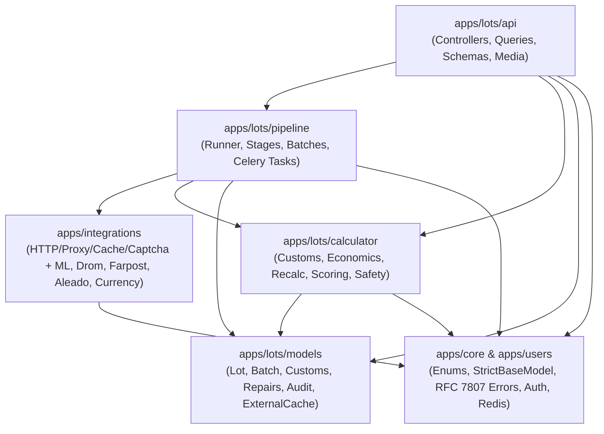

# Backend Architecture & Layer Boundaries

## Package Map & Target Layers

## Layer Responsibilities

- **`apps/core/`**: Shared enums (`TextChoices`), `StrictBaseModel`, RFC 7807 `ProblemDetail` handlers, Redis helpers, middleware, and health controller. Must not import `apps.lots`, `apps.users`, or `apps.integrations`.
- **`apps/users/`**: Custom `User` model (`UUID` PK, lowercase `email`), JWT auth endpoints, and starter-lot seeding hooks.
- **`apps/integrations/`**: External gateways (`ml`, `drom`, `farpost`, `aleado`, `currency`) and shared HTTP/proxy/captcha/cache infrastructure. Must not contain business pricing/customs formulas or API controllers.
- **`apps/lots/models/`**: Django ORM models keeping `app_label = "lots"` so PostgreSQL tables and migrations remain untouched.
- **`apps/lots/calculator/`**: Pure domain math and scoring (`customs/`, `economics.py`, `recalc.py`, `scoring.py`, `safety.py`). Must not perform external network I/O or import `api/` or `pipeline/`.
- **`apps/lots/pipeline/`**: Batch orchestration, step transitions, parallel execution, recovery, and Celery tasks.
- **`apps/lots/api/`**: Thin Ninja Extra controllers, read query builders, response schemas, and safe media delivery.

## Automated Enforcement (`import-linter` & `ruff`)

- `[tool.importlinter]` in `backend/pyproject.toml` enforces all architectural layer boundaries (6 contracts across `core`, `lots.models`, `integrations`, `lots.calculator`, `lots.pipeline`, and `lots.lifecycle`).
- `ruff` checks complexity (`C901`, `max-complexity = 12`) and code hygiene alongside pytest.
- Module size soft target: **≤ 300–350 lines** per module (split before growing monoliths).
