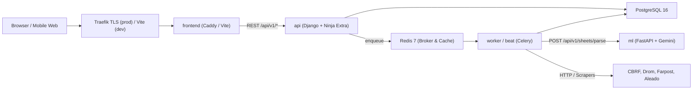

# System Overview

## Container Topology

- **Dev (`docker-compose.yml`):** `frontend` (Vite `:5173`) → `api` (Granian ASGI `:8000`) ↔ `worker` / `beat` (Celery) → `db` (PostgreSQL 16), `redis` (Redis 7), `ml` (FastAPI Uvicorn `:8001`).
- **Prod (`docker-compose.prod.yml`):** External Traefik (`traefik-net`) terminates TLS and routes traffic to `frontend` (Caddy HTTP `:80`), which serves SPA static files from `/srv`, proxies `/api/*` to `api:8000`, and serves `/media/*` from the shared `media_data_prod` volume.

## Configuration Strategy

1. **`backend/config.toml` & `ml_service/config.toml` (committed):** Non-secret defaults, timeouts, TTLs, model chains, batch limits, and scraper intervals loaded via `TomlConfigSettingsSource`.
2. **Root `.env` (gitignored, template `.env.example`):** Secrets, API keys (`SECRET_KEY`, `ML_SERVICE_API_KEY`, `GEMINI_API_KEYS`, `SCRAPER_PROXY_URLS`, `ALEADO_USERNAME/PASSWORD`), PostgreSQL credentials, and host/CORS settings (`TRAEFIK_HOST`, `ALLOWED_HOSTS`, `CORS_ALLOWED_ORIGINS`, `CBRF_FALLBACK_RATES`).
3. **`ml_service/.env.example`:** Minimal override template when deploying `ml_service` standalone on a dedicated GPU/compute node.
4. **Precedence:** `init kwargs -> OS/Docker env -> .env -> config.toml -> Pydantic class defaults`.

## Contract Synchronization Flow

- Backend Django Ninja schemas (`StrictBaseModel`) are the single runtime source of truth for REST payloads.
- `make openapi` exports the schema snapshot to `docs/architecture/openapi.json` and regenerates `frontend/src/types/api.generated.ts`.
- `make check-contracts` verifies that both generated artifacts match the current backend schemas.
