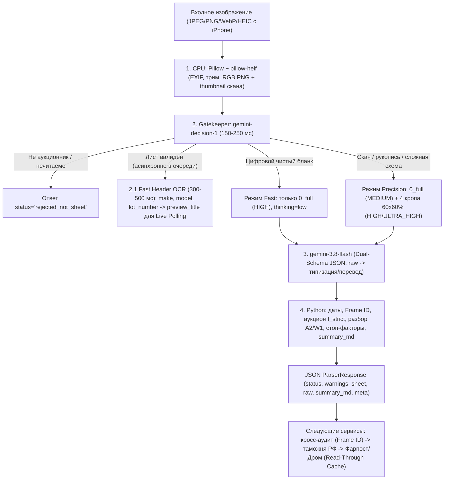

# Пайплайн микросервиса расшифровки японских аукционных листов

Документ фиксирует итоговую архитектуру **микросервиса-парсера** на базе **`google-genai`** (`gemini-decision-1` + `gemini-3.8-flash`) и его контракт для следующих сервисов хакатон-проекта (кросс-аукционный аудит по `Frame ID`, расчёт индекса строгости инспекций $I_{strict}$, привоз во Владивосток и смета ремонта/аналогов с Фарпоста и Дрома через Read-Through Cache). Целевое время ответа парсера: **~3–7 секунд** при одном вызове `gemini-3.8-flash`.

---

## 1. Общая архитектура и граница ответственности

**Граница ответственности парсера:** извлекает, типизирует и переводит **строго только то, что написано/отмечено на листе** (плюс нормализует канонический `Frame ID` и рассчитывает индекс строгости аукциона $I_{strict}$, без домысливания привода или точного объёма по каталогам — обогащение, таможня РФ и поиск по Фарпосту/Дрому живут в следующих сервисах).



---

## 2. Валидация ограничений и найденных нюансов

### Квоты Free Tier и стратегия надежности на хакатоне
| Модель | Назначение в пайплайне | Лимиты Free Tier | Выходные токены |
| :--- | :--- | :--- | :--- |
| **`gemini-decision-1`** | Gatekeeper + роутер сложности + проверка чекбоксов | **200 RPM / 50K TPM / 10 000 RPD** | **0** (150–250 мс) |
| **`gemini-3.8-flash`** | Извлечение текста, рукописи, схемы и перевод в JSON | **5 RPM / 250K TPM / 20 RPD (на проект)** | Тарифицируются (включая thinking) |

> [!IMPORTANT]
> **Стратегия преодоления лимита 20 RPD на 29 часов спринта:**
> 1. В пайплайне с `thinking_level="low"` один запрос тратит всего **~6K–10K входных токенов** (при 5 кропах), что с огромным запасом укладывается в `250K TPM`.
> 2. Используется **пул из 3 API-ключей/проектов** с циклической ротацией (Round-Robin), что дает суммарно 60 реальных вызовов в день.
> 3. Для защиты от сбоев сети на демо-стенде реализован **отказоустойчивый кэш готовых JSON-ответов** на ключевые эталонные сценарии (включая пару лотов Corolla Touring `NRE210-2005418` за 120 мс), при этом сохраняется возможность «живой» загрузки пользовательского листа.

### Критические краевые случаи с реальных аукционных листов (по ресерчу)
1. **Японские годы без буквы эры (`H` / `R`):** на бланках часто указано просто `26年 [5月]`, `27 / 2月`, `28 3月`, `30年 [2月]`. Стандартный парсер без контекста не определит эру. Добавлен нормализатор с эвристикой для «голых» годов с учетом переходных лет Heisei 31/32 (2019/2020 гг.).
2. **Двойная запись года и месяца (`R8 11月 / 2026年`):** парсер сначала проверяет японскую эру или пару месяц+год, чтобы не потерять месяц `11`.
3. **Канонический `Frame ID` и неполный номер шасси:** на листах USS в графе `車台番号` указан только серийный номер шасси (например `1356915`), а код кузова — в графе `型式` (`6AA-RV5`). Пайплайн автоматически синтезирует канонический `Frame ID` (`RV5-1356915`), срезая эко-префиксы министерства (`6AA-`, `3BA-`, `DBA-` и др.), либо валидирует прямой полный номер (как на TAA: `RU3-1248879` или `NRE210-2005418`).
4. **Аукционная система и индекс строгости $I_{strict}$:** в шапке/логотипе листа извлекается аукционный дом (TAA, USS, CAA, JU, ARAI, Honda, Mirive), что позволяет автоматически назначить индекс строгости инспекции ($1.00$ для TAA против $0.75$ для USS и $0.60$ для JU) для кросс-аудита арбитража.
5. **Безусловные стоп-факторы безопасности («Красная зона»):** выявление в рукописных заметках инспектора следов затопления (`冠水車` / `水没`), сработавших подушек безопасности (`エアバッグ展開`), градобоя (`ひょう害車`) и сквозной коррозии (`下廻り 腐食` / `C1..C2`).
6. **Составные коды дефектов (`A2/W1`, `AU3`):** разбор множественных отметок на одном элементе с сохранением индивидуальной степени повреждения каждого типа (царапина `A2` + вторичный окрас `W1`).
7. **Разделение кодов `XX` и `X`:** `XX` — замененный элемент (контроль зазоров), `X` — деталь деформирована под обязательную замену (триггер покупки контрактной детали на Farpost).
8. **Вертикальный текст под 90° справа (USS):** правая полоса замечаний попадает целиком в правые кропы `2_top_right` и `4_bottom_right` при 20% перекрытии и корректно читается при `HIGH` / `ULTRA_HIGH`.
9. **Обязательный формат `RGB PNG`:** нельзя переводить лист в ч/б бинаризацию — это рвёт тонкие овалы опций (`P/S`, `P/W`, `ABS`), касающиеся рамок таблицы.

---

## 3. Проверенные настройки `google-genai` (`>= 3.2`)

- **API-версия:** `genai.Client(http_options={"api_version": "v1beta"})` — требуется для `client.decisions.create` и per-part `media_resolution`.
- **`media_resolution` (per-part для Gemini 3):**
  - `0_full` → `PartMediaResolutionLevel.MEDIA_RESOLUTION_MEDIUM` (`560` токенов) — общий ориентир сторон/структуры;
  - `1_top_left`, `2_top_right`, `3_bottom_left`, `4_bottom_right` → `HIGH` (`1120`) или `ULTRA_HIGH` (`2240`, доступно **только per-part**, глобально в `GenerateContentConfig` его нет).
- **`thinking_config` для `gemini-3.8-flash`:** использовать `types.ThinkingConfig(thinking_level="low")` (или `"medium"` для полностью рукописных листов). **Не передавать `thinking_budget`** — на Gemini 3.x это вызывает ошибку `400 INVALID_ARGUMENT`.
- **`temperature`:** оставлять по умолчанию **`1.0`**. По официальной документации Gemini 3 снижение `temperature` к `0` вызывает деградацию и зацикливание.
- **Search Grounding:** не передавать `tools=[...]` — тогда веб-поиск отключён и модель не додумывает филиалы аукциона вроде `Yamaguchi` из сети.
- **Structured Outputs:** использовать `response_mime_type="application/json"` + `response_json_schema=AuctionSheet.model_json_schema()`, где сырые японские поля (`*_raw`) и `visual_location` стоят **перед** русскими полями (`*_ru`) для предотвращения «лингвистического отмывания» ошибок.

---

## 4. Готовые модули пайплайна

### А. Нарезка, миниатюра скана и нормализация изображения (`cropper.py`)
Проверено на всех 6 бланках (выход: `1129–1200 px` на сторону в lossless RGB PNG). Для поддержки фото с камеры iPhone в браузере (`image/heic` / `image/heif`) при старте модуля регистрируется декодер `pillow-heif`. Здесь же формируется компактная миниатюра **самого аукционного листа** (`sheet_thumb.webp`) для ленты Экрана 1 (`LotSummary.thumbnail_url` — никаких сторонних фото машины):

```python
from pathlib import Path
from PIL import Image, ImageOps

try:
    import pillow_heif
    pillow_heif.register_heif_opener()
except ImportError:
    pass


def trim_uniform_margins(img: Image.Image, bg_threshold: int = 245, pad_ratio: float = 0.02) -> Image.Image:
    """Мягко убирает пустые светлые поля по краям скана с сохранением отступа."""
    gray = img.convert("L")
    mask = gray.point(lambda p: 255 if p < bg_threshold else 0)
    bbox = mask.getbbox()
    if not bbox:
        return img

    w, h = img.size
    pad_x, pad_y = int(w * pad_ratio), int(h * pad_ratio)
    left = max(0, bbox[0] - pad_x)
    top = max(0, bbox[1] - pad_y)
    right = min(w, bbox[2] + pad_x)
    bottom = min(h, bbox[3] + pad_y)

    if (right - left) < w * 0.96 or (bottom - top) < h * 0.96:
        return img.crop((left, top, right, bottom))
    return img


def normalize_size(img: Image.Image, min_px: int = 1200, max_px: int = 1800) -> Image.Image:
    """Подтягивает мелкие кропы до min_px и сжимает слишком крупные фото до max_px."""
    w, h = img.size
    longest = max(w, h)
    if longest < min_px or longest > max_px:
        target = min_px if longest < min_px else max_px
        scale = target / longest
        return img.resize((int(w * scale), int(h * scale)), Image.Resampling.LANCZOS)
    return img


def slice_auction_sheet(
    image_path: str | Path,
    out_dir: str | Path | None = None,
    overlap: float = 0.20,
    min_px: int = 1200,
    max_px: int = 1800,
) -> dict[str, Path]:
    """Готовит 0_full и 4 перекрывающихся квадранта (60%x60% при overlap=0.20)."""
    src = Path(image_path)
    out = Path(out_dir) if out_dir else src.parent / f"{src.stem}_crops"
    out.mkdir(parents=True, exist_ok=True)

    img = ImageOps.exif_transpose(Image.open(src)).convert("RGB")
    img = trim_uniform_margins(img)
    w, h = img.size

    ratio = min(0.75, max(0.50, 0.5 + overlap / 2))
    cw, ch = int(w * ratio), int(h * ratio)

    boxes = {
        "full": (0, 0, w, h),
        "top_left": (0, 0, cw, ch),
        "top_right": (w - cw, 0, w, ch),
        "bottom_left": (0, h - ch, cw, h),
        "bottom_right": (w - cw, h - ch, w, h),
    }

    result: dict[str, Path] = {}
    for name, box in boxes.items():
        part = normalize_size(img.crop(box), min_px=min_px, max_px=max_px)
        dst = out / f"{name}.png"
        part.save(dst, format="PNG", optimize=True)
        result[name] = dst

    # Миниатюра самого аукционного листа для карточки ленты (Экран 1)
    thumb = img.copy()
    thumb.thumbnail((320, 460), Image.Resampling.LANCZOS)
    thumb_dst = out / "sheet_thumb.webp"
    thumb.save(thumb_dst, format="WEBP", quality=82)
    result["thumbnail"] = thumb_dst

    return result
```

---

### Б. Gatekeeper и роутер на `gemini-decision-1`
Быстрая проверка до вызова `gemini-3.8-flash` (отсекает скриншоты/брак, определяет сложность бланка):

```python
import base64
from pathlib import Path
from google import genai


def check_sheet_with_decision(client: genai.Client, full_png_path: Path) -> tuple[bool, str]:
    b64_img = base64.b64encode(full_png_path.read_bytes()).decode("ascii")

    res = client.decisions.create(
        model="gemini-decision-1",
        input=[
            {
                "type": "image",
                "data": b64_img,
                "mime_type": "image/png",
                "resolution": "low",
            }
        ],
        questions={
            "is_auction_sheet": {
                "type": "noul",
                "instructions": "Is this image a Japanese car auction sheet?",
            },
            "is_readable": {
                "type": "noul",
                "instructions": "Is the text and body diagram readable enough for extraction?",
            },
            "layout_complexity": {
                "type": "choice",
                "instructions": "Classify the sheet readability and layout complexity:",
                "criteria": {
                    "clean_digital": "Crisp digital printed sheet with no handwritten notes or tiny circled ovals.",
                    "complex_or_handwritten": "Scan/fax, handwritten inspector/seller notes, circled ovals, or dense diagram.",
                },
            },
        },
    )

    is_sheet = res.answers["is_auction_sheet"].noul >= 0.65
    is_readable = res.answers["is_readable"].noul >= 0.60
    mode = res.answers["layout_complexity"].choice
    return (is_sheet and is_readable), mode
```

---

### Б.1. Fast Header OCR для очереди обработки (Экран 3: Live Polling)
Пока тяжёлый конвейер (`gemini-3.8-flash` с 5 кропами + кросс-аудит + таможня + Farpost/Drom, итого ~4–8 сек) ещё работает, на **Экране 3 (Очередь)** пользователю сразу нужно видеть не безликое имя файла (`IMG_4021.jpg`), а **марку, модель и номер лота** (например, `⏳ Subaru Forester #5190`).

Для этого сразу после успешного прохождения `Gatekeeper` воркер запускает облегчённый запрос по верхнему кропу (`top_left` + `top_right` или `0_full` в разрешении `LOW` без thinking) и немедленно публикует `preview_title` в статус элемента пачки (`BatchItemStatus.preview_title` в `GET /api/v1/lots/batches/{batch_id}`):

```python
from pydantic import BaseModel, Field


class FastHeaderPreview(BaseModel):
    """Сверхбыстрое извлечение шапки листа (~300-500 мс) для прогресс-очереди."""
    make: str | None = Field(default=None, description="Марка латиницей (Subaru, Toyota, Honda)")
    model: str | None = Field(default=None, description="Модель латиницей (Forester, Corolla Touring)")
    lot_number: str | None = Field(default=None, description="Номер лота в шапке (#5190)")

    @property
    def preview_title(self) -> str | None:
        car = " ".join(p for p in [self.make, self.model] if p).strip()
        if car and self.lot_number:
            return f"{car} #{self.lot_number}"
        return car or (f"Лот #{self.lot_number}" if self.lot_number else None)
```

> [!TIP]
> Fast Header OCR выполняется параллельно с началом полной расшифровки (или перед шагом `CROSS_AUDIT`) с жёстким таймаутом **≤ 1.2 сек**: если шапка распозналась, фронт на следующем полле заменяет `IMG_4021.jpg` на `Subaru Forester #5190`; при таймауте строка остаётся с `original_filename` без блокировки основного пайплайна.

---

### В. Извлечение в `gemini-3.8-flash` (Dual-Schema Pydantic)

```python
from enum import Enum
from pathlib import Path
from typing import Literal
from pydantic import BaseModel, ConfigDict, Field
from google import genai
from google.genai import types


class BodyPanel(str, Enum):
    FRONT_BUMPER = "front_bumper"
    REAR_BUMPER = "rear_bumper"
    HOOD = "hood"
    ROOF = "roof"
    TAILGATE = "tailgate"
    FRONT_LEFT_FENDER = "front_left_fender"
    FRONT_RIGHT_FENDER = "front_right_fender"
    FRONT_LEFT_DOOR = "front_left_door"
    FRONT_RIGHT_DOOR = "front_right_door"
    REAR_LEFT_DOOR = "rear_left_door"
    REAR_RIGHT_DOOR = "rear_right_door"
    REAR_LEFT_QUARTER = "rear_left_quarter"
    REAR_RIGHT_QUARTER = "rear_right_quarter"
    LEFT_SILL = "left_sill"
    RIGHT_SILL = "right_sill"
    WINDSHIELD = "windshield"
    OTHER = "other"


class DefectExtraction(BaseModel):
    visual_location: str = Field(
        description="Где на схеме кузова стоит метка (ориентация сверху по ходу движения, без зеркалирования)"
    )
    panel_id: BodyPanel
    panel_ru: str = Field(description="Название детали кузова на русском")
    raw_code: str = Field(description="Оригинальный код дефекта с листа: A1, U2, W2, XX, AU3 и т. п.")


class ExtractedRiskFlags(BaseModel):
    is_flooded: bool = Field(description="Следы затопления/топляк (冠水車, 水没) — безусловный стоп-фактор")
    airbag_deployed: bool = Field(description="Сработали подушки безопасности (エアバッグ展開) — стоп-фактор")
    hail_damage: bool = Field(description="Повреждения кузова градом (ひょう害車, 雹) — стоп-фактор")
    underbody_rust: bool = Field(description="Поверхностная ржавчина по днищу/подвеске (下廻り S)")
    underbody_corrosion: bool = Field(description="Сквозная коррозия, гниение порогов/арок/днища (下廻り 腐食/C)")
    core_support_repair: bool = Field(description="Упомянут ли ремонт/замена/складка рамки радиатора (コアサポート)")
    pillar_or_frame_repair: bool = Field(description="Упомянут ли ремонт/окрас стоек, лонжеронов, крыши, силовой структуры (ピラー, フレーム)")
    color_changed: bool = Field(description="Есть ли отметка о смене цвета (色替)")
    windshield_damage: bool = Field(description="Есть ли скол/трещина/замена лобового стекла (FW, G)")


class AuctionExtraction(BaseModel):
    model_config = ConfigDict(protected_namespaces=())

    # 1. Сырые значения (извлекаются первыми как якорь точности)
    auction_house_raw: str | None = Field(
        default=None,
        description="Название аукционной системы из шапки/логотипа бланка: USS, TAA, CAA, JU, ARAI, Honda, MIRIVE, KCAA, Aucnet и т. д.",
    )
    lot_number_raw: str
    make_raw: str
    model_raw: str
    trim_raw: str | None = None
    model_code_raw: str = Field(description="Код кузова (型式), например DAA-RU3 или 3BA-NRE210W")
    chassis_number_raw: str = Field(description="Номер шасси (車台番号), например RU3-1248879 или 1356915")
    first_reg_raw: str = Field(description="Дата первой регистрации в оригинале: H30/2, 26年5月, R8 11")
    mileage_raw: str = Field(description="Пробег и знаки одометра (*, $, #)")
    engine_cc_raw: str
    transmission_raw: str
    drive_type_raw: str | None = Field(default=None, description="ТОЛЬКО если 2WD или 4WD явно отмечены на листе")
    color_raw: str | None = None
    paint_code_raw: str | None = None
    shaken_raw: str | None = None
    recycling_fee_raw: str | None = None
    overall_grade: str
    exterior_grade: str | None = None
    interior_grade: str | None = None
    inspector_notes_raw: list[str] = Field(default_factory=list)
    seller_comments_raw: list[str] = Field(default_factory=list)

    # 2. Типизированные и переведённые поля (строго с листа, без каталожных догадок)
    auction_house: str | None = Field(
        default=None,
        description="Нормализованное название аукционного дома латиницей: USS, TAA, CAA, JU, ARAI, Honda, Mirive, KCAA, Aucnet",
    )
    make_en: str = Field(description="Марка авто на латинице, например Honda")
    model_en: str = Field(description="Модель авто на латинице, например Vezel")
    trim_en: str | None = Field(default=None, description="Комплектация, например Hybrid Z Honda Sensing")
    mileage_km: int | None = Field(default=None, description="Пробег целым числом в км")
    odometer_status: Literal["confirmed", "replaced", "tampered", "unknown"] = "confirmed"
    engine_cc: int | None = Field(default=None, description="Объём двигателя в см³ целым числом, например 1490 или 1500")
    transmission_ru: str
    drive_type: Literal["2WD", "4WD"] | None = Field(default=None, description="ТОЛЬКО если явно отмечено на листе, иначе null")
    fuel_type: Literal["gasoline", "hybrid", "diesel", "ev", "other"] | None = None
    color_ru: str | None = Field(default=None, description="Буквальный перевод цвета без угадывания оттенка по коду")
    color_changed_ru: str | None = None
    shaken_ru: str | None = None
    recycling_fee_yen: int | None = None
    recycling_fee_paid: bool | None = None
    equipment_ru: list[str] = Field(default_factory=list, description="Отмеченные опции + графа кондиционера")
    defects: list[DefectExtraction] = Field(default_factory=list)
    risk_flags: ExtractedRiskFlags
    inspector_notes_ru: list[str] = Field(default_factory=list)
    seller_comments_ru: list[str] = Field(default_factory=list)
    extra_ru: list[str] = Field(default_factory=list)
    unreadable_fields: list[str] = Field(
        default_factory=list,
        description="Названия полей, которые не удалось разобрать из-за почерка или качества скана",
    )


SYSTEM_PROMPT = """
Ты — точный парсер японских автомобильных аукционных листов.
Правила:
1. БЕЗ домыслов: извлекай ТОЛЬКО то, что прямо написано или отмечено на листе. Название аукционной системы (USS, TAA, CAA, JU, Honda, ARAI и др.) считывай строго из шапки/логотипа бланка (не додумывай филиал по номеру лота). Если привод (2WD/4WD) не обведён — ставь null. Не угадывай оттенок цвета по коду краски (パール = перламутр).
2. В *_ru полях и extra_ru — БЕЗ кандзи, каны и транслита (пиши 'скол', без '(тобиси)').
3. Стоп-факторы безопасности: внимательно проверяй заметки инспектора на маркеры затопления (冠水, 水没), сработавших подушек безопасности (エアバッグ), града (ひょう害, 雹), деформации стоек (ピラー) и сквозной коррозии (腐食).
4. Схема дефектов: смотри сверху по ходу движения (перед вверху → левый борт слева, правый справа; не зеркаль стороны!). Передняя дверь — ближе к переднему колесу, задняя — к заднему. Чек-лист лобового стекла (FW) переноси в inspector_notes_ru и risk_flags.windshield_damage, а не в defects.
5. Коды дефектов: извлекай в точности как написано, включая составные коды (A2/W1, AU3, U2), замену (XX) и деформацию под замену (X).
6. Отдельно проверяй вертикальный текст по краям листа и глубину протектора шин в мм у колёс (добавляй в extra_ru).
7. Если поле обрезано или неразборчиво — не угадывай, добавь его имя в unreadable_fields.
""".strip()


def _img_part(path: Path, level: types.PartMediaResolutionLevel) -> types.Part:
    return types.Part(
        inline_data=types.Blob(data=path.read_bytes(), mime_type="image/png"),
        media_resolution=types.PartMediaResolution(level=level),
    )


def extract_sheet(client: genai.Client, crops: dict[str, Path], mode: str) -> AuctionExtraction:
    if mode == "clean_digital":
        contents = [
            "Лист аукциона:",
            _img_part(crops["full"], types.PartMediaResolutionLevel.MEDIA_RESOLUTION_HIGH),
            "Извлеки данные строго по JSON-схеме.",
        ]
        thinking_level = "low"
    else:
        contents = [
            "Общий лист (для ориентации сторон и общей структуры):",
            _img_part(crops["full"], types.PartMediaResolutionLevel.MEDIA_RESOLUTION_MEDIUM),
            "Фрагмент 1 (верх-лево):",
            _img_part(crops["top_left"], types.PartMediaResolutionLevel.MEDIA_RESOLUTION_HIGH),
            "Фрагмент 2 (верх-право — оценки, чек-лист опций, продавец):",
            _img_part(crops["top_right"], types.PartMediaResolutionLevel.MEDIA_RESOLUTION_ULTRA_HIGH),
            "Фрагмент 3 (низ-лево — заметки инспектора, шасси):",
            _img_part(crops["bottom_left"], types.PartMediaResolutionLevel.MEDIA_RESOLUTION_ULTRA_HIGH),
            "Фрагмент 4 (низ-право — схема дефектов, вертикальный текст):",
            _img_part(crops["bottom_right"], types.PartMediaResolutionLevel.MEDIA_RESOLUTION_ULTRA_HIGH),
            "Извлеки данные строго по JSON-схеме. Не дублируй метки с пересечений фрагментов.",
        ]
        thinking_level = "low"  # При тяжёлой рукописи можно переключать на "medium"

    resp = client.models.generate_content(
        model="gemini-3.8-flash",
        contents=contents,
        config=types.GenerateContentConfig(
            system_instruction=SYSTEM_PROMPT,
            # temperature оставляем 1.0 (рекомендация для Gemini 3)
            thinking_config=types.ThinkingConfig(thinking_level=thinking_level),
            response_mime_type="application/json",
            response_json_schema=AuctionExtraction.model_json_schema(),
        ),
    )
    return AuctionExtraction.model_validate_json(resp.text)
```

---

### Г. Постобработка, публичный контракт `ParserResponse` и рендер Markdown (`postprocess.py`)

Ниже — сборка финального ответа микросервиса (`status`, `warnings`, типизированный `sheet`, `raw`, `summary_md`, `meta`) с расчётом индекса строгости $I_{strict}$, синтезом канонического `Frame ID`, разбором составных кодов дефектов (`A2/W1` → отдельные дефекты с сохранением степеней), стоп-факторами «Красной зоны» и нормализацией дат:

```python
import datetime
import re
import unicodedata
from typing import Literal
from pydantic import BaseModel, ConfigDict, Field

CHASSIS_RE = re.compile(r"^(?:[A-Z0-9]{2,7}-\d{4,8}|\d{6,8}|[A-HJ-NPR-Z0-9]{17})$")
KATASHIKI_RE = re.compile(r"^(?:[A-Z0-9]{1,4}-)?[A-Z0-9]{2,8}(?:-[A-Z0-9]{1,5})?$")
KANJI_DIGITS = {"〇": 0, "零": 0, "一": 1, "二": 2, "三": 3, "四": 4, "五": 5, "六": 6, "七": 7, "八": 8, "九": 9}

# Индекс строгости инспекций японских автоаукционов (Том 3 исследования)
AUCTION_STRICTNESS: dict[str, float] = {
    "TAA": 1.00,
    "HONDA": 0.95,
    "HAA": 0.95,
    "CAA": 0.90,
    "USS": 0.75,
    "ORIX": 0.75,
    "ARAI": 0.75,
    "AUCNET": 0.70,
    "JU": 0.60,
    "MIRIVE": 0.55,
    "KCAA": 0.55,
    "LAA": 0.55,
    "ZIP": 0.75,
}

EMISSION_PREFIX_RE = re.compile(r"^[0-9A-Z]{1,4}-")
CHASSIS_CANONICAL_RE = re.compile(r"^[A-Z0-9]{2,8}-\d{4,8}$")
DEFECT_ITEM_RE = re.compile(r"^([A-Z]{1,2})(\d)?$")


def normalize_auction_house(raw: str | None) -> tuple[str | None, float | None]:
    """Нормализует имя аукционного дома и возвращает его индекс строгости I_strict."""
    if not raw:
        return None, None
    upper = raw.strip().upper()
    for key, strictness in AUCTION_STRICTNESS.items():
        if key in upper:
            return key, strictness
    return raw.strip(), None


def synthesize_frame_id(model_code: str, chassis_number: str) -> tuple[str, Literal["exact", "synthesized", "raw"]]:
    """
    Синтезирует канонический Frame ID для поиска в базе истории (Том 3 и planning/01).
    - Если номер шасси уже содержит дефис и префикс (RU3-1248879, NRE210-2005418) -> exact.
    - Если в шасси только цифры (1356915 на бланках USS), а код кузова 6AA-RV5 -> RV5-1356915 (synthesized).
    """
    c = chassis_number.strip().upper()
    m = model_code.strip().upper()

    if "-" in c and CHASSIS_CANONICAL_RE.match(c):
        return c, "exact"

    if c.isdigit():
        # Срезаем экологический префикс министерства (6AA-, 3BA-, DAA-, DBA- и т. д.)
        clean_model = EMISSION_PREFIX_RE.sub("", m)
        # Отрезаем суффикс типа кузова (например W в NRE210W -> NRE210)
        core_code = re.sub(r"(?<=\d)[A-Z]$", "", clean_model)
        if core_code:
            return f"{core_code}-{c}", "synthesized"

    return c, "raw"


def split_defect_codes(raw_code: str) -> list[tuple[str, int | None]]:
    """
    Корректно разбирает сложные и составные коды дефектов:
    'A2'    -> [('A', 2)]
    'XX'    -> [('XX', None)]
    'X'     -> [('X', None)]
    'AU3'   -> [('A', 3), ('U', 3)]
    'A2/W1' -> [('A', 2), ('W', 1)]
    'A2 W1' -> [('A', 2), ('W', 1)]
    """
    norm = unicodedata.normalize("NFKC", raw_code).strip().upper()
    parts = re.split(r"[/,\s]+", norm)
    results: list[tuple[str, int | None]] = []

    for p in parts:
        p = p.strip()
        if not p:
            continue
        if p in {"XX", "X"}:
            results.append((p, None))
            continue
        m = DEFECT_ITEM_RE.match(p)
        if m:
            letters, sev = m.group(1), int(m.group(2)) if m.group(2) else None
            # Для спаренных букв вида AU3 -> A3 и U3
            if len(letters) == 2 and letters not in {"XX", "FW"}:
                results.append((letters[0], sev))
                results.append((letters[1], sev))
            else:
                results.append((letters, sev))
        else:
            results.append((p, None))

    return results or [(norm, None)]


class NormalizedDefect(BaseModel):
    panel_id: BodyPanel
    panel_ru: str
    defect_types: list[str] = Field(description="Разобранные типы дефектов, например ['A'] или ['XX']")
    severity: int | None = Field(default=None, description="Степень дефекта 1..3, если указана")
    raw_code: str


class RiskFlags(BaseModel):
    is_flooded: bool = Field(description="Следы затопления/топляк (冠水車, 水没) — КРАСНЫЙ СТОП-ФАКТОР")
    airbag_deployed: bool = Field(description="Сработали подушки безопасности (エアバッグ展開) — КРАСНЫЙ СТОП-ФАКТОР")
    hail_damage: bool = Field(description="Повреждения кузова градом (ひょう害車, 雹) — СТОП-ФАКТОР")
    underbody_rust: bool = Field(description="Поверхностная ржавчина по днищу (下廻り S) — ЖЕЛТАЯ ЗОНА")
    underbody_corrosion: bool = Field(description="Сквозная коррозия/гнили по днищу и аркам (下廻り 腐食/C) — КРАСНЫЙ СТОП-ФАКТОР")
    core_support_repair: bool = Field(description="Ремонт рамки радиатора (コアサポート)")
    pillar_or_frame_repair: bool = Field(description="Ремонт стоек, лонжеронов, силовой структуры (ピラー, フレーム)")
    panel_replaced_xx: bool = Field(description="Замененные кузовные элементы (XX)")
    panel_needs_replacement_x: bool = Field(description="Детали под замену (X) — триггер закупки контрактных деталей Farpost")
    odometer_issue: bool = Field(description="Проблемы с одометром: скручен ($), заменен (*), неизвестен (#)")
    color_changed: bool = Field(description="Отметка о смене цвета (色替)")
    windshield_damage: bool = Field(description="Скол/трещина/замена лобового стекла (FW, G)")
    repaired_grade_r_ra: bool = Field(description="Аварийная или ремонтная оценка (R, RA, 0, ★, ***, 99, 1, 2)")


class NormalizedSheet(BaseModel):
    model_config = ConfigDict(protected_namespaces=())

    lot_number: str
    auction_house: str | None = Field(default=None, description="Нормализованное имя аукциона: TAA, USS, JU и др.")
    auction_strictness_index: float | None = Field(default=None, description="Индекс строгости инспекций I_strict (0.55..1.00)")
    make: str
    model: str
    trim: str | None
    model_code: str
    chassis_number: str
    frame_id: str = Field(description="Канонический Frame ID для базы истории лотов (например RV5-1356915 или NRE210-2005418)")
    frame_id_confidence: Literal["exact", "synthesized", "raw"]
    first_reg_year: int | None
    first_reg_month: int | None
    first_reg_date: str | None
    engine_cc: int | None
    mileage_km: int | None
    odometer_status: Literal["confirmed", "replaced", "tampered", "unknown"]
    transmission: str
    drive_type: Literal["2WD", "4WD"] | None
    fuel_type: Literal["gasoline", "hybrid", "diesel", "ev", "other"] | None
    color_ru: str | None
    paint_code: str | None
    overall_grade: str
    exterior_grade: str | None
    interior_grade: str | None
    shaken_until: str | None
    recycling_fee_yen: int | None
    recycling_fee_paid: bool | None
    equipment_ru: list[str]
    defects: list[NormalizedDefect]
    risk_flags: RiskFlags
    inspector_notes_ru: list[str]
    seller_comments_ru: list[str]
    extra_ru: list[str]


class ParserMeta(BaseModel):
    model_config = ConfigDict(protected_namespaces=())

    processing_ms: int
    mode_used: str
    cached: bool
    model_used: str = "gemini-3.8-flash"


class ParserResponse(BaseModel):
    status: Literal["ok", "partial", "rejected_not_sheet"]
    warnings: list[str] = Field(default_factory=list)
    low_confidence_fields: list[str] = Field(default_factory=list)
    sheet: NormalizedSheet | None = None
    raw: dict | None = None
    summary_md: str | None = None
    meta: ParserMeta


def _replace_kanji_numbers(text: str) -> str:
    pattern = re.compile(r"[〇零一二三四五六七八九十]+")

    def _conv(m: re.Match[str]) -> str:
        s = m.group(0)
        if "十" not in s:
            return "".join(str(KANJI_DIGITS[ch]) for ch in s)
        parts = s.split("十", 1)
        tens = KANJI_DIGITS.get(parts[0], 1) if parts[0] else 1
        ones = KANJI_DIGITS.get(parts[1], 0) if parts[1] else 0
        return str(tens * 10 + ones)

    return pattern.sub(_conv, text)


def parse_japanese_date(
    raw: str | None,
    *,
    is_future_date: bool = False,
    current_year: int | None = None,
) -> tuple[int | None, int | None, str | None, bool]:
    """Возвращает (year, month, formatted_str, is_ambiguous_bare_year)."""
    if not raw:
        return None, None, None, False
    cur_y = current_year or datetime.date.today().year
    cur_reiwa = cur_y - 2018

    s = unicodedata.normalize("NFKC", raw).strip().replace("元年", "1年")
    s = _replace_kanji_numbers(s)

    def _fmt(y: int, m: str | None, ambiguous: bool = False) -> tuple[int, int | None, str, bool]:
        if m and 1 <= int(m) <= 12:
            mi = int(m)
            return y, mi, f"{mi:02d}.{y}", ambiguous
        return y, None, str(y), ambiguous

    m_era = re.search(r"(?<![A-Za-z])(R|令和|H|平成|S|昭和)\s*(\d{1,2})(?:\D+(\d{1,2}))?", s, re.I)
    if m_era:
        era = m_era.group(1).upper()
        offsets = {"R": 2018, "令和": 2018, "H": 1988, "平成": 1988, "S": 1925, "昭和": 1925}
        year = offsets[era] + int(m_era.group(2))
        month = m_era.group(3) or (re.search(r"(\d{1,2})\s*月", s).group(1) if re.search(r"(\d{1,2})\s*月", s) else None)
        return _fmt(year, month)

    m_mm_yyyy = re.search(r"\b(\d{1,2})[./](19\d{2}|20\d{2})\b", s)
    if m_mm_yyyy and 1 <= int(m_mm_yyyy.group(1)) <= 12:
        return _fmt(int(m_mm_yyyy.group(2)), m_mm_yyyy.group(1))

    m_greg = re.search(r"(19\d{2}|20\d{2})(?:\D+(\d{1,2}))?", s)
    if m_greg:
        month = m_greg.group(2) or (re.search(r"(\d{1,2})\s*月", s).group(1) if re.search(r"(\d{1,2})\s*月", s) else None)
        return _fmt(int(m_greg.group(1)), month)

    m_bare = re.search(r"^(\d{1,2})(?:\D+(\d{1,2}))?", s)
    if m_bare:
        num, month = int(m_bare.group(1)), m_bare.group(2)
        if is_future_date:
            if 1 <= num <= 18:
                return _fmt(2018 + num, month)
            if 19 <= num <= 32:
                return _fmt(1988 + num, month)
            return None, None, raw, True
        else:
            if 1 <= num <= cur_reiwa:
                # Диапазон 1..cur_reiwa без буквы эры теоретически пересекается с H1..H8
                return _fmt(2018 + num, month, ambiguous=True)
            if (cur_reiwa + 1) <= num <= 32:
                # Включая переходные бланки Heisei 31 (2019) и Heisei 32 (2020)
                return _fmt(1988 + num, month)
            if 33 <= num <= 64:
                # Эра Showa (1958..1989)
                return _fmt(1925 + num, month)
            return None, None, raw, True

    return None, None, raw, True


def clean_code(raw: str | None) -> str:
    if not raw:
        return ""
    return unicodedata.normalize("NFKC", raw).strip().replace(" ", "")


def build_parser_response(
    ext: AuctionExtraction,
    *,
    processing_ms: int,
    mode_used: str,
    cached: bool,
) -> ParserResponse:
    warnings: list[str] = []
    low_conf = list(ext.unreadable_fields)

    reg_y, reg_m, reg_str, reg_ambig = parse_japanese_date(ext.first_reg_raw, is_future_date=False)
    if reg_ambig:
        warnings.append("ambiguous_bare_year_without_era")
    if reg_y is None:
        warnings.append("unparsed_registration_date")
        low_conf.append("first_reg_date")

    _, _, shaken_str, _ = parse_japanese_date(ext.shaken_raw, is_future_date=True)
    chassis = clean_code(ext.chassis_number_raw)
    katashiki = clean_code(ext.model_code_raw)
    paint_code = clean_code(ext.paint_code_raw) or None

    if not CHASSIS_RE.match(chassis.upper()):
        warnings.append("invalid_chassis_format")
        low_conf.append("chassis_number")
    if not KATASHIKI_RE.match(katashiki.upper()):
        warnings.append("invalid_model_code_format")
        low_conf.append("model_code")
    if ext.drive_type is None:
        warnings.append("drive_type_not_marked_on_sheet")
    if ext.engine_cc is None:
        warnings.append("missing_engine_cc")
        low_conf.append("engine_cc")

    # Нормализация аукциона и индекса строгости I_strict
    auc_house, auc_strict = normalize_auction_house(ext.auction_house or ext.auction_house_raw)
    if not auc_house:
        warnings.append("unidentified_auction_house")

    # Синтез канонического Frame ID
    frame_id, frame_conf = synthesize_frame_id(katashiki, chassis)
    if frame_conf == "raw":
        warnings.append("unverified_frame_id_format")

    # Разбор дефектов и выявление X / XX / коррозии
    norm_defects: list[NormalizedDefect] = []
    has_xx = False
    has_x = False
    has_severe_corrosion_c = False

    for d in ext.defects:
        parsed_items = split_defect_codes(d.raw_code)
        for d_type, sev in parsed_items:
            if d_type == "XX":
                has_xx = True
            elif d_type == "X":
                has_x = True
            elif d_type == "C":
                has_severe_corrosion_c = True
            norm_defects.append(
                NormalizedDefect(
                    panel_id=d.panel_id,
                    panel_ru=d.panel_ru,
                    defect_types=[d_type],
                    severity=sev,
                    raw_code=d.raw_code,
                )
            )

    grade_up = ext.overall_grade.strip().upper()
    is_repaired_grade = (
        grade_up in {"R", "RA", "0", "★", "***", "99", "1", "2"}
        or grade_up.startswith("R")
        or "R" in grade_up
    )

    risk_flags = RiskFlags(
        is_flooded=ext.risk_flags.is_flooded,
        airbag_deployed=ext.risk_flags.airbag_deployed,
        hail_damage=ext.risk_flags.hail_damage,
        underbody_rust=ext.risk_flags.underbody_rust,
        underbody_corrosion=ext.risk_flags.underbody_corrosion or has_severe_corrosion_c,
        core_support_repair=ext.risk_flags.core_support_repair,
        pillar_or_frame_repair=ext.risk_flags.pillar_or_frame_repair,
        panel_replaced_xx=has_xx,
        panel_needs_replacement_x=has_x,
        odometer_issue=(ext.odometer_status != "confirmed"),
        color_changed=ext.risk_flags.color_changed,
        windshield_damage=ext.risk_flags.windshield_damage,
        repaired_grade_r_ra=is_repaired_grade,
    )

    sheet = NormalizedSheet(
        lot_number=clean_code(ext.lot_number_raw),
        auction_house=auc_house,
        auction_strictness_index=auc_strict,
        make=ext.make_en,
        model=ext.model_en,
        trim=ext.trim_en,
        model_code=katashiki,
        chassis_number=chassis,
        frame_id=frame_id,
        frame_id_confidence=frame_conf,
        first_reg_year=reg_y,
        first_reg_month=reg_m,
        first_reg_date=reg_str,
        engine_cc=ext.engine_cc,
        mileage_km=ext.mileage_km,
        odometer_status=ext.odometer_status,
        transmission=ext.transmission_ru,
        drive_type=ext.drive_type,
        fuel_type=ext.fuel_type,
        color_ru=ext.color_ru,
        paint_code=paint_code,
        overall_grade=ext.overall_grade,
        exterior_grade=ext.exterior_grade,
        interior_grade=ext.interior_grade,
        shaken_until=shaken_str or ext.shaken_ru,
        recycling_fee_yen=ext.recycling_fee_yen,
        recycling_fee_paid=ext.recycling_fee_paid,
        equipment_ru=ext.equipment_ru,
        defects=norm_defects,
        risk_flags=risk_flags,
        inspector_notes_ru=ext.inspector_notes_ru,
        seller_comments_ru=ext.seller_comments_ru,
        extra_ru=ext.extra_ru,
    )

    summary_md = render_markdown(sheet)
    status: Literal["ok", "partial"] = "partial" if low_conf else "ok"

    return ParserResponse(
        status=status,
        warnings=sorted(set(warnings)),
        low_confidence_fields=sorted(set(low_conf)),
        sheet=sheet,
        raw=ext.model_dump(include={
            "auction_house_raw", "lot_number_raw", "make_raw", "model_raw", "trim_raw", "model_code_raw",
            "chassis_number_raw", "first_reg_raw", "mileage_raw", "engine_cc_raw",
            "transmission_raw", "drive_type_raw", "color_raw", "paint_code_raw",
            "shaken_raw", "recycling_fee_raw", "inspector_notes_raw", "seller_comments_raw",
        }),
        summary_md=summary_md,
        meta=ParserMeta(processing_ms=processing_ms, mode_used=mode_used, cached=cached),
    )


def render_markdown(s: NormalizedSheet) -> str:
    od_map = {
        "confirmed": "подтверждён",
        "replaced": "замена одометра (*)",
        "tampered": "скручен ($)",
        "unknown": "неизвестен (#)",
    }
    lines = ["**Основная информация**"]
    lines.append(f"- **Номер лота:** {s.lot_number}")
    if s.auction_house:
        strict_str = f" (индекс строгости: {s.auction_strictness_index})" if s.auction_strictness_index else ""
        lines.append(f"- **Аукционный дом:** {s.auction_house}{strict_str}")
    lines.append(f"- **Марка и модель:** {s.make} {s.model}")
    if s.trim:
        lines.append(f"- **Наименование комплектации:** {s.trim}")
    lines.append(f"- **Код кузова (модели):** {s.model_code}")
    lines.append(f"- **Номер кузова (шасси):** {s.chassis_number}")
    conf_label = " (верифицирован)" if s.frame_id_confidence == "exact" else (" (синтезирован)" if s.frame_id_confidence == "synthesized" else "")
    lines.append(f"- **Канонический Frame ID:** `{s.frame_id}`{conf_label}")
    lines.append(f"- **Дата первой регистрации:** {s.first_reg_date or '[не указано]'}")
    if s.color_ru or s.paint_code:
        lines.append(f"- **Цвет и заводской код краски:** {', '.join(p for p in [s.color_ru, s.paint_code] if p)}")
    if s.risk_flags.color_changed:
        lines.append("- **Отметка о смене цвета:** да")

    lines.append("\n**Технические характеристики**")
    lines.append(f"- **Объем двигателя:** {f'{s.engine_cc} см³' if s.engine_cc else '[не указано]'}")
    lines.append(f"- **Тип трансмиссии:** {s.transmission}")
    if s.drive_type:
        lines.append(f"- **Тип привода:** {s.drive_type}")
    km_str = f"{s.mileage_km:,}".replace(",", " ") + " км" if s.mileage_km is not None else "[не указано]"
    lines.append(f"- **Пробег и статус одометра:** {km_str}, {od_map[s.odometer_status]}")
    if s.shaken_until:
        lines.append(f"- **Статус техосмотра:** {s.shaken_until}")
    if s.recycling_fee_yen is not None:
        paid = ", оплачен" if s.recycling_fee_paid else ""
        yen_str = f"{s.recycling_fee_yen:,}".replace(",", " ")
        lines.append(f"- **Сумма утилизационного сбора:** {yen_str} иен{paid}")

    lines.append("\n**Оценки и оборудование**")
    lines.append(f"- **Общая оценка:** {s.overall_grade}")
    if s.exterior_grade:
        lines.append(f"- **Оценка кузова:** {s.exterior_grade}")
    if s.interior_grade:
        lines.append(f"- **Оценка салона:** {s.interior_grade}")
    if s.equipment_ru:
        lines.append(f"- **Чек-лист базового оборудования:** {', '.join(s.equipment_ru)}")

    # Блок стоп-факторов и рисков (Красная и Желтая зоны "Аукционного светофора")
    critical_alerts = []
    if s.risk_flags.is_flooded:
        critical_alerts.append("КРАСНЫЙ СТОП-ФАКТОР: Автомобиль-топляк / следы затопления (冠水車)")
    if s.risk_flags.airbag_deployed:
        critical_alerts.append("КРАСНЫЙ СТОП-ФАКТОР: Сработали подушки безопасности (エアバッグ展開)")
    if s.risk_flags.hail_damage:
        critical_alerts.append("СТОП-ФАКТОР: Автомобиль после сильного града (ひょう害車)")
    if s.risk_flags.underbody_corrosion:
        critical_alerts.append("КРАСНЫЙ СТОП-ФАКТОР: Сквозная коррозия порогов/днища (腐食/C)")
    if s.risk_flags.repaired_grade_r_ra:
        critical_alerts.append(f"ВНИМАНИЕ: Аварийный/ремонтный статус лота ({s.overall_grade})")
    if s.risk_flags.panel_needs_replacement_x:
        critical_alerts.append("ВНИМАНИЕ: Детали под обязательную замену (код X) — смета Farpost")

    if critical_alerts:
        lines.append("\n**Предупреждения безопасности и риски:**")
        for alert in critical_alerts:
            lines.append(f"- ⚠️ {alert}")

    lines.append("\n**Состояние и комментарии**")
    defects_str = "; ".join(f"{d.panel_ru}: {d.raw_code}" for d in s.defects) if s.defects else "дефекты не отмечены"
    lines.append(f"- **Схема дефектов кузова:** {defects_str}")
    lines.append(f"- **Замечания инспектора:** {'; '.join(s.inspector_notes_ru) if s.inspector_notes_ru else '[не указано]'}")
    if s.seller_comments_ru:
        lines.append(f"- **Комментарии продавца:** {'; '.join(s.seller_comments_ru)}")

    if s.extra_ru:
        lines.append("\n**Дополнительно:**")
        for item in s.extra_ru:
            lines.append(f"- {item}")

    return "\n".join(lines)
```

---

## 5. Поэтапный план для хакатона и выход в сеть

### Фаза 1 — Рабочий MVP (главный приоритет)
1. **Базовая нарезка 2×2** (`slice_auction_sheet` — `full` + 4 перекрывающихся квадранта 60%×60%).
2. **Конвейер API:** `gemini-decision-1` (Gatekeeper + роутер) → `gemini-3.8-flash` (Structured Outputs) → Python-постобработка.
3. **Сервер и публикация в сеть:**
   - Локальный `FastAPI` (`uvicorn main:app --host 0.0.0.0 --port 8000`) с `sha256`-кэшем и семафором на `5 RPM`.
   - Вывод локального порта наружу через **`OpenTunnel.xyz`** (`opentunnel route add 8000` — zero-knowledge TLS-туннель без настройки роутера, с опциональным `--name`).

### Фаза 2 — Если останется время после запуска Фазы 1 (GTX 1660 Super / Colab)
- **Умный кроппер на YOLO (полу-локально на вашем ПК):** обучить в Colab (`L4` / `T4`) компактную `yolo26n` на ~50–100 листах для детекции 4 смысловых зон (`header_specs`, `equipment_box`, `inspector_notes`, `car_diagram`, без аугментации `fliplr`) и запускать локально на **GTX 1660 Super** (`< 1 ГБ VRAM`, ~5–15 мс) с автоматическим fallback на сетку `2×2`.
- **Резервный локальный OCR в Colab (`L4` / `T4`):** связка **`YomiToku`** + **`PaddleOCR-VL-1.6`** как второе мнение на случай тяжёлой рукописи или нехватки API-квот.
