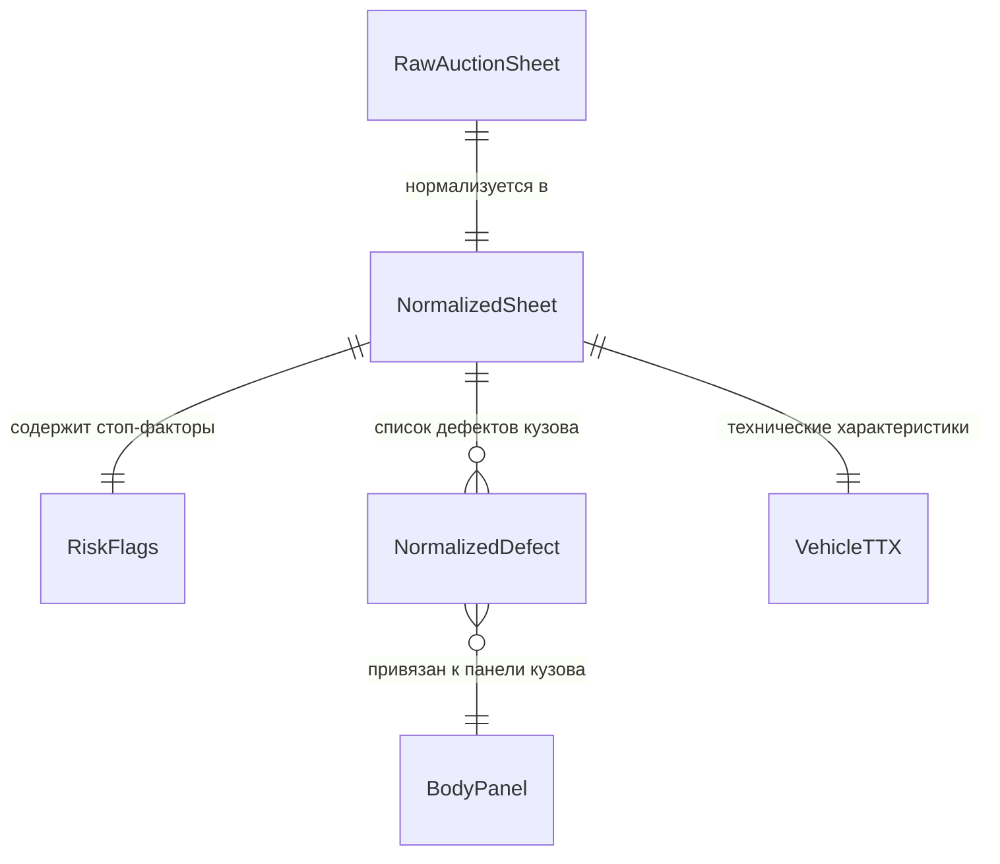

# Домен 1: Аукционный лист, ТТХ и Дефектоскопия кузова (`sheet_and_tech`)

> **Статус:** Каноническая спецификация (SSOT)  
> **Версия:** 1.0.0  
> **Файл:** `docs/domains/01_sheet_and_tech.md`  
> **Назначение в UI:** Экран 4 (Таб «Общий» — паспорт ТТХ) и Экран 5 (Таб «Тех» — векторная проекция кузова с пинами дефектов)

---

## 1. Схема связей сущностей домена (Entity Relationship Diagram)



---

## 2. Спецификация сущностей и полей

### А. Сущность `NormalizedSheet` (Нормализованный паспорт листа и ТТХ)
Основная модель, формируемая после распознавания бланка нейросетью и нормализации питоновским пайплайном.

| Поле (Technical Key) | Тип данных | Nullable | Источник данных | Отображение в UI | Описание и бизнес-правила |
| :--- | :--- | :-: | :--- | :--- | :--- |
| `lot_number` | `string` | Нет | Бланк: графа `出品番号` | Шапка авто, Rich Card | Номер лота на аукционе (например, `"3142"`). Очищается от спецсимволов. |
| `auction_house` | `string` | Да | Логотип/шапка бланка | Шапка авто, ТТХ | Нормализованное имя аукционного дома: `TAA`, `USS`, `CAA`, `JU`, `Honda`, `ARAI`. |
| `auction_strictness_index`| `float` | Да | Python справочник | Бейдж строгости в ТТХ | Число от `0.55` до `1.00`. TAA = 1.00 (строгий), USS = 0.75, JU = 0.60. |
| `make` | `string` | Нет | Бланк: графа `車名` | Заголовок карточки | Марка автомобиля латиницей (например, `"Toyota"`). |
| `model` | `string` | Нет | Бланк: графа `車名` | Заголовок карточки | Модель автомобиля латиницей (например, `"Corolla Touring"`). |
| `trim` | `string` | Да | Бланк: графа `グレード` | Подзаголовок карточки | Комплектация (например, `"W×B"`, `"Hybrid Z"`). |
| `model_code` | `string` | Нет | Бланк: графа `型式` | ТТХ: код кузова | Полный заводской код модели из бланка (например, `"3BA-NRE210W"`). |
| `chassis_number` | `string` | Нет | Бланк: графа `車台番号` | ТТХ: номер шасси | Серийный номер шасси (например, `"NRE210-2005418"` или `"1356915"`). |
| `frame_id` | `string` | Нет | Python нормализатор | Шапка, Rich Card, ТТХ | **Канонический Frame ID** для поиска истории (например, `NRE210-2005418`). Срезает эко-префиксы (`3BA-`, `6AA-`). |
| `frame_id_confidence` | `enum` | Нет | Python правило | Внутренний флаг | `exact` (полный номер на бланке) или `synthesized` (синтезирован из 型式 + шасси). |
| `first_reg_year` | `integer` | Да | Бланк: графа `登録年` | ТТХ: год регистрации | Год первой регистрации по Григорианскому календарю (например, `2020`). |
| `first_reg_month` | `integer` | Да | Бланк: графа `登録月` | ТТХ: месяц | Месяц первой регистрации (`1..12`). |
| `first_reg_date_str` | `string` | Да | Python нормализатор | Блок ТТХ: Возраст | Форматированная строка: `"10.2020 (Возраст 4 года 2 мес.)"`. |
| `is_pass_corridor_3_5` | `boolean` | Нет | Python расчет даты | Подсветка пошлины | `true`, если возраст авто от 3 до 5 лет на момент расчета (льготная пошлина ЕАЭС). |
| `engine_cc` | `integer` | Да | Бланк: графа `排気量` | Блок ТТХ: двигатель | Рабочий объем двигателя в см³ (например, `1196`). Обязателен для расчета таможни. |
| `power_hp` | `integer` | Да | Каталог / экстракция | Блок ТТХ: мощность | Мощность в л.с. (например, `116`). Критично для порога утильсбора 160 л.с. |
| `is_under_160_hp` | `boolean` | Нет | Python расчет | Статус утильсбора | `true` при мощности $\le 160$ л.с. (льготный сбор 5 200 ₽, иначе 528 000 ₽). |
| `mileage_km` | `integer` | Да | Бланк: графа `走行` | Hero-метрика, Rich Card | Пробег целым числом в км (например, `58240`). |
| `odometer_status` | `enum` | Нет | Бланк: символы одометра| Иконка пробега | `confirmed` (родной), `replaced` (`*` замена), `tampered` (`$` скручен), `unknown` (`#`). |
| `transmission` | `string` | Нет | Бланк: графа `シフト` | Блок ТТХ | Тип КПП на русском (например, `"6-ступ. МКПП (6MT)"` или `"Вариатор (CVT)"`). |
| `drive_type` | `enum` | Да | Бланк: отметка 2WD/4WD | Блок ТТХ | `"2WD"` или `"4WD"`. Заполняется, ТОЛЬКО если явно обведено на листе (иначе `null`). |
| `fuel_type` | `enum` | Да | Бланк: графа топлива | Блок ТТХ | `"gasoline"`, `"hybrid"`, `"diesel"`, `"ev"`. |
| `color_ru` | `string` | Да | Бланк: графа `外装色` | Блок ТТХ: цвет | Перевод цвета на русский язык (например, `"Белый перламутр"`). |
| `paint_code` | `string` | Да | Бланк: графа `カラーNo` | Блок ТТХ: код краски | Заводской код цвета краски (например, `"070"`). Ключ для поиска деталей Farpost! |
| `overall_grade` | `string` | Нет | Бланк: графа `評価点` | Hero-метрика, Rich Card | Общая оценка лота: `"S"`, `"6"`, `"5"`, `"4.5"`, `"4.0"`, `"3.5"`, `"3.0"`, `"R"`, `"RA"`. |
| `exterior_grade` | `string` | Да | Бланк: графа `外装` | ТТХ: салон/кузов | Оценка экстерьера: `"A"`, `"B"`, `"C"`, `"D"`, `"E"`. |
| `interior_grade` | `string` | Да | Бланк: графа `内装` | ТТХ: салон/кузов | Оценка интерьера: `"A"`, `"B"`, `"C"`, `"D"`, `"E"`. |
| `equipment_ru` | `string[]`| Нет | Бланк: чекбоксы опций | Список опций в ТТХ | Чек-лист стандартных опций: `["Климат-контроль", "LED-оптика", "Диски R17"]`. |
| `inspector_notes_ru` | `string[]`| Нет | Бланк: заметки инспектора| Список замечаний (Таб 5)| Переведенные комментарии эксперта аукциона без японских иероглифов. |

---

### Б. Сущность `NormalizedDefect` (Дефекты кузова для векторной проекции)
Каждый дефект, нанесенный инспектором на схему автомобиля.

| Поле (Technical Key) | Тип данных | Nullable | Источник данных | Отображение в UI | Описание и бизнес-правила |
| :--- | :--- | :-: | :--- | :--- | :--- |
| `panel_id` | `enum` | Нет | Позиция на схеме кузова | ID панели в SVG кузова | Идентификатор кузовной детали (16 панелей, см. справочник ниже). |
| `panel_ru` | `string` | Нет | Автоперевод | Текст под пином | Русское название детали (например, `"Передняя левая дверь"`). |
| `defect_types` | `string[]`| Нет | Разбор кода дефекта | Буквы на пине | Типы повреждений: `A` (царапина), `U` (вмятина), `W` (окрас), `S` (ржавчина), `XX` (заменена). |
| `severity` | `integer` | Да | Индекс степени дефекта | Цифра на пине | Степень от `1` до `3` (`1` — незначительный, `3` — крупный/глубокий). Для `XX`/`X` = `null`. |
| `raw_code` | `string` | Нет | Бланк: символ на схеме | Тултип пина | Оригинальный код с аукционника (например, `"A2"`, `"U2"`, `"W1"`, `"XX"`, `"A2/W1"`). |

#### Справочник 16 панелей кузова (`BodyPanel`):
1. `front_bumper` — Передний бампер
2. `rear_bumper` — Задний бампер
3. `hood` — Капот
4. `roof` — Крыша
5. `tailgate` — Крышка багажника / пятая дверь
6. `front_left_fender` — Переднее левое крыло
7. `front_right_fender` — Переднее правое крыло
8. `front_left_door` — Передняя левая дверь
9. `front_right_door` — Передняя правая дверь
10. `rear_left_door` — Задняя левая дверь
11. `rear_right_door` — Задняя правая дверь
12. `rear_left_quarter` — Заднее левое крыло
13. `rear_right_quarter` — Заднее правое крыло
14. `left_sill` — Левый порог
15. `right_sill` — Правый порог
16. `windshield` — Лобовое стекло

---

### В. Сущность `RiskFlags` (Безусловные стоп-факторы безопасности)
Флаги критических состояний, автоматически выявляемые парсером в рукописных заметках инспектора.

| Флаг (Technical Key) | Тип данных | Источник триггера | Влияние на скоринг | Описание |
| :--- | :--- | :--- | :-: | :--- |
| `is_flooded` | `boolean` | `冠水車`, `水没` в заметках | 🔴 СТОП-ФАКТОР | Автомобиль-топляк (следы затопления). Покупка категорически не рекомендуется. |
| `airbag_deployed` | `boolean` | `エアバッグ展開` | 🔴 СТОП-ФАКТОР | Сработавшие подушки безопасности (тяжелое ДТП). |
| `hail_damage` | `boolean` | `ひょう害車`, `雹` | 🔴 СТОП-ФАКТОР | Машина после сильного градобоя (множественные повреждения по всей плоскости). |
| `underbody_corrosion` | `boolean` | `下廻り 腐食`, `C1..C2` | 🔴 СТОП-ФАКТОР | Сквозная коррозия порогов, днища, лонжеронов. Не пройдет лабораторию СБКТС. |
| `pillar_or_frame_repair` | `boolean` | `ピラー`, `フレーム` | 🔴 СТОП-ФАКТОР | Ремонт или вытяжка несущих стоек, пола багажника, рамки радиатора. |
| `repaired_grade_r_ra` | `boolean` | Оценка `R`, `RA`, `0` | 🔴 СТОП-ФАКТОР | Официальный статус битого / восстановленного в Японии авто. |
| `underbody_rust` | `boolean` | `下廻り S1..S2` | 🟡 Желтая зона | Поверхностный налет ржавчины на подвеске (требует антикора ~15 000 ₽). |
| `panel_needs_replacement_x` | `boolean` | Код `X` на детали | 🟡 Триггер Farpost | Деталь замята под замену — триггер расчета закупки контрактной детали. |
| `panel_replaced_xx` | `boolean` | Код `XX` на детали | ℹ️ Контроль зазоров | Деталь уже менялась в Японии. Требуется осмотр зазоров. |

---

## 3. Эталонный JSON-сниппет Домена 1 (Toyota Corolla Touring `NRE210-2005418`)

```json
{
  "lot_number": "3142",
  "auction_house": "TAA",
  "auction_strictness_index": 1.00,
  "make": "Toyota",
  "model": "Corolla Touring",
  "trim": "W×B",
  "model_code": "3BA-NRE210W",
  "chassis_number": "NRE210-2005418",
  "frame_id": "NRE210-2005418",
  "frame_id_confidence": "exact",
  "first_reg_year": 2020,
  "first_reg_month": 10,
  "first_reg_date_str": "10.2020 (Возраст 4 года 2 мес.)",
  "is_pass_corridor_3_5": true,
  "engine_cc": 1196,
  "power_hp": 116,
  "is_under_160_hp": true,
  "mileage_km": 58240,
  "odometer_status": "confirmed",
  "transmission": "6-ступ. МКПП (6MT)",
  "drive_type": "2WD",
  "fuel_type": "gasoline",
  "color_ru": "Белый трехслойный перламутр",
  "paint_code": "070",
  "overall_grade": "3.5",
  "exterior_grade": "C",
  "interior_grade": "C",
  "equipment_ru": [
    "Климат-контроль",
    "Светодиодная LED-оптика",
    "Заводской спойлер W×B",
    "Литые диски R17",
    "Комбинированный кожаный салон",
    "Круиз-контроль",
    "Электростеклоподъемники"
  ],
  "defects": [
    {
      "panel_id": "front_bumper",
      "panel_ru": "Передний бампер",
      "defect_types": ["A"],
      "severity": 2,
      "raw_code": "A2"
    },
    {
      "panel_id": "front_left_fender",
      "panel_ru": "Переднее левое крыло",
      "defect_types": ["U"],
      "severity": 2,
      "raw_code": "U2"
    },
    {
      "panel_id": "front_left_door",
      "panel_ru": "Передняя левая дверь",
      "defect_types": ["XX"],
      "severity": null,
      "raw_code": "XX"
    },
    {
      "panel_id": "rear_left_door",
      "panel_ru": "Задняя левая дверь",
      "defect_types": ["W"],
      "severity": 1,
      "raw_code": "W1"
    }
  ],
  "risk_flags": {
    "is_flooded": false,
    "airbag_deployed": false,
    "hail_damage": false,
    "underbody_rust": false,
    "underbody_corrosion": false,
    "pillar_or_frame_repair": false,
    "repaired_grade_r_ra": false,
    "panel_needs_replacement_x": false,
    "panel_replaced_xx": true
  },
  "inspector_notes_ru": [
    "Царапина A2 на переднем бампере снизу",
    "Небольшая вмятина U2 на переднем левом крыле",
    "Заменена передняя левая дверь (код XX), вторичный окрас задней двери W1 без шпаклевки",
    "Салон: легкие потертости обивки водительского кресла (оценка C)",
    "Силовой каркас, лонжероны и геометрия в норме"
  ]
}
```
