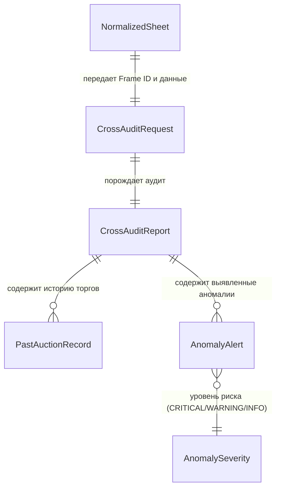

# Домен 2: Кросс-аудит по Frame ID и Проверка безопасности (`audit_and_safety`)

> **Статус:** Каноническая спецификация (SSOT)  
> **Версия:** 1.0.0  
> **Файл:** `docs/domains/02_audit_and_safety.md`  
> **Назначение в UI:** Экран 4 (Таб «Общий» — Липкая плашка опасности `Sticky Danger Alert`, блок `История лота в Японии`, предупреждения эксперта)

---

## 1. Схема связей сущностей домена (Entity Relationship Diagram)



---

## 2. Спецификация сущностей и полей

### А. Сущность `CrossAuditReport` (Итоговый отчет проверки лота)
Корневой объект результатов проверки истории автомобиля в архивах японских аукционов (AucJP / Aleado / внутренняя база).

| Поле (Technical Key) | Тип данных | Nullable | Источник данных | Отображение в UI | Описание и бизнес-правила |
| :--- | :--- | :-: | :--- | :--- | :--- |
| `status` | `enum` | Нет | Движок аудита | Заголовок блока истории | `clean` (чистая история / первичный лот), `anomaly_detected` (найдены расхождения), `not_found` (в архиве нет записей). |
| `risk_level` | `enum` | Нет | Каскад правил аудита | Цвет плашки и бейджа | `CRITICAL` (красный 🔴), `WARNING` (желтый 🟡), `INFO` (синий ℹ️), `CLEAN` (зеленый 🟢). |
| `has_critical_anomaly` | `boolean` | Нет | Расчет по рискам | Триггер Sticky Banner | `true` при скрученном пробеге, скрытом `R`-грейде или нарушении геометрии кузова. Активирует липкую плашку в шапке Экрана 4. |
| `headline_ru` | `string` | Нет | Генератор саммери | Текст плашки опасности | Краткий вывод для покупателя (например, *"⚠️ ВНИМАНИЕ: Выявлен скрученный пробег (-124 000 км)"*). |
| `anomalies` | `AnomalyAlert[]`| Нет | Анализ различий | Список карточек рисков | Детализированный список всех обнаруженных нестыковок между прошлыми и текущими торгами. |
| `history` | `PastAuctionRecord[]`| Нет | Архив торгов (AucJP) | Таймлайн прошлых продаж | Хронологический список всех предыдущих выставлений авто на аукционах Японии. |
| `times_auctioned` | `integer` | Нет | Подсчет по истории | Счетчик в ТТХ | Сколько раз машина выставлялась на торги (1 = первичный лот, $\ge 2$ = повторные торги). |
| `verified_at` | `string (ISO)` | Нет | Системное время | Подпись времени аудита | Время проведения сверки базы (например, `"2026-11-13T10:15:00Z"`). |

---

### Б. Сущность `AnomalyAlert` (Карточка выявленной аномалии)
Каждое конкретное несоответствие между текущим состоянием машины и ее архивной историей.

| Поле (Technical Key) | Тип данных | Nullable | Источник данных | Отображение в UI | Описание и бизнес-правила |
| :--- | :--- | :-: | :--- | :--- | :--- |
| `type` | `enum` | Нет | Классификатор риска | Иконка и тип проблемы | `odometer_rollback` (скрутка), `concealed_salvage_r` (скрытый тотал), `grade_inflation` (накрутка балла), `unreported_defects` (скрытые дефекты). |
| `severity` | `enum` | Нет | Каскад правил | Цвет рамки карточки | `critical` (стоп-фактор), `warning` (требует внимания эксперта), `info` (информационный факт). |
| `title_ru` | `string` | Нет | Шаблонизатор правил | Заголовок карточки риска | Например, *"Скрученный одометр"* или *"Скрытый аварийный ремонт"*. |
| `message_ru` | `string` | Нет | Формирование описания| Описание под заголовком | Подробное разъяснение: *"На торгах TAA в 2023 г. зафиксирован пробег 182 400 км. Текущий пробег 58 240 км занижен на 124 160 км"*. |
| `diff_details` | `object` | Да | Матрица расхождений | Блок «Было ➔ Стало» | Структура с точными числами до/после: `{ "archived_val": "182 400 км", "current_val": "58 240 км", "delta": -124160 }`. |

---

### В. Сущность `PastAuctionRecord` (Запись архивных торгов)
Историческая карточка продажи данного автомобиля по его уникальному номеру кузова (`Frame ID`).

| Поле (Technical Key) | Тип данных | Nullable | Источник данных | Отображение в UI | Описание и бизнес-правила |
| :--- | :--- | :-: | :--- | :--- | :--- |
| `auction_date` | `string` | Нет | Архив AucJP / Aleado | Дата в строке таймлайна | Дата проведения прошлых торгов (например, `"14.04.2023"`). |
| `auction_house` | `string` | Нет | Архив торгов | Логотип аукциона | Где продавалась машина (например, `"TAA Chubu"`). |
| `auction_strictness` | `float` | Да | Справочник строгости | Индекс строгости | Индекс строгости той площадки ($1.00$ для TAA, $0.75$ для USS). |
| `lot_number` | `string` | Нет | Архив торгов | Номер архивного лота | Номер лота на прошлых торгах (например, `"8104"`). |
| `overall_grade` | `string` | Нет | Архивный лист | Оценка в таймлайне | Прошлая оценка: `"R"`, `"RA"`, `"3.5"`, `"4.0"` и т.д. |
| `mileage_km` | `integer` | Да | Архивный лист | Пробег в таймлайне | Пробег на момент тех торгов в км (например, `182400`). |
| `defects_summary` | `string` | Да | Архивные дефекты | Комментарий в таймлайне | Краткое описание дефектов с прошлого листа (например, *"Замена левого лонжерона, окрас крыши W2"*). |
| `closing_price_jpy` | `integer` | Да | Статистика продаж | Цена закрытия (если есть) | Сумма, за которую авто было продано на прошлых торгах (в иенах). |
| `sheet_archive_url` | `string (URI)` | Да | CDN архивных сканов | Кнопка «Смотреть старый лист» | Ссылка на скан оригинального архивного листа для независимой сверки. |

---

## 3. Логика каскада детекции рисков (Decision Rules)

| Правило детекции | Входное условие проверки | Присваиваемый уровень | Рекомендация клиенту |
| :--- | :--- | :-: | :--- |
| **Скрутка пробега** | $\text{Пробег}_{\text{текущий}} < \text{Пробег}_{\text{архивный}} - 1\,000\,\text{км}$ | 🔴 **CRITICAL** | **Категорический отказ от покупки.** Реальный износ узлов и агрегатов скрыт. |
| **Маскировка Salvage `R`** | $\text{Оценка}_{\text{архив}} \in \{R, RA, 0\}$ ПРИ $\text{Оценка}_{\text{текущая}} \ge 3.5$ | 🔴 **CRITICAL** | **Категорический отказ.** Машина была в тяжелом ДТП, геометрия маскирована перекупщиками для перепродажи. |
| **Скрытая замена силовой структуры** | На прошлом строгом листе (TAA) были замены лонжеронов/стоек (`XX`), не указанные на текущем мягком листе (USS/JU) | 🔴 **CRITICAL** | **Не пройдет лабораторию СБКТС в РФ.** Нарушена жесткость кузова. |
| **Накрутка балла перекупщиками** | $\text{Оценка}_{\text{текущая}} - \text{Оценка}_{\text{архив}} \ge 0.5$ балла (при переходе с TAA на USS) | 🟡 **WARNING** | **Требуется ручной осмотр.** Состояние приукрашено за счет поверхностной полировки. |
| **Неуказанный вторичный окрас** | В архиве зафиксирован перекрас деталей (`W2/W3`), опущенный на текущем листе | 🟡 **WARNING** | Риск шпаклевки и разнотона деталей (заложить ~30 000 ₽ на перекрас). |
| **Повторные торги без криминала** | Оценки, пробег и дефекты совпадают (авто не продали из-за нехватки резервной цены) | ℹ️ **INFO** | Штатная ситуация. Позволяет точно рассчитать ставку по статистике непроданного лота. |

---

## 4. Эталонный JSON-сниппет Домена 2 (Критический кейс: Скрутка пробега и скрытый ремонт)

Ниже — эталонный JSON, генерируемый системой при обнаружении попытки перекупщиков скрыть аварию и пробег:

```json
{
  "status": "anomaly_detected",
  "risk_level": "CRITICAL",
  "has_critical_anomaly": true,
  "headline_ru": "КРИТИЧЕСКИЙ РИСК: Скрытый аварийный ремонт и скрученный пробег (-124 160 км)",
  "times_auctioned": 2,
  "verified_at": "2026-11-13T10:15:00Z",
  "anomalies": [
    {
      "type": "odometer_rollback",
      "severity": "critical",
      "title_ru": "Скрученный одометр",
      "message_ru": "На торгах TAA Chubu 14.04.2023 пробег составлял 182 400 км. На текущих торгах заявлен пробег 58 240 км. Скручено 124 160 км.",
      "diff_details": {
        "archived_mileage_km": 182400,
        "current_mileage_km": 58240,
        "delta_km": -124160
      }
    },
    {
      "type": "concealed_salvage_r",
      "severity": "critical",
      "title_ru": "Скрытый аварийный статус (Маскировка оценки R)",
      "message_ru": "Автомобиль продавался на строгом аукционе TAA с оценкой R (аварийный/восстановленный, деформация левого лонжерона). На текущем аукционе USS выставлен с завышенной оценкой 4.0.",
      "diff_details": {
        "archived_grade": "R",
        "current_grade": "4.0",
        "archived_auction": "TAA Chubu (строгость 1.00)",
        "current_auction": "USS Tokyo (строгость 0.75)"
      }
    }
  ],
  "history": [
    {
      "auction_date": "14.04.2023",
      "auction_house": "TAA Chubu",
      "auction_strictness": 1.00,
      "lot_number": "8104",
      "overall_grade": "R",
      "mileage_km": 182400,
      "defects_summary": "Замена передней левой двери XX, складка рамки радиатора, ремонт левого брызговика и лонжерона",
      "closing_price_jpy": 410000,
      "sheet_archive_url": "https://cdn.ajes.com/archive/taa_8104_sheet.jpg"
    },
    {
      "auction_date": "12.11.2024",
      "auction_house": "USS Tokyo",
      "auction_strictness": 0.75,
      "lot_number": "3142",
      "overall_grade": "4.0",
      "mileage_km": 58240,
      "defects_summary": "Царапина A2, вмятина U2, вторичный окрас W1 (лонжероны не указаны)",
      "closing_price_jpy": null,
      "sheet_archive_url": "https://cdn.ajes.com/active/uss_3142_sheet.jpg"
    }
  ]
}
```
