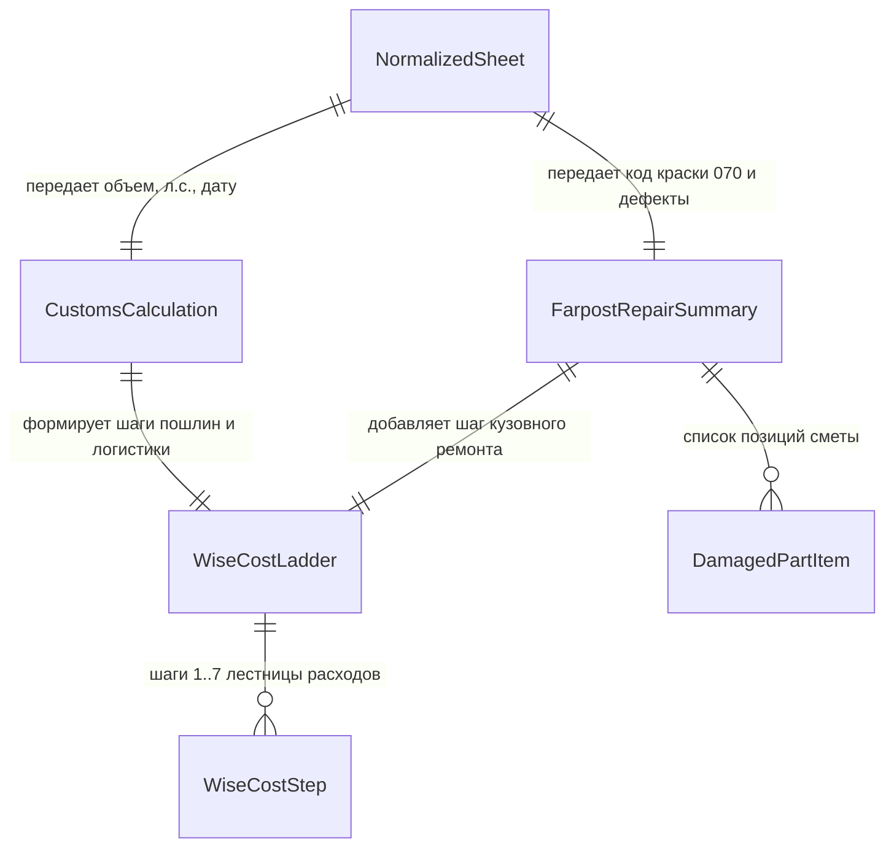

# Домен 3: Финансовая модель, Таможня ЕАЭС и Смета Farpost (`economics_and_customs`)

> **Статус:** Каноническая спецификация (SSOT)  
> **Версия:** 1.0.0  
> **Файл:** `docs/domains/03_economics_and_customs.md`  
> **Назначение в UI:** Экран 5 (Таб «Тех» — блок сметы ремонта Farpost) и Экран 6 (Таб «Эконом» — интерактивный слайдер ставки, лестница Wise, переключатель утильсбора)

---

## 1. Схема связей сущностей домена (Entity Relationship Diagram)



---

## 2. Спецификация сущностей и полей

### А. Сущность `CustomsCalculation` (Таможенно-логистический расчет)
Расчет всех обязательных платежей для легального ввоза автомобиля через таможню Владивостока для физлиц.

| Поле (Technical Key) | Тип данных | Nullable | Источник данных | Отображение в UI | Описание и бизнес-правила |
| :--- | :--- | :-: | :--- | :--- | :--- |
| `age_corridor` | `enum` | Нет | Расчет по дате рег. | ТТХ: Коридор возраста | `under_3_years` (до 3 лет), `3_to_5_years` (проходной 3–5 лет), `over_5_years` (старше 5 лет). |
| `duty_rate_eur_per_cc` | `float` | Да | Сетка тарифов ЕАЭС | Тултип к пошлине | Ставка пошлины в евро за 1 см³ объема двигателя (для Corolla 1196 см³ = `1.70 €`). |
| `customs_duty_eur` | `float` | Нет | Формула ЕАЭС | Детали расчета | Сумма пошлины в евро ($1\,196 \times 1.7 = \mathbf{2\,033.20\,€}$). |
| `customs_duty_rub` | `integer` | Нет | Пошлина $\times$ курс EUR| Шаг 4 лестницы Wise | Пошлина в рублях по курсу ЦБ РФ ($2\,033.2 \times 95.0 = \mathbf{193\,154\,₽}$). |
| `is_under_160_hp` | `boolean` | Нет | Мощность авто | Инфо-бейдж утильсбора | `true` при мощности $\le 160$ л.с. Позволяет применить льготную ставку утильсбора. |
| `is_commercial_util` | `boolean` | Нет | Пользовательский свитч | iOS Stadium Switch | `false` = личное пользование (льгота), `true` = авто под перепродажу или юрлицо. |
| `utilization_fee_rub` | `integer` | Нет | ПП РФ № 1713 | Шаг 5 лестницы Wise | **5 200 ₽** (для физлиц, 3–5 лет, $\le 160$ л.с.) либо **528 000 ₽** (при перепродаже/коммерции). |
| `customs_clearance_fee_rub`| `integer`| Нет | Сетка ФТС РФ | В составе шага брокера | Сбор за таможенное оформление (для авто стоимостью до 1.2 млн ₽ = **4 268 ₽**). |
| `freight_vladivostok_rub` | `integer`| Нет | Тарифы судоходства | Шаг 3 лестницы Wise | Морской фрахт (Япония ➔ Владивосток): коносамент, выгрузка в порту (**95 000 ₽**). |
| `broker_svh_sbkts_rub` | `integer`| Нет | Партнерские ставки | Шаг 6 лестницы Wise | Услуги брокера, хранение СВХ, испытания лаборатории и оформление СБКТС (**43 835 ₽**). |
| `cbrf_rates_snapshot` | `object` | Нет | Шлюз ЦБ РФ | Сноска даты курсов | Снимок курсов валют на момент расчета: `{ "JPY_RUB": 0.642, "EUR_RUB": 95.0, "date": "12.11.2026" }`. |

---

### Б. Сущность `FarpostRepairSummary` и `DamagedPartItem` (Смета ремонта Farpost)
Оценка расходов на устранение дефектов кузова по базам контрактных запчастей во Владивостоке.

#### 1. Карточка детали `DamagedPartItem`:
| Поле (Technical Key) | Тип данных | Nullable | Источник данных | Отображение в UI | Описание и бизнес-правила |
| :--- | :--- | :-: | :--- | :--- | :--- |
| `panel_id` | `enum` | Нет | Дефект из Домена 1 | Иконка кузовной зоны | Идентификатор панели кузова (`front_left_door`, `front_bumper` и др.). |
| `defect_code` | `string` | Нет | Бланк аукциона | Бейдж дефекта | Код повреждения: `XX` (замена), `X` (деформация), `A2` (царапина), `U2` (вмятина). |
| `part_name_ru` | `string` | Нет | Каталог Farpost | Название позиции | Наименование контрактной детали: *"Дверь передняя левая (в цвет 070)"*. |
| `part_price_rub` | `integer` | Нет | Медиана P50 Farpost | Стоимость детали | Цена контрактной детали во Владивостоке (**18 000 ₽**). Для PDR = `0 ₽`. |
| `replacement_labor_rub`| `integer` | Нет | Справочник автосервисов| Стоимость арматурки | Снятие, установка, подгонка зазоров (**4 000 ₽**). |
| `paint_labor_rub` | `integer` | Нет | Малярный справочник | Стоимость покраски | Подготовка и окрас детали. **0 ₽**, если деталь найдена в заводской цвет кузова (`paint_code`)! Иначе 9 000 ₽. |
| `total_item_rub` | `integer` | Нет | Сумма детали и работ | Итого по строке | Суммарная стоимость устранения дефекта (**22 000 ₽**). |
| `in_stock_vladivostok` | `boolean` | Нет | Наличие на складах | Зеленый бейдж наличия | `true`, если деталь есть в наличии в магазинах/разборках Владивостока. |
| `is_statistical_fallback`| `boolean`| Нет | Fallback-триггер | Предупреждение ℹ️ | `true`, если цена взята из эконометрической матрицы средних цен (при таймауте парсера). |
| `farpost_url` | `string (URI)` | Да | Поисковый шлюз | Ссылка «Открыть деталь» | Прямая ссылка на объявление на Farpost.ru для подборщика. |

#### 2. Сводка сметы `FarpostRepairSummary`:
| Поле (Technical Key) | Тип данных | Nullable | Источник данных | Отображение в UI | Описание и бизнес-правила |
| :--- | :--- | :-: | :--- | :--- | :--- |
| `items` | `DamagedPartItem[]`| Нет | Агрегация дефектов | Список деталей сметы | Массив всех оцененных элементов кузова. |
| `total_parts_rub` | `integer` | Нет | Сумма деталей | Строка «Запчасти» | Общая стоимость деталей (**18 000 ₽**). |
| `total_labor_rub` | `integer` | Нет | Сумма работ | Строка «Работы» | Суммарная стоимость работ малярки и жестянки (**13 000 ₽**). |
| `grand_total_repair_rub`| `integer` | Нет | Итоговая смета | Шаг 7 лестницы Wise | Итоговая сумма кузовного восстановления авто (**31 000 ₽**). |
| `has_color_matched_parts`| `boolean`| Нет | Анализ по коду краски| Бейдж «В цвет 070» | `true`, если удалось подобрать детали строго в заводской цвет без перекраса. |

---

### В. Сущность `WiseCostLadder` (Пошаговая лестница расходов Wise Pattern)
Прозрачная калькуляция себестоимости под ключ, где каждый рубль привязан к конкретному этапу импорта.

| Поле (Technical Key) | Тип данных | Nullable | Источник данных | Отображение в UI | Описание и бизнес-правила |
| :--- | :--- | :-: | :--- | :--- | :--- |
| `car_bid_jpy` | `integer` | Нет | Ввод / Слайдер | Поле ввода ставки | Ставка на аукционе в японских иенах (например, `780 000 ¥`). |
| `car_bid_rub` | `integer` | Нет | Ставка $\times$ курс JPY | Рублевый эквивалент | Ставка в рублях по курсу ЦБ РФ ($780\,000 \times 0.642 = \mathbf{500\,760\,₽}$). |
| `steps` | `WiseCostStep[]`| Нет | Агрегатор расходов | 7 нумерованных строк | Пошаговые статьи затрат (см. детальную структуру ниже). |
| `turnkey_cost_rub` | `integer` | Нет | Сумма всех шагов | Большая плашка «ИТОГО: Под ключ во Владивостоке» | Полная себестоимость растаможенного авто под ключ во Владивостоке (**1 104 899 ₽**). |
| `market_price_rf_rub` | `integer` | Нет | Парсер Дрома / Авто.ру | Строка «Рынок РФ» | Среднерыночная цена аналогичного автомобиля в РФ (**1 520 000 ₽**). |
| `net_benefit_rub` | `integer` | Нет | Рынок РФ - Итого ВЛК | Зеленый бейдж выгоды | Чистая экономия покупателя: $1\,520\,000 - 1\,104\,899 = \mathbf{+415\,101\,₽}$. |
| `benefit_percentage` | `float` | Нет | Выгода / Итого $\times$ 100| Процент ROI | Доходность/выгода в процентах ($\mathbf{37.6\%}$). |

#### Структура строки шага `WiseCostStep`:
Каждый шаг имеет единый формат:
* `step_number` (`integer`): порядковый номер шага (`1..7`).
* `name_ru` (`string`): понятное название статьи затрат.
* `amount_rub` (`integer`): сумма в рублях РФ.
* `original_currency` (`string?`): оригинальная валюта (`"JPY"`, `"EUR"`, `"RUB"`).
* `original_amount` (`float?`): сумма в валюте первоисточника.
* `is_optional` (`boolean`): признак отключаемого шага (например, смета ремонта).

---

## 3. Эталонный состав 7 шагов лестницы Wise (Бенчмарк Corolla Touring `NRE210`)

| Шаг | Название статьи затрат | Оригинал | Сумма в RUB | Логика и обоснование |
| :-: | :--- | :-: | :-: | :--- |
| **1** | Ставка на аукционе FOB | `780 000 JPY` | **500 760 ₽** | Победная цена лота на торгах в Японии. |
| **2** | Расходы в Японии и аукционный сбор | `75 000 JPY` | **48 150 ₽** | Аукционный сбор, снятие с учета (экспортный сертификат), доставка до порта отправки (Тояма/Йокогама). |
| **3** | Морской фрахт в порт Владивосток | `—` | **95 000 ₽** | Морская перевозка судном типа Ro-Ro, выгрузка на причал Владивостокского морского торгового порта. |
| **4** | Таможенная пошлина ЕАЭС | `2 033.20 EUR` | **193 154 ₽** | Единая ставка для авто 3–5 лет: $1\,196\,\text{см}^3 \times 1.7\,\text{€} = 2\,033.20\,\text{€}$ по курсу 95.0. |
| **5** | Утилизационный сбор РФ (ПП РФ № 1713) | `—` | **5 200 ₽** | Льготная ставка для физлиц (возраст 3–5 лет, мощность 116 л.с. $\le 160$ л.с.). При перепродаже = 528 000 ₽. |
| **6** | СВХ, таможенный брокер и лаборатория | `—` | **43 835 ₽** | Склад временного хранения (7 дней), подача ПТД брокером, испытания СБКТС и оформление электронного ПТС (ЭПТС). |
| **7** | Смета кузовного ремонта Farpost | `—` | **31 000 ₽** | Дверь в цвет 070 ($18\,000\,₽$), замена ($4\,000\,₽$), PDR бампера и полировка крыла ($9\,000\,₽$). |
| **ИТОГО** | **Себестоимость во Владивостоке под ключ** | | **1 104 899 ₽** | **Чистая выгода клиента к рынку РФ: +415 101 ₽ (ROI 37.6%)** |

---

## 4. Интерактивная симуляция ставки (Таб «Эконом»): Client-Side vs Server-Side

* **0 мс (Мгновенно на клиенте):**  
  При перемещении слайдера ставки в мобильном приложении сумма пересчитывается в реальном времени формулой:
  $$\text{ИТОГО}_{\text{new}} = \text{ИТОГО}_{\text{old}} + (\text{Bid}_{\text{new}} - \text{Bid}_{\text{old}}) \times \text{Rate}_{\text{JPY}}$$
  Интерфейс не виснет, слайдер движется с частотой 60 кадров в секунду.
* **150 мс (Валидация на BFF):**  
  При отпускании пальца (дебаунс 300 мс) клиент отправляет запрос:
  `POST /api/v1/lots/{lot_id}/recalculate` с телом `{"bid_jpy": 850000, "is_commercial_util": false, "include_repairs": true}`.
  Сервер возвращает верифицированный объект `RecalculateResponse` с обновленным PDF-отчетом.

---

## 5. Эталонный JSON-сниппет Домена 3

```json
{
  "lot_id": "8fa1947b-1234-4567-8901-abcdef123456",
  "currency_rates": {
    "JPY_RUB": 0.642,
    "EUR_RUB": 95.0,
    "USD_RUB": 88.5,
    "cbrf_date": "12.11.2026"
  },
  "customs": {
    "age_corridor": "3_to_5_years",
    "engine_cc": 1196,
    "duty_rate_eur_per_cc": 1.7,
    "customs_duty_eur": 2033.2,
    "customs_duty_rub": 193154,
    "is_under_160_hp": true,
    "is_commercial_util": false,
    "utilization_fee_rub": 5200,
    "customs_clearance_fee_rub": 4268,
    "freight_vladivostok_rub": 95000,
    "broker_svh_sbkts_rub": 43835
  },
  "farpost_repair": {
    "total_parts_rub": 18000,
    "total_labor_rub": 13000,
    "grand_total_repair_rub": 31000,
    "has_color_matched_parts": true,
    "items": [
      {
        "panel_id": "front_left_door",
        "defect_code": "XX",
        "part_name_ru": "Дверь передняя левая (контрактная, цвет 070)",
        "part_price_rub": 18000,
        "replacement_labor_rub": 4000,
        "paint_labor_rub": 0,
        "total_item_rub": 22000,
        "in_stock_vladivostok": true,
        "is_statistical_fallback": false,
        "farpost_url": "https://www.farpost.ru/vladivostok/auto/sell_spare_parts/10928412.html"
      },
      {
        "panel_id": "front_bumper",
        "defect_code": "A2",
        "part_name_ru": "Локальное устранение царапины A2 (полировка/подкрас)",
        "part_price_rub": 0,
        "replacement_labor_rub": 0,
        "paint_labor_rub": 5000,
        "total_item_rub": 5000,
        "in_stock_vladivostok": true,
        "is_statistical_fallback": false,
        "farpost_url": null
      },
      {
        "panel_id": "front_left_fender",
        "defect_code": "U2",
        "part_name_ru": "Беспокрасочное удаление вмятины PDR (вмятина U2)",
        "part_price_rub": 0,
        "replacement_labor_rub": 0,
        "paint_labor_rub": 4000,
        "total_item_rub": 4000,
        "in_stock_vladivostok": true,
        "is_statistical_fallback": false,
        "farpost_url": null
      }
    ]
  },
  "wise_cost_ladder": {
    "car_bid_jpy": 780000,
    "car_bid_rub": 500760,
    "turnkey_cost_rub": 1104899,
    "market_price_rf_rub": 1520000,
    "net_benefit_rub": 415101,
    "benefit_percentage": 37.6,
    "steps": [
      {
        "step_number": 1,
        "name_ru": "Ставка на аукционе FOB",
        "amount_rub": 500760,
        "original_currency": "JPY",
        "original_amount": 780000,
        "is_optional": false
      },
      {
        "step_number": 2,
        "name_ru": "Расходы в Японии и аукционный сбор",
        "amount_rub": 48150,
        "original_currency": "JPY",
        "original_amount": 75000,
        "is_optional": false
      },
      {
        "step_number": 3,
        "name_ru": "Морской фрахт в порт Владивосток",
        "amount_rub": 95000,
        "original_currency": "RUB",
        "original_amount": 95000,
        "is_optional": false
      },
      {
        "step_number": 4,
        "name_ru": "Таможенная пошлина ЕАЭС (1.7 €/см³)",
        "amount_rub": 193154,
        "original_currency": "EUR",
        "original_amount": 2033.2,
        "is_optional": false
      },
      {
        "step_number": 5,
        "name_ru": "Утилизационный сбор РФ (льготный, до 160 л.с.)",
        "amount_rub": 5200,
        "original_currency": "RUB",
        "original_amount": 5200,
        "is_optional": false
      },
      {
        "step_number": 6,
        "name_ru": "СВХ, таможенный брокер и лаборатория СБКТС",
        "amount_rub": 43835,
        "original_currency": "RUB",
        "original_amount": 43835,
        "is_optional": false
      },
      {
        "step_number": 7,
        "name_ru": "Смета кузовного ремонта Farpost (детали + работы)",
        "amount_rub": 31000,
        "original_currency": "RUB",
        "original_amount": 31000,
        "is_optional": true
      }
    ]
  }
}
```
