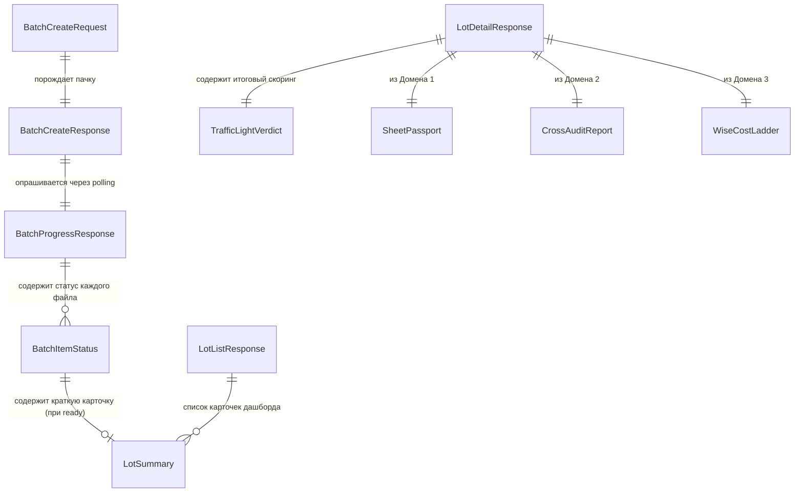

# Домен 4: Пользовательские сценарии, Очереди обработки и API (`app_flow_and_api`)

> **Статус:** Каноническая спецификация (SSOT)  
> **Версия:** 1.0.0  
> **Файл:** `docs/domains/04_app_flow_and_api.md`  
> **Назначение в UI:** Экран 1 (Дашборд), Экран 2 (Модалка загрузки), Экран 3 (Очередь и маскот), скоринг «Аукционный светофор» и все мобильные API-роуты

---

## 1. Схема связей сущностей домена (Entity Relationship Diagram)



---

## 2. Спецификация сущностей и полей

### А. Сущности пакетной загрузки и очередей (Экраны 2 и 3)

#### 1. `BatchCreateRequest` (Запрос на загрузку пачки листов)
* **Эндпоинт:** `POST /api/v1/lots/batches`
* **Формат:** `multipart/form-data`

| Поле (Technical Key) | Тип данных | Nullable | Обязательное | Описание и бизнес-правила |
| :--- | :--- | :-: | :-: | :--- |
| `files` | `binary[]` | Нет | **Да** | Массив изображений аукционных листов (от 1 до 10 файлов). Форматы: PNG, JPEG, WEBP. Размер до 15 МБ на файл. Никаких лишних полей режима `mode` не передается — бэкенд определяет все автоматически! |

#### 2. `BatchCreateResponse` (Ответ на прием пачки в обработку)
* **HTTP Статус:** `202 Accepted`

| Поле (Technical Key) | Тип данных | Nullable | Источник данных | Отображение в UI | Описание |
| :--- | :--- | :-: | :--- | :--- | :--- |
| `batch_id` | `UUID` | Нет | Генератор UUIDv4 | URL параметр экрана 3 | Уникальный ID пачки для последующего опроса (`GET /batches/{id}`). |
| `total_items` | `integer` | Нет | Подсчет файлов | «0 из N готово» | Количество принятых к обработке файлов (например, `4`). |
| `status` | `enum` | Нет | Брокер задач | Статус очереди | `queued` (в очереди), `processing` (обрабатывается), `completed` (все готово). |
| `created_at` | `string (ISO)`| Нет | Системное время | Внутренний таймстемп | Время постановки пачки в очередь обработки. |

#### 3. `BatchProgressResponse` (Ответ Live Polling для Экрана 3)
* **Эндпоинт:** `GET /api/v1/lots/batches/{batch_id}`
* **Интервал опроса:** каждые 1.5–2.0 секунды.

| Поле (Technical Key) | Тип данных | Nullable | Источник данных | Отображение в UI | Описание |
| :--- | :--- | :-: | :--- | :--- | :--- |
| `batch_id` | `UUID` | Нет | Состояние пачки | Идентификатор | Идентификатор опрашиваемой пачки. |
| `status` | `enum` | Нет | Реестр очередей | Состояние маскота | `processing` (робот думает), `completed` (робот радуется), `partial_failed` (есть ошибки). |
| `total_count` | `integer` | Нет | Состояние пачки | Текст «3 из 4» | Общее количество файлов в данной пачке (`4`). |
| `processed_count` | `integer` | Нет | Счетчик готовности | Прогресс-бар пачки | Сколько файлов уже полностью обработано (`3`). Прогресс = $(3 / 4) \times 100\% = 75\%$. |
| `ready_count` | `integer` | Нет | Счетчик успешных | Зеленые бейджи | Количество успешно готовых лотов (`3`). |
| `failed_count` | `integer` | Нет | Счетчик сбоев | Красные бейджи | Количество забракованных файлов (`0`). |
| `items` | `BatchItemStatus[]`| Нет | Массив элементов | Список строк очереди | Статус каждого конкретного файла в пачке (см. ниже). |

#### 4. `BatchItemStatus` (Строка в списке очереди)
| Поле (Technical Key) | Тип данных | Nullable | Источник данных | Отображение в UI | Описание |
| :--- | :--- | :-: | :--- | :--- | :--- |
| `lot_id` | `UUID` | Нет | Инициализатор лота | Ключ навигации | ID создаваемого лота. Клик по строке со статусом `ready` мгновенно открывает этот лот! |
| `file_index` | `integer` | Нет | Индекс загрузки | Порядковый номер | Порядковый номер файла в пачке (`0..N-1`). |
| `original_filename` | `string` | Нет | Заголовок файла | Имя файла в строке | Исходное имя загруженного файла (например, `"sheet_corolla_3142.jpg"`). |
| `status` | `enum` | Нет | Воркер пайплайна | Иконка статуса строки | `queued` (в очереди), `processing` (спиннер), `ready` (зеленая галка), `failed` (красный крестик). |
| `current_step` | `string` | Да | Текущий этап DAG | Текст под строкой | Этап: `"gatekeeper"`, `"gemini_ocr"`, `"cross_audit"`, `"customs_calc"`, `"farpost_parts"`. |
| `progress_pct` | `integer` | Нет | Расчет этапа | Мини прогресс-бар | Процент готовности данной строки (`0..100%`). |
| `error_message` | `string` | Да | Лог сбоя | Красный текст ошибки | Например: *"Фотография не является аукционным листом"*. |
| `summary` | `LotSummary` | Да | Домены 1, 2, 3 | Карточка при готовности| Заполняется, как только статус становится `ready`. Позволяет показать марку, цену и светофор прямо в очереди! |

---

### Б. Сущность `LotSummary` (Компактная карточка Дашборда — Экран 1)
Модель данных карточки автомобиля в ленте расчетов.

| Поле (Technical Key) | Тип данных | Nullable | Источник данных | Отображение в Rich Card | Описание |
| :--- | :--- | :-: | :--- | :--- | :--- |
| `lot_id` | `UUID` | Нет | База данных | Ключ карточки | Уникальный ID лота для перехода на детальный экран. |
| `make` | `string` | Нет | Домен 1 | Заголовок карточки | Марка авто (например, `"Toyota"`). |
| `model` | `string` | Нет | Домен 1 | Заголовок карточки | Модель авто (например, `"Corolla Touring"`). |
| `trim` | `string` | Да | Домен 1 | Подзаголовок | Комплектация (например, `"W×B"`). |
| `year` | `integer` | Нет | Домен 1 | Верхняя строка | Год выпуска (например, `2020`). |
| `engine_cc` | `integer` | Да | Домен 1 | Верхняя строка | Рабочий объем (например, `1196 см³`). |
| `frame_id` | `string` | Нет | Домен 1 | Строка шасси | Канонический номер кузова (например, `"NRE210-2005418"`). |
| `auction_house` | `string` | Нет | Домен 1 | Аукционный бейдж | Название аукциона (например, `"TAA"`). |
| `lot_number` | `string` | Нет | Домен 1 | Аукционный бейдж | Номер лота (например, `"3142"`). |
| `overall_grade` | `string` | Нет | Домен 1 | Бейдж оценки | Оценка аукциона (например, `"3.5"`). |
| `mileage_km` | `integer` | Нет | Домен 1 | Строка пробега | Пробег в км (например, `58 240 км`). |
| `turnkey_cost_rub` | `integer` | Нет | Домен 3 (Wise) | **Цена «под ключ» (крупный шрифт)** | Итоговая стоимость привоза авто под ключ во Владивосток (**1 104 899 ₽**). Включает покупку на аукционе, фрахт, таможню, утильсбор, лабораторию СБКТС и комиссию. |
| `market_price_rf_rub` | `integer` | Нет | Домен 3 | Сравнение с рынком | Средняя цена на Дроме в РФ (**1 520 000 ₽**). |
| `verdict` | `enum` | Нет | Домен 4 (Скоринг) | **Цветная пилюля** | `green` (зеленый), `yellow` (желтый), `red` (красный). |
| `net_benefit_rub` | `integer` | Нет | Домен 3 | Текст выгоды | Чистая выгода покупателя относительно рынка РФ (**+415 101 ₽**). |
| `has_anomaly` | `boolean` | Нет | Домен 2 (Аудит) | Тревожная плашка | `true`, если по машине найден скрученный пробег или скрытый аварийный ремонт. |
| `anomaly_text` | `string` | Да | Домен 2 | Текст предупреждения | Например, *"Скрутка пробега (-124k км)"*. |
| `thumbnail_url` | `string (URI)`| Нет | S3 / CDN | Квадратное фото авто | Ссылка на миниатюру фото автомобиля (или кроп титульного угла листа). |
| `created_at` | `string (ISO)`| Нет | База данных | Дата расчета | Дата и время добавления лота в историю. |

---

### В. Сущность `TrafficLightVerdict` (Правила скоринга «Аукционный светофор»)
Алгоритм агрегации технического состояния (Домен 1), рисков безопасности (Домен 2) и экономики ввоза (Домен 3).

| Поле (Technical Key) | Тип данных | Nullable | Источник данных | Отображение в UI | Описание |
| :--- | :--- | :-: | :--- | :--- | :--- |
| `verdict` | `enum` | Нет | Движок скоринга | Фон карточки вердикта | `green` (Рекомендовано к покупке), `yellow` (Внимание/Нюансы), `red` (Критический риск/Не брать). |
| `headline` | `string` | Нет | Шаблонизатор вердикта| Крупный заголовок Таба 4| Например: *"🟢 РЕКОМЕНДОВАНО К ПОКУПКЕ"*. |
| `badge_text` | `string` | Нет | Генератор бейджей | Текст в пилюле | Например: *"ВЫГОДНО: +415 101 ₽"*. |
| `net_benefit_rub` | `integer` | Нет | $\text{Рынок РФ} - \text{ВЛК}$ | Hero-метрика 1 | Сумма чистой выгоды в рублях. |
| `benefit_percentage` | `float` | Нет | $\text{Выгода} / \text{ВЛК} \times 100$| Процент ROI | Доходность вложения (например, `37.6%`). |
| `confidence_score` | `float` | Нет | Оценка достоверности | Внутренний скор | Число от `0.0` до `1.0` (полнота данных, строгий аукцион = 0.95). |
| `summary_text` | `string` | Нет | Генератор вывода | Поясняющий абзац | 2-3 предложения для клиента, почему сформирован данный вердикт. |
| `reasoning` | `string[]` | Нет | Список факторов | Буллеты «За» и «Против»| Аргументы алгоритма: родной пробег, замена двери в заводской цвет, высокая ликвидность. |

#### Логика присвоения цветов светофора:
* 🟢 **ЗЕЛЕНЫЙ (green):**
  * Чистая выгода $\Delta \ge 150\,000\,\text{₽}$ (или $\text{ROI} \ge 10\%$);
  * Кросс-аудит чист (`risk_level == "CLEAN"` или `"INFO"`);
  * Силовой каркас, лонжероны и подушки безопасности целы;
  * Детали под замену отсутствуют либо имеются в наличии во Владивостоке строго в заводской цвет кузова.
* 🟡 **ЖЕЛТЫЙ (yellow):**
  * Чистая выгода от $50\,000$ до $150\,000\,\text{₽}$;
  * Либо есть косметические замечания: поверхностная ржавчина днища (`S1..S2`), накрутка аукционного балла на 0.5;
  * Либо требуется перекрас деталей из-за отсутствия запчастей в цвет кузова на Farpost.
* 🔴 **КРАСНЫЙ (red):**
  * Сработал хотя бы один **безусловный стоп-фактор безопасности** (топляк, сработавшие подушки безопасности, сквозная коррозия порогов/лонжеронов, деформация несущих стоек);
  * Либо выявлен **скрученный пробег** или маскировка аварийной оценки `R`;
  * Либо экономическая выгода $\Delta < 50\,000\,\text{₽}$ (покупка лишена коммерческого смысла).

---

## 3. Каталог всех 7 клиентских эндпоинтов мобильного приложения

```
[ Мобильное приложение ]
       │
       ├─► (1) POST /api/v1/lots/batches             ➔ Загрузка пачки фото (до 10 шт)
       ├─► (2) GET  /api/v1/lots/batches/{id}        ➔ Live Polling очереди (1.5-2.0 сек)
       ├─► (3) POST /api/v1/lots/batches/{id}/items  ➔ Догрузка еще листов без прерывания
       ├─► (4) GET  /api/v1/lots                     ➔ Главный дашборд (лента расчетов)
       ├─► (5) GET  /api/v1/lots/{id}                ➔ Полная спецификация (Табы 4, 5, 6)
       ├─► (6) POST /api/v1/lots/{id}/recalculate    ➔ Интерактивный слайдер ставки и свитчи
       └─► (7) GET  /api/v1/lots/{id}/report.pdf     ➔ Официальный PDF-отчет для клиента
```

| Метод | Путь эндпоинта | Назначение в приложении | Входные параметры / Тело | Ответ |
| :--- | :--- | :--- | :--- | :--- |
| `POST` | `/api/v1/lots/batches` | Экран 2: Загрузка пачки листов из галереи | `multipart/form-data: files[]` | `202 Accepted` (`BatchCreateResponse`) |
| `GET` | `/api/v1/lots/batches/{batch_id}` | Экран 3: Опрос прогресса очереди и маскота | `batch_id: UUID` в path | `200 OK` (`BatchProgressResponse`) |
| `POST` | `/api/v1/lots/batches/{batch_id}/items`| Экран 3: Кнопка «+ Еще листы» | `batch_id` + `multipart: files[]` | `202 Accepted` (`BatchProgressResponse`) |
| `GET` | `/api/v1/lots` | Экран 1: Главный дашборд с фильтрами | Query: `tab=ready\|processing`, `verdict`, `query` | `200 OK` (`LotListResponse`) |
| `GET` | `/api/v1/lots/{lot_id}` | Экраны 4, 5, 6: Детальный экран со всеми табами| `lot_id: UUID` в path | `200 OK` (`LotDetailResponse`) |
| `POST` | `/api/v1/lots/{lot_id}/recalculate` | Экран 6: Симуляция слайдера ставки и свитчей | JSON: `bid_jpy`, `is_commercial_util`, `repairs` | `200 OK` (`RecalculateResponse`) |
| `GET` | `/api/v1/lots/{lot_id}/report.pdf` | Экспорт фирменного PDF для клиента | `lot_id: UUID` в path | `200 OK` (`application/pdf`) |

---

## 4. Эталонные JSON-сниппеты Домена 4

### Сниппет 1: Live Polling очереди `BatchProgressResponse` (Экран 3 — маскот 3/4)
```json
{
  "batch_id": "4d1b8294-9876-4321-abcd-ef0123456789",
  "status": "processing",
  "total_count": 4,
  "processed_count": 3,
  "ready_count": 3,
  "failed_count": 0,
  "items": [
    {
      "lot_id": "8fa1947b-1234-4567-8901-abcdef123456",
      "file_index": 0,
      "original_filename": "sheet_corolla_3142.jpg",
      "status": "ready",
      "current_step": "completed",
      "progress_pct": 100,
      "error_message": null,
      "summary": {
        "lot_id": "8fa1947b-1234-4567-8901-abcdef123456",
        "make": "Toyota",
        "model": "Corolla Touring",
        "trim": "W×B",
        "year": 2020,
        "engine_cc": 1196,
        "frame_id": "NRE210-2005418",
        "auction_house": "TAA",
        "lot_number": "3142",
        "overall_grade": "3.5",
        "mileage_km": 58240,
        "turnkey_cost_rub": 1104899,
        "market_price_rf_rub": 1520000,
        "verdict": "green",
        "net_benefit_rub": 415101,
        "has_anomaly": false,
        "anomaly_text": null,
        "thumbnail_url": "https://8.ajes.com/imgs/corolla_thumb.jpg",
        "created_at": "2026-11-13T10:10:00Z"
      }
    },
    {
      "lot_id": "7bb2947b-0000-1111-2222-abcdef123456",
      "file_index": 1,
      "original_filename": "sheet_vezel_9182.jpg",
      "status": "processing",
      "current_step": "farpost_parts_evaluation",
      "progress_pct": 75,
      "error_message": null,
      "summary": null
    }
  ]
}
```

### Сниппет 2: Агрегированный вердикт `TrafficLightVerdict` (Экран 4 — Таб «Общий»)
```json
{
  "verdict": "green",
  "headline": "🟢 РЕКОМЕНДОВАНО К ПОКУПКЕ",
  "badge_text": "ВЫГОДНО: +415 101 ₽",
  "net_benefit_rub": 415101,
  "benefit_percentage": 37.6,
  "confidence_score": 0.95,
  "summary_text": "Отличный вариант для покупки: оригинальный пробег 58k км подтвержден строгим аукционом TAA, геометрия и лонжероны не повреждены. Чистая экономия под ключ во Владивостоке составляет 415 101 ₽ относительно рынка РФ.",
  "reasoning": [
    "✅ Аукционный дом высшей строгости TAA Chubu (индекс строгости 1.00)",
    "✅ История торгов чиста: первичный лот, пробег 58 240 км подтвержден одометром",
    "✅ Повреждения только навесные: замена передней левой двери (XX) и мелкие сколы A2/U2",
    "✅ Контрактная дверь в цвет 070 найдена в наличии во Владивостоке (18 000 ₽, малярка 0 ₽)",
    "✅ Проходной возраст 4 года 2 мес. (льготная ставка пошлины ЕАЭС 1.7 €/см³)",
    "✅ Двигатель 116 л.с. укладывается в порог 160 л.с. (льготный утильсбор 5 200 ₽ вместо 528 000 ₽)"
  ]
}
```
