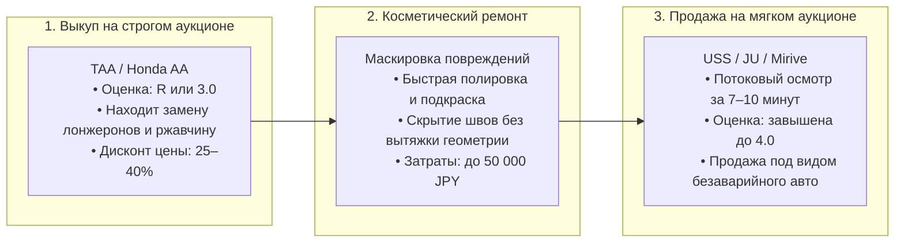
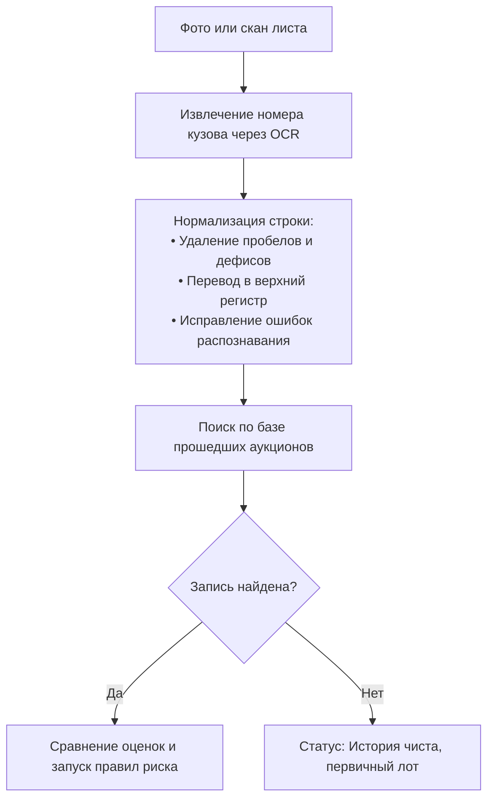
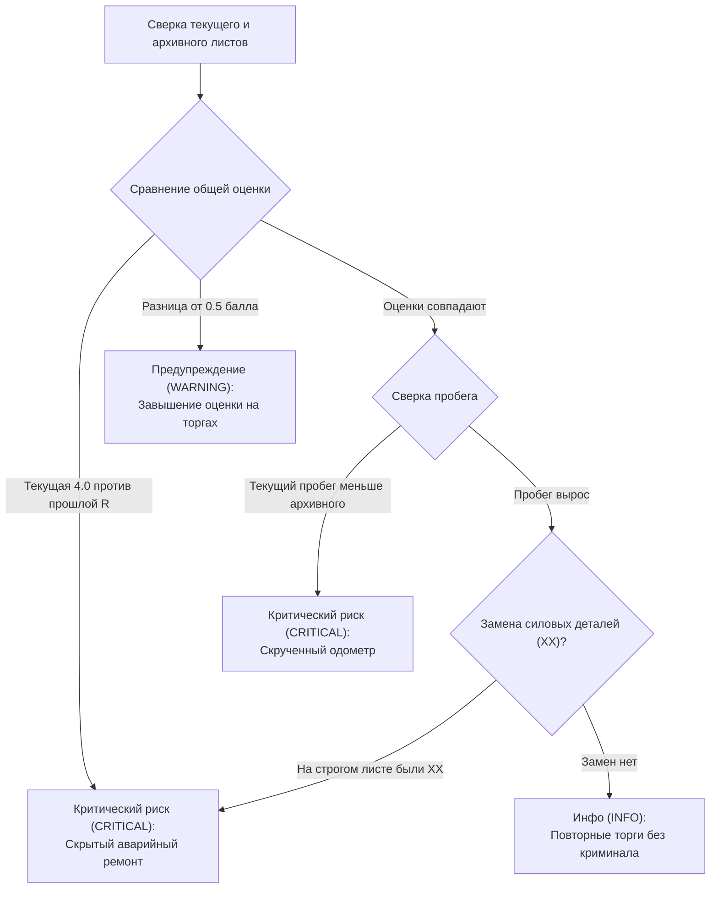

# Кросс-аукционный аудит: выявление скрытого ремонта и накрученных оценок

> **Классификация документа:** Аналитическое исследование и алгоритмическая концепция (Research & Detection Framework).  
> **Проект:** Интеллектуальный сервис дефектоскопии японских аукционных листов и расчета себестоимости автомобилей AuctionCalc.  
> **Связанные документы:**
> - [Сводный концептуальный отчет](./README.md)
> - [Методология скоростной разработки](./02_RAPID_DEVELOPMENT_METHODOLOGY.md)
> - [Том 3. Дефектоскопия и смета ремонта](../research/03_AUCTION_INSPECTION_AND_REPAIR_ECONOMETRICS.md)
> 
> **Суть (BLUF):** Перекупщики в Японии выкупают битые автомобили на строгих аукционах (TAA) с оценкой `R` со скидкой 25–40%. Затем они маскируют следы аварии и перепродают машины на массовых торгах (USS, JU) с завышенной оценкой `4.0`. Сервис сверяет листы по уникальному номеру кузова (`Frame ID`), предупреждает покупателя о скрытом ремонте и защищает от потери 200 000 – 500 000 ₽.

---

## 1. Экономика арбитража: как битые лоты с TAA превращаются в «целые» на USS

В Японии работают более 130 независимых автоаукционов. Площадки оценивают машины по разным стандартам. Из-за этой разницы возникает серый рынок арбитража: перекупщики зарабатывают на несовпадении строгости инспекций.



### Формула спекулятивной прибыли

```
Прибыль перекупщика = (Цена на USS - Цена на TAA) × Курс JPY - Затраты на ремонт - Сборы аукционов
```

На популярных несанкционных моделях вроде Toyota Corolla Touring разница в цене между дефектным лотом `3.5` (или `R`) и целым лотом `4.0–4.5` составляет от 300 000 до 450 000 JPY. Перекупщик зарабатывает от 180 000 до 280 000 ₽ чистой прибыли, а покупатель в России получает машину со скрытыми дефектами кузова.

### Где инспекторы смотрят строже всего

| Аукционный дом | Индекс строгости (0.0–1.0) | Как осматривают и чем рискует покупатель |
| :--- | :-: | :--- |
| **TAA (Toyota Auto Auction)** | **1.00** | Самая жесткая инспекция. Эксперты замеряют толщину краски и проверяют геометрию лонжеронов. Любая замена несущей детали сразу дает оценку `R`. |
| **Honda AA** | **0.95** | Высокая строгость. Тщательно осматривают силовой каркас и батареи гибридов e:HEV. |
| **CAA** | **0.85** | Надежно находят перекрашенные навесные детали (`W1..W3`). |
| **USS** | **0.70** | Крупнейшая сеть с огромным потоком машин. На осмотр одного авто инспектор тратит 7–10 минут, поэтому часто пропускает коррозию днища и замененные крылья. |
| **JU** | **0.60** | Аукцион дилерской ассоциации. Оценки регулярно завышены на 0.5–1.0 балла по сравнению с TAA. |
| **Mirive / BayAuc** | **0.55** | Мягкие региональные площадки без глубокой проверки скрытых полостей. |

---

## 2. Поиск по Frame ID вместо японского VIN

У праворульных машин для внутреннего рынка Японии нет международного 17-значного VIN-кода. Единственный идентификатор автомобиля — **номер кузова (Frame ID)**.

Номер кузова состоит из кода модели и серийного номера шасси через дефис:
```
[Код модели кузова] - [Серийный номер шасси]
```
Примеры: `NRE210-2005418` (Toyota Corolla Touring), `SK9-023412` (Subaru Forester).

### Как система находит историю лота



---

## 3. Каскад правил и три уровня риска

Если система находит прошлые торги автомобиля, она сравнивает старый и новый листы по каскадной схеме:



### Как трактовать уровни риска

| Уровень риска | Когда срабатывает правило | Что это значит для покупателя в РФ |
| :--- | :--- | :--- |
| **CRITICAL** | • Прошлая оценка была `R`, а текущая стала `>= 3.5`.<br>• На прошлом листе стояли отметки `XX` на лонжеронах или стойках.<br>• Пробег уменьшился по сравнению с прошлыми торгами.<br>• В прошлых заметках были отметки о сработавших подушках безопасности или затоплении. | **Покупать нельзя.** Нарушена геометрия кузова. Машина не пройдет лабораторию СБКТС, а скрытый ремонт обойдется более чем в 500 000 ₽. |
| **WARNING** | • Оценку завысили на 0.5–1.0 балла (например, с `3.5` на TAA до `4.0` на USS).<br>• Пропустили ржавчину днища (`S1/S2`).<br>• Не указали повторный окрас детали (`W2/W3`). | **Нужна ручная проверка экспертом.** Потребуются дополнительные 30 000 – 80 000 ₽ на перекрас и антикоррозийную обработку. |
| **INFO** | • Оценки и повреждения совпадают.<br>• Машину просто перевыставили, потому что на прошлых торгах не достигли резервной цены продавца. | **Штатная ситуация.** Разрешает рассчитать победную ставку на основе прошлой непроданной цены. |

---

## 4. Что видит пользователь в интерфейсе

Система показывает результат проверки прямо в карточке автомобиля:

1. **Цветная статус-капсула в шапке:**
   - Зеленая: `История чиста: первичные торги`.
   - Синяя: `История торгов: повторный лот (без расхождений)`.
   - Красная пульсирующая: `⚠️ Внимание: Расхождение в оценках (TAA: R / USS: 4.0)`.
2. **Сравнение листов Side-by-Side:**
   - Схема текущего листа размещается рядом с архивной схемой.
   - Красный цвет подсвечивает детали, замененные после аварии (`XX`), и пропущенные очаги ржавчины.
   - Сервис выводит перевод архивных заметок японского инспектора на русский язык.

---

## 5. Шаги реализации в рамках спринта (13–14 ноября)

1. **Загрузить эталонный кейс арбитража:** внести в тестовую базу пару реальных листов Toyota Corolla Touring (`Frame ID: NRE210-2005418`) — первичный лист TAA Chubu с оценкой `3.5` (дефекты `A2`, `U2`) и лист повторных торгов USS Tokyo с завышенной оценкой `4.0`.
2. **Отрегулировать парсинг номера кузова:** прописать регулярное выражение для связки `код_модели-номер_шасси` и исключить путаницу между буквами и цифрами (`O` и `0`, `I` и `1`).
3. **Собрать виджет сравнения:** сверстать в карточке авто блок с двумя схемами кузова и пульсирующим бейджем `CRITICAL`.
