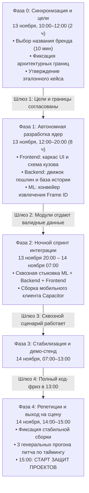

# Регламент соревновательного спринта: 29 часов до защиты (13–14 ноября)

> **Классификация документа:** Инженерная методология и процессный регламент (Execution Framework & Process Guide).  
> **Проект:** Интеллектуальный сервис дефектоскопии японских аукционных листов и расчета себестоимости автомобилей AuctionCalc.  
> **Связанные документы:**
> - [Сводный концептуальный отчет](./README.md)
> - [Кросс-аукционная дефектоскопия](./01_CROSS_AUCTION_ANOMALY_DETECTION.md)
> - [Анализ номенклатуры продукта](./03_PRODUCT_NOMENCLATURE_ANALYSIS.md)
> - [Стартовый чеклист разработки](./04_PRE_IMPLEMENTATION_CHECKLIST.md)
> 
> **Суть (BLUF):** Соревновательный спринт длится 29 астрономических часов: от старта работы над проектами (13 ноября в 10:00) до начала защит перед жюри (14 ноября в 15:00). График привязан к официальной программе мероприятия. Команда работает с минимальным сном (3.5 часа ночью) и объявляет полный код-фриз за 2 часа до защиты — 14 ноября в 13:00.

---

## 1. Фазово-шлюзовая модель разработки (Phase-Gate Lifecycle)

---

## 2. Сводная сетка спринта по официальной программе хакатона

| Дата и слот официальной программы | Время | Статус команды | Инженерные задачи и результат |
| :--- | :-: | :--- | :--- |
| **13 ноября: Вводная часть** | 09:30 – 10:00 | Общий сбор | Регистрация, сбор команды на площадке, настройка рабочих мест и репозиториев. |
| **13 ноября: Работа над проектами** | 10:00 – 12:00 | **Фаза 0: Синхронизация** | 10-минутное голосование по бренду, фиксация сетевого периметра (Frontend → Backend → ML) и эталонного кейса Corolla Touring. |
| **13 ноября: Работа над проектами** | 12:00 – 13:30 | **Фаза 1: Старт ядер** | Параллельный старт разработки: верстка каркаса UI, движок пошлин ЕАЭС, препроцессинг Vision. |
| **13 ноября: Обед** | 13:30 – 14:30 | Рабочий обед | Совмещение питания с быстрым обсуждением макетов в Figma и структуры сущностей. |
| **13 ноября: Работа над проектами** | 14:30 – 16:30 | **Фаза 1: Разработка ядер** | Векторная схема кузова, калькулятор утильсбора 160 л.с., промпты Vision LLM для Frame ID. |
| **13 ноября: Кофе-пауза** | 16:30 – 17:00 | Короткий синк (15 мин) | Сверка статусов команд перед вечерним блоком, устранение блокеров. |
| **13 ноября: Работа над проектами** | 17:00 – 20:00 | **Фаза 1: Финализация ядер** | Завершение автономных модулей, проверка готовности к сквозной стыковке. Шлюз 2. |
| **Ночь: Закрытие площадки / Спринт** | 20:00 – 03:00 | **Фаза 2: Ночная интеграция** | Сквозная стыковка конвейера (ML → Backend → Frontend), WebSocket синк Desktop ↔ Mobile, сборка мобильного клиента Capacitor. |
| **Ночь: Минимальный сон** | 03:00 – 06:30 | Сон / восстановление (3.5 ч) | Минимальный сон команды для сохранения концентрации и свежести на защите. |
| **14 ноября: До открытия площадки** | 06:30 – 10:00 | **Фаза 3: Утренний разгон** | Устранение ночных дефектов, проверка сквозной цепочки на эталонном лоте Corolla Touring. |
| **14 ноября: Работа над проектами** | 10:00 – 13:00 | **Фаза 3: Демо-стенд и видео** | Настройка локального оффлайн-кэша, полировка лоадеров, запись Full HD видеоролика демонстрации. |
| **14 ноября: Обед и код-фриз** | 13:00 – 14:30 | **Фаза 4: КОД-ФРИЗ и обед** | **В 13:00 полный код-фриз.** Фиксация сборки. Во время обеда — прогон речи спикера со секундомером. |
| **14 ноября: Работа над проектами** | 14:30 – 15:00 | **Фаза 4: Готовность сцены** | Проверка кликера, проектора, звука и запасного видео. Переход в зал защиты. |
| **14 ноября: Защиты проектов** | **15:00 – 20:00** | **ЗАЩИТА ПРОЕКТА** | Выступление перед жюри, демонстрация рабочего продукта и ответы на вопросы. |
| **14 ноября: Награждение и фуршет** | 20:00 – 21:00 | Финал | Подведение итогов, награждение победителей. |

---

## 3. Детальный регламент фаз

### Фаза 0: Синхронизация и цели (13 ноября, 10:00 – 12:00, 2 часа)
- **Цель:** Исключить разногласия на этапе интеграции и зафиксировать правила взаимодействия.
- **Действия команды:**
  1. **Утверждение бренда (10 минут):** Голосование по шорт-листу из [03_PRODUCT_NOMENCLATURE_ANALYSIS.md](./03_PRODUCT_NOMENCLATURE_ANALYSIS.md).
  2. **Фиксация архитектурных границ:** Фронтенд взаимодействует строго с серверным API. Прямые клиентские вызовы внешних нейросетей исключены.
  3. **Согласование эталонного кейса:** Фиксация лота Toyota Corolla Touring (`Frame ID: NRE210-2005418`) с историей завышения оценки (TAA `3.5` против USS `4.0`).
  4. **Разделение на пары:**
     - Пара «Бизнес-логика»: Backend + ML (оркестрация и конвейер распознавания).
     - Пара «Интерфейс и продукт»: Frontend + Product (дизайн-система, экраны, интерактивная схема).

---

### Фаза 1: Автономная разработка ядер (13 ноября, 12:00 – 20:00, 8 часов)
- **Цель:** Создать независимые рабочие модули на моковых контрактах к моменту закрытия официальной площадки.

#### Задачи по направлениям:
- **Frontend / Интерфейсы:**
  - Адаптивный каркас для десктопа и смартфонов.
  - Интерактивный векторный компонент кузова с цветовой подсветкой дефектов (`A`, `U`, `W`, `XX`).
  - Виджет истории лота со сравнительной плашкой старого и нового листа.
  - Компонент «Лестница расходов» с пошаговой детализацией себестоимости.
- **Backend / Архитектура:**
  - Математический калькулятор пошлин ЕАЭС и утилизационного сбора по критерию 160 л.с.
  - Модуль курсов валют ЦБ РФ с добавлением коммерческого спреда иены.
  - Реестр истории торгов и поиск по номеру кузова (`Frame ID`).
  - Базовые API-эндпоинты для аналитики и финансовых расчетов.
- **ML / Компьютерное зрение:**
  - Модуль препроцессинга входных изображений (кадрирование, выравнивание, контрастирование).
  - Промпт-пайплайн для надежного считывания номера кузова, общих оценок и замечаний инспектора.
  - Валидация точности извлечения данных на тестовых сканах.
- **Product / Дизайн и аналитика:**
  - Макеты экранов в Figma по дизайн-системе Clean Light.
  - Калибровка нормативов стоимости кузовного ремонта во Владивостоке.
  - Контроль пользовательских сценариев.

---

### Фаза 2: Ночной спринт интеграции (13 ноября 20:00 – 14 ноября 07:00, 11 часов)
- **Цель:** Собрать модули в единую функционирующую цепочку и подготовить мобильный клиент.
- **Регламент ночи:**
  - **20:00 – 03:00 (7 часов непрерывной работы):**
    - Сквозная стыковка конвейера: Загрузка листа → OCR и Frame ID → Сверка с историей → Расчет пошлин и ремонта → Комплексный отчет.
    - Сессионная синхронизация: мгновенное сопряжение смартфона и десктопа по QR-коду без логинов и паролей.
    - Сборка Capacitor под мобильное устройство, проверка работы встроенной камеры.
  - **03:00 – 06:30 (3.5 часа отдыха):**
    - Минимальный командный сон для сохранения свежести восприятия и энергии на защиту.
  - **06:30 – 10:00 (3.5 часа утреннего разгона):**
    - Устранение дефектов ночной сборки, первый сквозной прогон всей цепочки на эталонном лоте Corolla Touring.

---

### Фаза 3: Стабилизация, демо-стенд и видео (14 ноября, 10:00 – 13:00, 3 часа)
- **Цель:** Обеспечить 100% надежность показа и исключить любые риски сетевых сбоев.
- **Действия команды:**
  1. **Отказоустойчивый кэш:** Серверное кэширование готового ответа для эталонного лота Corolla Touring. При отключении интернета система отдает результат из памяти за 120 мс.
  2. **Полировка визуальных состояний:** Настройка скелетонов загрузки и анимаций ожидания.
  3. **Резервная видеостраховка:** Запись непрерывного Full HD 60fps скринкаста живой работы интерфейса со смартфона и десктопа.

---

### Фаза 4: Код-фриз, репетиции и защита (14 ноября, 13:00 – 15:00, 2 часа)
- **Цель:** Зафиксировать стабильную релизную версию и отрепетировать выступление.
- **Регламент:**
  - **13:00 — ПОЛНЫЙ КОД-ФРИЗ (Code Freeze):**
    - Любые изменения логики и кода строго запрещены за 2 часа до начала защит.
    - Фиксация стабильного тега в Git, деплой на сервер и локальное резервное зеркало на ноутбуке.
  - **13:00 – 14:30 (Обед и репетиции):**
    - Минимум 3 сквозных командных прогона питча со секундомером.
  - **14:30 – 15:00 (Готовность оборудования):**
    - Проверка оборудования в зале: кликер, проектор, звук, запасной видеофайл.
  - **15:00 — СТАРТ ЗАЩИТ ПРОЕКТОВ** (15:00 – 20:00 по официальной программе).

---

## 4. Матрица распределения ответственности (RACI)

| Участник | Ролевой профиль | Фаза 0: Синхронизация (13.11, 10:00–12:00) | Фаза 1: Ядра (13.11, 12:00–20:00) | Фаза 2: Ночной спринт (13.11, 20:00 – 14.11, 07:00) | Фазы 3–4: Финал (14.11, 07:00–15:00) |
| :--- | :--- | :--- | :--- | :--- | :--- |
| **Frontend / Mobile** | Интерфейсы и мобильный клиент | Согласование информационных потоков | Адаптивная верстка, интерактивная схема кузова, виджет истории | Стыковка с серверным API, сессионный синк, сборка Capacitor | Полировка UI, анимации ожидания, подготовка мобильного устройства к показу |
| **Backend / Архитектор** | Серверная логика и оркестрация | Определение архитектурных границ системы | Движок пошлин и утильсбора, курсы валют, сервис проверки Frame ID | Оркестрация сквозного конвейера, WebSocket каналы синхронизации | Развертывание стабильного сервера, оффлайн-кэш, контроль код-фриза в 13:00 |
| **ML / Компьютерное зрение** | Конвейер оцифровки документов | Определение извлекаемых сущностей из листа | Препроцессинг изображений, промпт-пайплайн для Frame ID и заметок | Оптимизация задержки отклика, валидация структурированного ответа | Подготовка резервного ответа для эталонного лота, контроль точности |
| **Product / UX Аналитик** | Продуктовый дизайн и сценарии | 10-мин выбор бренда, согласование эталонного кейса | Макеты экранов в Figma, калибровка нормативов ремонта | Сквозное QA-тестирование, проверка расчетов выгоды и расхождений | Видеостраховка демонстрации, контроль тайминга репетиций, координация показа |

---

## 5. Превентивное управление рисками (Risk Mitigation)

| Риск | Влияние | Превентивное архитектурное решение |
| :--- | :-: | :--- |
| **Сбой или задержка внешнего API Vision LLM** | Критическое | Локальный отказоустойчивый кэш ответа для эталонного лота Corolla Touring (мгновенная отдача за 120 мс). |
| **Нестабильный интернет в презентационном зале** | Критическое | Автономное локальное окружение на ноутбуке и подготовленный видеоролик живой демонстрации. |
| **Спешка и появление багов перед защитой** | Высокое | **Жесткий код-фриз в 13:00 14 ноября** — ровно за 2 часа до начала защит. |
| **Рассинхронизация форматов между модулями** | Высокое | Фиксация архитектурных границ и базовых сущностей в первые 2 часа (Фаза 0). |

---

## 6. Критерии приемки продукта (Definition of Done)

1. **Оцифровка аукционного листа:** Корректное извлечение `Frame ID`, марки, года выпуска, общей оценки и визуализация повреждений на схеме кузова.
2. **Кросс-аукционный аудит:** Автоматическое обнаружение первичной продажи для эталонного лота Corolla Touring с предупреждением о завышении оценки (TAA `3.5` против USS `4.0`) и скрытом ремонте.
3. **Финансовая точность:** Корректный расчет таможенных платежей ЕАЭС и дифференциация утилизационного сбора по критерию 160 л.с.
4. **Сессионная синхронизация:** Сквозное сопряжение смартфона и десктопа по QR-коду с мгновенным выводом отчета на экран.
5. **Демонстрационная надежность:** Безупречное прохождение сквозного сценария на контрольном лоте в условиях любого качества сетевого подключения к 15:00 14 ноября.
