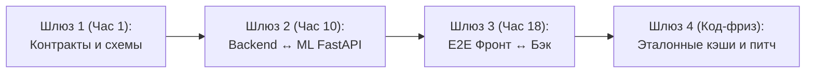

# Командный бэклог разработки (ML · Backend · Frontend/Design)

> **Статус:** Рабочий план реализации (после `/grill-me` и аудита контрактов)  
> **Базовые спецификации:**  
> - Контракты API и Pydantic V2: [docs/API_DATA_CONTRACTS.md](../docs/API_DATA_CONTRACTS.md)  
> - ML-пайплайн OCR: [docs/auction_pipeline.md](../docs/auction_pipeline.md)  
> - Вайрфреймы (Экраны 1–7): [docs/assets/wireframes_and_flows.png](../docs/assets/wireframes_and_flows.png)  
> - Дизайн-система: [docs/DESIGN.md](../docs/DESIGN.md) и [docs/showcase.html](../docs/showcase.html)  
> - Эталонный расчёт: [docs/BENCHMARK_CASE_COROLLA_TOURING.md](../docs/BENCHMARK_CASE_COROLLA_TOURING.md)  
> - Источники и парсеры: [research/04_INFRASTRUCTURE_REGISTRY_AND_DATA_SOURCES.md](../research/04_INFRASTRUCTURE_REGISTRY_AND_DATA_SOURCES.md)

---

## 1. Архитектурное разделение и принятые решения

| Направление | Стек и формат | Зона ответственности |
| :--- | :--- | :--- |
| **1. ML / CV Pipeline** | Отдельный микросервис **FastAPI** (Python 3.11+) | Препроцессинг (`cropper.py` + `HEIC` + миниатюра скана), `Gatekeeper`, **Fast Header OCR**, полный Dual-Schema OCR (`gemini-3.8-flash`), нормализация (`Frame ID`, даты, `A2/W1/XX`, 13 `RiskFlags`), `sha256`-кэш и пул ключей. |
| **2. Backend** | Основной API на **Django Ninja** | Пользователи и **JWT-авторизация**, БД и очередь пачек, вызовы ML по HTTP, все внешние интеграции (`Drom` + каталог `power_hp` + фильтр «Под заказ», `Farpost`, `AucJP/AAA/Pravto`, ЦБ РФ/ДВ-банки) с Read-Through Cache и fallback, расчёты ЕАЭС/160 л.с./Светофора, симуляция `recalculate`. |
| **3. Frontend & Design** | Web / Mobile-First (стек на выбор разработчика) | Дизайн-система Clean Light, Auth UI, экраны 1–7, интерактивный **2D SVG кузова (16 панелей)**, Bottom Sheets, live-слайдер экономики (0 мс + debounce), **клиентский экспорт PDF** (`@media print` / `html2pdf` на MVP). |

---

## 2. Критические точки стыковки (Integration Gates)

1. **Шлюз 1:** Фиксация общих схем и контрактов (`API_DATA_CONTRACTS.md`, опционально `openapi.yaml`, внутренний контракт ML `ParserResponse` + `FastHeaderPreview`). ML и Backend сразу пишут боевой код без траты времени на временные фейковые HTTP-моки; Frontend автономно поднимает свой локальный Mock Service (`MockApiClient` / `MSW`) по тем же JSON-фикстурам.
2. **Шлюз 2:** Backend переключает воркер очереди на живой HTTP-клиент к ML-микросервису + сохранение сгенерированных миниатюр `sheet_thumb.webp`.
3. **Шлюз 3:** Сквозной E2E-прогон: Регистрация → Загрузка фото (в т.ч. HEIC) → Fast Header OCR в очереди → Табы 4/5/6 + 2D-схема + слайдер `recalculate` → Печатный PDF.
4. **Шлюз 4:** Проверка отказоустойчивого кэша на эталоне `Toyota Corolla Touring NRE210-2005418`, отключение нестабильных экспериментов, финальная репетиция.

---

## 3. Бэклог ML-инженера (FastAPI-микросервис парсера)

Базовая реализация модулей уже спроектирована в [docs/auction_pipeline.md](../docs/auction_pipeline.md) — главная задача перенести их в стабильный HTTP-сервис с кэшем и квотами.

### P0 — Обязательный контур MVP

- **`ML-01` Каркас FastAPI-микросервиса и внутренние HTTP-эндпоинты**
  - Поднять сервис на `FastAPI` + `Uvicorn`, подключить Pydantic V2 схемы (`ParserResponse`, `FastHeaderPreview`, `NormalizedSheet`, `RiskFlags`, `NormalizedDefect`).
  - Реализовать роуты для Backend:
    - `POST /internal/parse/prepare` — приём изображения, декодирование `HEIC/HEIF`, тримминг полей, генерация `0_full` + 4 кропов `60×60%` + миниатюры скана `sheet_thumb.webp` (возврат путей/URL или base64).
    - `POST /internal/parse/gatekeeper` — вызов `gemini-decision-1` (проверка: лист ли это + читаемость + выбор режима `clean_digital` / `complex_or_handwritten`).
    - `POST /internal/parse/fast-header` — быстрое извлечение шапки (`make`, `model`, `lot_number` → `preview_title`, таймаут ≤ 1.2 сек) для живого отображения на Экране 3.
    - `POST /internal/parse/full` — основной вызов `gemini-3.8-flash` (Dual-Schema) + Python-постобработка → `ParserResponse`.
- **`ML-02` Препроцессинг изображений и поддержка iPhone `HEIC/HEIF`**
  - Перенести `cropper.py`, подключить `pillow-heif` (`register_heif_opener()`), `ImageOps.exif_transpose`, мягкий тримминг полей и ресайз в lossless RGB PNG (`1200–1800 px`, без ч/б бинаризации!).
  - Генерировать `sheet_thumb.webp` (`320×460 px`) строго из оригинального скана.
- **`ML-03` Надёжность квот Gemini (`5 RPM / пул ключей / sha256-кэш`)**
  - Реализовать пул из 3 API-ключей с round-robin ротацией и `asyncio.Semaphore` под лимит `5 RPM`.
  - Встроить постоянный файловый/Redis кэш по `sha256` исходного файла: повторная или демо-загрузка эталонных листов (`Corolla Touring #3142` и др.) отдаётся за `< 150 мс`.
- **`ML-04` Детерминированная Python-постобработка (`postprocess.py`)**
  - Канонический `Frame ID` (`frame_id` + `frame_id_confidence`: `"exact" | "synthesized" | "raw"` со срезом `6AA-`, `3BA-`, `DBA-`).
  - Парсер японских дат (эры `R/H/S` + «голые» годы + двойная запись вида `R8 11月 / 2026年`).
  - Разбор составных дефектов (`A2/W1`, `AU3`, разделение `X` и `XX`), вычисление индекса строгости аукциона `I_strict`, маппинг всех **13 флагов `RiskFlags`** и сохранение `inspector_notes_raw` + `warnings` / `low_confidence_fields`.
- **`ML-05` Калибровка `description_ru` и эталонный прогон**
  - Генерировать краткую человекочитаемую строку `description_ru` для каждого `NormalizedDefect` (под 4-строчную легенду Экрана 5, например `Передняя левая дверь — замена (в цвет 070)`).
  - Прогнать минимум 5–6 реальных бланков (`TAA`, `USS`, `CAA`, `JU`, рукописные) + зафиксировать эталон `Corolla Touring #3142`.

### P1 / P2 — Улучшения (после Шлюза 3)
- **`ML-06` [P1] Интеллектуальный Retry при частичном OCR:** при провале/пустом `frame_id` в режиме `Fast` автоматический дозапрос в режиме `Precision` с `thinking_level="medium"`.
- **`ML-07` [P2] Локальный YOLO-кроппер / резервный OCR в Colab:** дообучение `yolo26n` на 4 зоны листа и резервная связка `YomiToku` + `PaddleOCR-VL-1.6`.

---

## 4. Бэклог Backend-инженера (Django Ninja + интеграции + расчёты)

### P0 — Ядро API, Auth и оркестрация очереди

- **`BE-01` Каркас Django Ninja + модели БД + RFC 7807**
  - Настроить проект Django + Django Ninja + Pydantic V2 схемы из [API_DATA_CONTRACTS.md](../docs/API_DATA_CONTRACTS.md).
  - Спроектировать модели БД: `User`, `Batch`, `BatchItem`, `Lot` (хранение `NormalizedSheet`, `MarketComparisonInfo`, `CrossAuditReport`, `FarpostRepairSummary`, `CustomsCalculation`, `TrafficLightVerdict`, ссылок на скан и миниатюру), `ExternalCache` (ключ + TTL + JSON).
  - Настроить глобальный обработчик ошибок в формате **RFC 7807 Problem Details** (`InvalidParamDetail`, `ProblemDetail`) и раздачу статики/медиа для `sheet_thumbnail_url` и `sheet_scan_url`.
- **`BE-02` Полноценная JWT-авторизация и сидинг стартовых лотов**
  - Реализовать `POST /api/v1/auth/register`, `POST /api/v1/auth/login`, `POST /api/v1/auth/refresh`, `GET /api/v1/auth/me` (`Bearer` JWT).
  - Изолировать пачки и лоты по `user_id` (`401 Unauthorized` без токена, `404` при доступе к чужому `lot_id`/`batch_id`).
  - При регистрации нового пользователя автоматически привязывать к его аккаунту **3 стартовых эталонных лота** (`Toyota Corolla Touring #3142`, `Honda Vezel Hybrid`, `Nissan Note e-Power`), чтобы лента сразу работала на первом входе.
- **`BE-03` Асинхронная очередь загрузки и Live Polling (Экраны 1–3)**
  - `POST /api/v1/lots/batches` — приём 1..10 файлов (`jpeg`, `png`, `webp`, `heic`, `heif`, до 15 МБ), сохранение на диск, постановка в фоновый воркер.
  - Оркестрация DAG по шагам `TaskStep`: `gatekeeper` → `fast_header_ocr` (сразу обновляет `preview_title` в `BatchItem`!) → `gemini_ocr` → параллельный запуск (`cross_audit` + `drom_market` + `farpost_parts`) → `customs_calc` → `scoring`.
  - `GET /api/v1/lots/batches/{batch_id}` — отдача `BatchProgressResponse` и состояния робота-маскота `MascotState` (без `progress_pct` на Экране 1).
  - `POST /api/v1/lots/batches/{batch_id}/items` — догрузка новых листов в активную пачку (`409 Conflict`, если пачка уже завершена).
- **`BE-04` Главный дашборд и детальный эндпоинт (Экраны 1, 4–7)**
  - `GET /api/v1/lots` — LIFO-лента с поиском `query`, фильтрами (`make`, `model`, `verdict`, `has_anomaly`), пагинацией, `AvailableFilters` со счётчиками (`total_lots_count`, `makes[]`, `models[]` для чипсов `Все (12)` / `Vezel (4)`), и блоком `in_progress` без процентов (`total_processing_lots` + `items[]` для аккордеона).
  - `GET /api/v1/lots/{lot_id}` — сборка недублированной модели `LotDetailResponse` (`passport`, `verdict`, `market`, `audit`, `safety_checklist`, `economics`, `media`).

### P0 — Внешние интеграции (с Read-Through Cache и Fallback)

- **`BE-05` Шлюз курсов валют (ЦБ РФ + коммерческий ДВ-банк)**
  - Клиент к `https://www.cbr-xml-daily.ru/daily_json.js` (`EUR`, `USD`) + спред/курс ДВ-банка для `JPY/RUB`.
  - Раздельное хранение в `CurrencyRates` (`jpy_rub_bank`, `eur_rub_cbrf`, `usd_rub_cbrf`, `cbrf_date`) + кэш на 1 час + надёжный fallback из БД/конфига.
- **`BE-06` Интеграция Drom.ru: аналоги в РФ + отсечение «Под заказ» + мощность `power_hp`**
  - Поиск по марке, модели, году, объёму и приводу/КПП во Владивостоке/ДФО:
    1. Фильтрация на уровне URL (`без пробега`, `не битый`, исключение статуса «под заказ»).
    2. Жёсткая пост-очистка сниппетов: отброс по стоп-словам (`"под заказ"`, `"в пути"`, `"привезем"`, `"аукцион"`, `"под полную пошлину из"`) + отсечение нижних аномальных выбросов перед расчётом медианы. Подсчёт `filtered_out_under_order_count`.
    3. Если точных аналогов `< 3`, авто-расширение (год ±1 / РФ) с честным флагом `is_fallback = true` и `fallback_reason_ru`.
  - В том же модуле (из `drom.ru/catalog/` + локальный JSON-кэш `katashiki`): автоматическое определение `power_hp` и `power_hp_source` (`"drom_catalog" | "katashiki_cache"`) по `model_code`.
- **`BE-07` Смета ремонта Farpost + статистическая матрица работ СТО**
  - Асинхронный поиск контрактных деталей на Farpost во Владивостоке для панелей с кодами `X` / `XX` с приоритетом поиска **строго в `paint_code`** (для формирования `price_from_rub` вида `от 18 000 ₽`, **без возврата `farpost_url`** в API).
  - Расчёт списка `service_works` (`mount_dismount`, `paint` = `0 ₽` с `zero_cost_reason_ru="не требуется"` при детали в цвет, `pdr_and_polish` для `A/U`), сумма `total_parts_from_rub + total_works_rub = grand_total_repair_rub`.
  - Обязательная статистическая fallback-матрица средних цен Владивостока (`is_statistical_fallback = true`), если Farpost не ответил или деталь не найдена.
- **`BE-08` Кросс-аудит по `Frame ID` (AucJP + AAA Japan / Pravto / Aleado)**
  - Реализация клиента поиска по `Frame ID` (`AucJP` как первичный источник + каскад к `AAA Japan` / `Pravto` для завершённых торгов, с fallback в `CrossAuditStatus.LIVE_ONLY` при таймаутах архива).
  - Каскад правил детекции: скрутка пробега (`delta > 1 000 км` → `CRITICAL`), скрытая оценка `R/RA` (`CRITICAL`), накрутка балла на мягком аукционе (`WARNING`), повторные штатные торги (`INFO`).

### P0 — Финансовый движок, вердикты и пересчёт

- **`BE-09` Таможенный калькулятор ЕАЭС, утильсбор (160 л.с.) и санкции METI**
  - Расчёт по 3 коридорам: `under_3_years` (`duty_calculation_mode="pct_of_value"`, 48–54%), `3_to_5_years` (`eur_per_cc`), `over_5_years` (`eur_per_cc`).
  - Таможенный сбор (сетка ПП РФ № 342), фрахт Тояма–ВЛК, СВХ/брокер/СБКТС, льготный (`5 200 ₽`) vs коммерческий (`ПП РФ № 1255`) утильсбор с проверкой порога `<= 160 л.с.`, флаг `meti_sanction_risk` (гибрид, EV или ДВС > 1 900 см³).
  - Сборка 7-шаговой лестницы `WiseCostLadder` так, чтобы **`sum(steps.amount_rub) == turnkey_cost_rub` с точностью до 1 ₽**.
- **`BE-10` Движок Светофора, генератор буллитов «Кузов»/«Салон» и чек-лист безопасности**
  - Логика `TrafficLightColor` (`GREEN` / `YELLOW` / `RED`) и `short_verdict_label`.
  - Детерминированный генератор коротких буллитов `body_summary_ru` (из `exterior_grade` + главного дефекта + минимальной цены детали Farpost) и `interior_summary_ru` (из `interior_grade` + словаря триггеров из `inspector_notes_ru`).
  - Сборка `SafetyChecklist` (5 систем) строго по `RiskFlags` и тексту листа (без выдуманных значений радиации).
- **`BE-11` Интерактивный пересчёт `POST /api/v1/lots/{lot_id}/recalculate`**
  - Валидатор взаимоисключения `bid_jpy` / `bid_rub`, поддержка `is_commercial_util`, `include_repairs`, `custom_power_hp`, `custom_freight_rub`, полный пересчёт таможни, лестницы и светофора.
- **`BE-12` Эталонные фикстуры и автотесты контрактов**
  - Тест сквозного расчёта `Corolla Touring NRE210-2005418` (`1 060 000 ¥` → `1 104 899 ₽` под ключ, выгода `+415 101 ₽`, `37.6%`) и тест пересчёта на `1 150 000 ¥` (`1 157 549 ₽`).

### P1 — После MVP
- **`BE-13` [P1] Серверный экспорт PDF `GET /api/v1/lots/{lot_id}/report.pdf`** с query-параметрами активной симуляции и заголовком `Cache-Control: private, no-store`.

---

## 5. Бэклог Frontend & Design-инженера (Mobile-First Web App)

Стек фронтендер выбирает самостоятельно; все компоненты, цвета, радиусы, шрифты и поведение должны следовать [DESIGN.md](../docs/DESIGN.md), [showcase.html](../docs/showcase.html) и [wireframes_and_flows.png](../docs/assets/wireframes_and_flows.png).

### P0 — Дизайн-система, Auth и сетевой слой

- **`FE-01` Настройка UI-кита (Clean Light tokens) и HTTP-клиента с JWT**
  - Палитра (`#F2F2F7`, `#FFFFFF`, `#EFEFF4`, `#FF6B00`, мягкие тинты светофора), иконки `Lucide`, вытянутый iOS 26 свитч, безрамные статус-капсулы.
  - Типизированный API-клиент по [API_DATA_CONTRACTS.md](../docs/API_DATA_CONTRACTS.md) с подстановкой `Authorization: Bearer <token>`, автоматическим перехватом `401` → `POST /auth/refresh`, обработкой ошибок RFC 7807.
  - Локальный Mock Service на стороне Frontend (`MockApiClient` за общим интерфейсом `ApiClient` или `MSW`) на базе валидированных JSON-фикстур из [API_DATA_CONTRACTS.md](../docs/API_DATA_CONTRACTS.md): симуляция таймеров поллинга 1.5с (`queued` → `fast_header_ocr` с появлением `preview_title` → `ready`) и локального пересчёта `POST /recalculate`, с переключением на реальный бэкенд одним env-флагом (например, `VITE_USE_MOCKS=false`) на Шлюзе 3.
- **`FE-02` Экраны Входа и Регистрации (Auth Flow)**
  - Чистые минималистичные формы Входа / Регистрации (`email`, `password`, опционально `name`), валидация длины пароля, отображение `409 Conflict` / `401`, переход на Экран 1 после успешного логина (и кнопка выхода в меню/профиле без перегрузки шапки).

### P0 — Экраны 1–3: Главный дашборд, Загрузка, Очередь

- **`FE-03` Экран 1: Главный Дашборд**
  - Верхний поиск (`query` по кузову/модели/лоту) + кнопка расширенных фильтров `⚙️` (Bottom Sheet с марками и вердиктами).
  - Горизонтальные чипсы моделей со счётчиками из `AvailableFilters`: `Все (12)`, `Vezel (4)`, `Corolla (3)`...
  - Выпадающая плашка очереди `⏳ В обработке: N авто ▾` (**строго без процентов!**) + раскрывающийся аккордеон со списком элементов `in_progress.items` и кликом в экран очереди.
  - LIFO-лента чистых карточек лотов: слева миниатюра **оригинального скана аукционного листа** (`thumbnail_url`), модель+год+аукцион+балл, `Frame ID`, цена под ключ, выгода, вердикт `verdict_headline` и бейдж `meti_sanction_risk` (при `true`).
  - Плавающая CTA-кнопка / триггер добавления листов.
- **`FE-04` Экран 2: Bottom Sheet загрузки листов**
  - Мультивыбор 1..10 изображений (`JPEG/PNG/WEBP/HEIC/HEIF` с камеры или галереи), клиентская проверка количества/размера (≤ 15 МБ), превью выбранных листов с удалением перед стартом и отправкой `multipart/form-data` на `POST /api/v1/lots/batches`.
- **`FE-05` Экран 3: Очередь обработки и робот-помощник `🤖`**
  - Live polling `GET /batches/{batch_id}` каждые **1.5 секунды** (с корректным `clearInterval`/остановкой при завершении и уходе со экрана).
  - Верхний блок с маскотом-роботом `🤖`, фразой статуса (`Распознаем лоты... 3/4`) и прогресс-баром.
  - Живой список файлов: плавная замена имени файла (`IMG_5190.heic`) на `preview_title` (`Subaru Forester #5190`) сразу по мере готовности Fast Header OCR; иконки статусов шагов, отображение ошибок отбраковки (`failed`).
  - Кнопка «Догрузить еще листы» (`POST /batches/{id}/items`) поверх активной очереди + мгновенный переход на карточку по клику на готовый лот.

### P0 — Экраны 4–7: Детализация лота (Табы 4, 5, 6) и Bottom Sheets

- **`FE-06` Общий Shell детальной карточки (Хедер + `[PDF]` + нижний Tab Bar)**
  - Единый закреплённый хедер на табах 4–6: `← Назад`, название авто (`Toyota Corolla Touring`), строка-сводка (`2020 г. • 1.2 л • 58 240 км`), кнопка `[PDF]`.
  - Нижний Tab Bar с переключением без перезагрузки: `Общий` | `Техника` | `Экономика`.
- **`FE-07` Экран 4: Таб «Общий»**
  - Блок «Аукционный светофор» (цветной бейдж + заголовок вердикта + **2 коротких буллита `body_summary_ru` и `interior_summary_ru`** + предупреждение кросс-аудита при аномалиях).
  - Карточка выгоды: крупно `Себестоимость под ключ`, зелёная капсула `Выгода: +... ₽`, рыночная цена Drom и вложения в ремонт.
  - Чистая двухколоночная карточка ТТХ (`Frame ID`, дата/возраст, ДВС, КПП/привод, оценка/аукцион, пробег, цвет/код краски, номер лота).
  - Две нижние строки-перехода:
    1. `Оригинальный аукционный лист ›` → открывает полноэкранный лайтбокс/модалку с зумом (`sheet_scan_url`).
    2. `Сравнить с рынком на Drom.ru ›` → показывает метаданные (`analogs_count`, диапазон цен, `is_fallback` при расширении) и открывает `drom_search_url`.
- **`FE-08` Экран 5: Таб «Техника» + Интерактивная 2D-схема кузова (16 панелей)**
  - Разработать масштабируемый **SVG-силуэт автомобиля (вид сверху/проекция 16 зон `BodyPanel`)** с точными координатами под пины дефектов (`XX`, `X`, `A2`, `U2`, `W1`, и др.) и цветовой кодировкой пинов.
  - 4-строчная (или по числу дефектов) легенда под схемой (`description_ru`).
  - Три нативные list-row строки:
    1. `Смета ремонта Farpost | 31 000 ₽ ›`
    2. `Замечания инспектора аукциона | Перевод ›`
    3. `Системы безопасности | В норме ›`
- **`FE-09` Экран 7 и 3 шторки Bottom Sheet (Таб «Техника»)**
  - **Bottom Sheet «Смета ремонта (Farpost)» (по образцу Экрана 7):**
    - Блок 1 — детали с ценой строго в формате **`от 18 000 ₽`** и подписью (`контрактная деталь в заводской цвет 070`) — **без прямых внешних ссылок**.
    - Блок 2 — работы СТО (`Снятие и монтаж`, `Покраска: 0 ₽ (не требуется)`, `PDR + полировка`).
    - Футер с `Итого расчетный ремонт` + кнопка `Закрыть`.
  - **Bottom Sheet «Замечания инспектора»:** перевод заметок (`inspector_notes_ru`), тумблер/блок «Оригинал на японском» (`inspector_notes_raw`), `seller_comments_ru` и `ocr_warnings` (если лист распознан частично).
  - **Bottom Sheet «Системы безопасности»:** 5 пунктов `SafetyChecklist.items` со статус-иконками (`ok` / `warning` / `critical`).
- **`FE-10` Экран 6: Таб «Экономика» (Live-слайдер и 7 шагов)**
  - Поле «Максимальный бюджет / ваша ставка на аукционе»: слайдер (`bid_slider_min/max/step`) + **тап по сумме для прямого ручного ввода** в ¥ или ₽.
  - Мгновенная клиентская интерполяция за **0 мс** при перетаскивании (с пометкой расчёта на лету для `under_3_years`) + **debounce 300 мс** на `POST /recalculate` для точной серверной перепроверки пошлины и светофора.
  - Вытянутый свитч `Льготный утильсбор (личный): 5 200 ₽` (и опциональный тумблер сметы ремонта / уточнения `>160 л.с.` если `power_hp == null`).
  - Список 7 шагов расходов + 3-шаговый итоговый блок (`1. Рыночная цена → 2. Наша цена под ключ → 3. Чистая выгода клиента`).
- **`FE-11` Клиентский экспорт отчёта по кнопке `[PDF]` (MVP P0)**
  - Сверстать чистую печатную HTML-страницу / A4-шаблон по текущему состоянию `LotDetailResponse` + активной симуляции Экрана 6 (паспорт ТТХ, схема дефектов/список, чек-лист безопасности, смета ремонта без внешних ссылок, таблица расходов, рыночное сравнение и скан листа).
  - Настроить экспорт через `@media print` (`window.print()`) или `html2pdf` без обращения к серверному эндпоинту в MVP.

### P1 — После MVP
- **`FE-12` [P1] Лайтбокс сравнения «Было ➔ Стало» при сработке `CrossAuditReport`** (показ архивного листа рядом с текущим при выявлении аномалий).
- **`FE-13` [P1] Переключение кнопки `[PDF]` на серверную генерацию** (`GET /lots/{id}/report.pdf`) при готовности `BE-13`.
