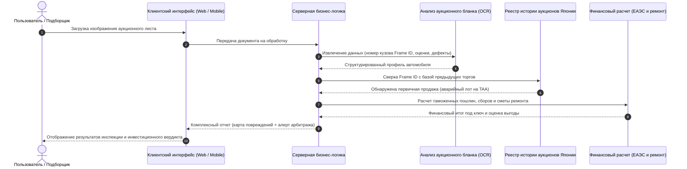

# Концептуальный отчет: Методология дефектоскопии, регламент разработки и выбор бренда AuctionCalc

> **Версия отчета:** 2.1-Lean  
> **Статус:** Концептуально-методологический отчет (Methodology & Strategic Planning Report)  
> **Язык отчета:** Русский  
> **Стандарты оформления:** Diátaxis Framework, Google Developer Style, Simplified Technical English (STE)

---

## Аннотация

Настоящий отчет формализует концептуальные и процессные основы проекта **AuctionCalc** для этапа высокоуровневого планирования:

1. **Методология кросс-аукционной дефектоскопии:** Исследование феномена аукционного арбитража в Японии, сопоставление строгости инспекций различных аукционных домов (TAA против USS/JU) и алгоритмическая концепция выявления скрытого ремонта по номеру кузова (`Frame ID`).
2. **Методология скоростной разработки (Rapid Engineering):** Фазово-шлюзовая модель реализации проекта в рамках соревновательного спринта (29 часов: с 10:00 13 ноября до защит в 15:00 14 ноября), почасовой регламент движения команды по официальной программе, распределение ролей (RACI), превентивное управление рисками и правила код-фриза в 13:00.
3. **Анализ номенклатуры и позиционирования бренда:** Сравнительный анализ шорт-листа из 8 вариантов названий (*TrueLot, AucLens, TrueCost, GradeR, GreenLot, Kantei, MiruCar, YokoScan*) и регламент командного выбора на старте проекта.

---

## Концептуальная последовательность обработки данных

---

## Состав документов раздела

Материалы сгруппированы в четыре специализированных документа:

### [Том 1. Методология кросс-аукционной дефектоскопии и выявления арбитража лотов](./01_CROSS_AUCTION_ANOMALY_DETECTION.md)
* Теоретические основы и эконометрика аукционного арбитража на японских торгах (миграция лотов со строгих аукционов на потоковые);
* Сравнительный индекс строгости инспекций (TAA, Honda AA, CAA, USS, JU, Mirive);
* Концепция извлечения и нормализации уникального номера кузова (`Frame ID`);
* Каскадная модель классификации расхождений (уровни `CRITICAL`, `WARNING`, `INFO`) и принципы визуального предупреждения покупателя.

### [Том 2. Регламент соревновательного спринта: 29 часов до защиты (13–14 ноября)](./02_RAPID_DEVELOPMENT_METHODOLOGY.md)
* Фазово-шлюзовая модель (Phase-Gate Lifecycle) с критериями контроля качества;
* Почасовой регламент выполнения задач на Фазах 0–4 с привязкой к официальной сетке хакатона;
* Матрица распределения ответственности (RACI) на 4 участников команды;
* Стратегия снижения рисков, код-фриз в 13:00 и критерии приемки продукта (Definition of Done).

### [Том 3. Анализ номенклатуры и вариантов наименования продукта](./03_PRODUCT_NOMENCLATURE_ANALYSIS.md)
* Контекст формирования бренда и векторы позиционирования (продуктовый, технологический, региональный);
* Сравнительный качественный анализ 8 кандидатов шорт-листа;
* Группировка вариантов по стратегическим фокусам восприятия;
* Регламент командного голосования на стартовой сессии хакатона.

### [Том 4. Стартовый чеклист разработки](./04_PRE_IMPLEMENTATION_CHECKLIST.md)
* Стартовые ресурсы: эталонная пара листов Corolla Touring, ключи API и шаблоны окружения;
* Контрольные точки согласования границ и финансовых параметров на Фазе 0;
* Чеклист финальной валидации демонстрационного стенда и отказоустойчивости.

---

## Взаимосвязь с другими разделами проекта

- **Отраслевое исследование:** [research/README.md](../research/README.md) (Макроэкономика, таможенная нормативная база, дефектоскопия кузова, реестр аукционов).
- **Продуктовая спецификация:** [docs/PRODUCT_SPECIFICATION.md](../docs/PRODUCT_SPECIFICATION.md) (УТП, воронка конверсии, матрица скоринга, монетизация).
- **Дизайн-система интерфейса:** [docs/DESIGN.md](../docs/DESIGN.md) (Типографика, цветовые токены, интерактивные состояния).
