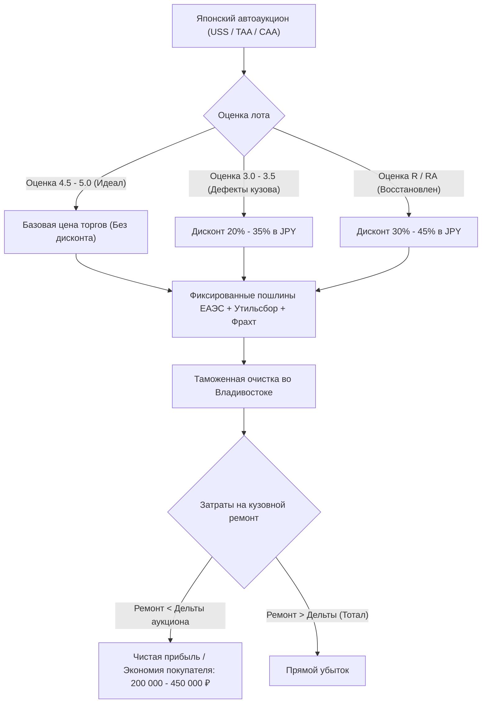
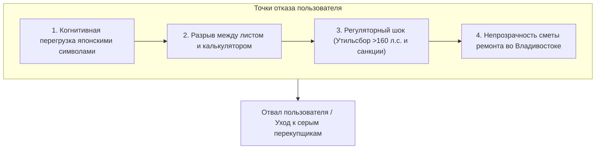

# Том 1. Макроэкономика импорта, арбитраж аукционных лотов и анализ конкурентной среды

> **Классификация документа:** Исследовательский отчет (Explanation & Reference).  
> **Предмет исследования:** Экономическая модель импорта бывших в употреблении легковых транспортных средств из Японии через таможенный пост Морской порт Владивосток.  
> **База данных:** Рыночные показатели 2024–2026 гг., аукционная статистика USS/TAA, аудит 12 операторов Владивостока.

---

## Аннотация

В отчете исследована экономическая механика ценообразования при импорте автомобилей из Японии в Россию через Владивосток. Проанализирован дисконт на автомобили с аукционными оценками `3.0`, `3.5` и `R` относительно лотов в идеальном состоянии (`4.5–5.0`). Построена экономическая модель арбитражного спрэда. Проведен аудит существующих цифровых калькуляторов, брокерских систем и 12 ведущих компаний-импортеров Владивостока. Выявлены критические точки потребительского трения (UX Friction), искажающие расчет себестоимости под ключ.

---

## 1. Макроэкономический контекст и модель аукционного арбитража

Импорт легковых автомобилей с аукционов Японии через порт Владивосток сохраняет статус базового канала снабжения Дальнего Востока и Сибири иностранной автотехникой. В условиях санкционных ограничений METI Японии и прогрессивного роста ставок утилизационного сбора РФ структура маржинальности импорта сместилась в сторону лотов с устранимыми кузовными дефектами.

### 1.1. Математика дисконта и фиксированные издержки

На японских аукционах разница в цене продажи между идеальным автомобилем (оценка `4.5–5.0`) и автомобилем с кузовными замечаниями (оценка `3.0–3.5` или `R`) составляет от 20% до 40% в японских иенах (JPY).

Ключевой фактор экономической эффективности: таможенная пошлина ЕАЭС, утилизационный сбор РФ, портовые сборы и морской фрахт детерминированы параметрами силовой установки (рабочий объем, мощность, возраст) и физическими габаритами ТС. Они не зависят от итоговой цены лота на аукционе. Весь дисконт аукциона трансформируется в чистую экономию покупателя при соблюдении условия:

> **Условие арбитражной эффективности:**  
> **Смета_ремонта** < **Разница_цены_выкупа_JPY** × **Курс_JPY**

Где:
* **Разница_цены_выкупа_JPY** — разница цены выкупа лота 4.5 и лота 3.5 на аукционе в иенах;
* **Курс_JPY** — эффективный коммерческий курс покупки иены с учетом банковской комиссии за перевод;
* **Смета_ремонта** — полная себестоимость устранения кузовных дефектов во Владивостоке.

---

### 1.2. Сквозная формула себестоимости под ключ

Полная себестоимость автомобиля под ключ во Владивостоке рассчитывается по формуле:

> **Итоговая стоимость (RUB)** = (Ставка_JPY + Расходы_Япония) × Курс_JPY + Фрахт + Пошлина_EUR × Курс_EUR + Таможенный_сбор + Утильсбор + Портовые_расходы + Смета_ремонта + Комиссия_брокера

Где составляющие включают:
* **Ставка_JPY** — аукционная цена выкупа автомобиля в Японии в иенах;
* **Расходы_Япония** — аукционный сбор и расходы по Японии (доставка в порт, снятие с учета, радиационный контроль, экспортный сертификат): 70 000 – 110 000 JPY;
* **Фрахт** — морская перевозка Япония → Владивосток: 800 – 1 500 USD в рублях по курсу оплаты;
* **Пошлина_EUR** — единая таможенная ставка пошлины ЕАЭС (в евро по курсу ЦБ РФ);
* **Утильсбор** — утилизационный сбор по ставкам ПП РФ № 1255 и № 1713;
* **Портовые_расходы** — терминальный комплекс Владивостока (СВХ, выгрузка, экспертиза, СБКТС, ЭПТС);
* **Смета_ремонта** — расчетная стоимость устранения дефектов (запчасти + работы);
* **Комиссия_брокера** — агентское вознаграждение за сопровождение во Владивостоке.

Чистый экономический эффект выкупа дефектного лота (**Чистая_выгода**) относительно среднерыночной цены целого аналога на классифайдах РФ (**Рыночная_цена**) равен:

> **Чистая_выгода** = **Рыночная_цена** - **Итоговая_стоимость**

---

## 2. Анализ потребительского трения (UX Friction)

Изучение поведения конечных покупателей, подборщиков и региональных дилеров выявило четыре критических барьера.

### 2.1. Барьер 1: Декодирование японской аукционной нотации
Покупатель без профильного опыта не дифференцирует дефекты по степени тяжести. Царапина `A1` устраняется восстановительной полировкой за 1 500 ₽, а отметка `A3` требует рихтовки и полного перекраса элемента за 14 000 ₽. Обозначения замены деталей `XX` и вторичного окраса `W2` воспринимаются неподготовленным пользователем как признак конструктивной гибели ТС («распил»). Рукописные инспекторские замечания (скоропись кандзи и каны) не распознаются стандартными машинными переводчиками без искажения технического смысла.

### 2.2. Барьер 2: Разрыв данных (Double Data Entry)
В действующих интерфейсах пользователь открывает скан листа на японском портале, вручную выписывает параметры: дату выпуска, объем двигателя, тип трансмиссии, пробег, цену. Затем вводит те же 12 параметров в калькулятор брокера. Ошибка в определении возраста автомобиля на 1 день (переход границы 5 лет) увеличивает таможенную пошлину в 1.5–2 раза.

### 2.3. Барьер 3: Регуляторная непрозрачность 2024–2026 гг.
Большинство калькуляторов не учитывают критические изменения законодательства:
1. Ограничение мощности 160 л.с. (ПП РФ № 1713 от 01.11.2025): непреднамеренный расчет мощного легкового автомобиля по льготному утильсбору 5 200 ₽ вместо коммерческого тарифа 1 200 000 ₽ создает кассовый разрыв.
2. Санкции METI Японии: расчет логистики гибрида или мотора свыше 1.9 л по стандартному прямому фрахту вместо параллельного транзита через третьи страны занижает смету на 2 500 – 4 000 USD.

---

## 3. Сравнительный анализ существующих цифровых решений

| Категория | Представители | Время ответа | Расчет таможни | Расчет ремонта | Сильные стороны | Системные дефекты |
| :--- | :--- | :--- | :--- | :--- | :--- | :--- |
| **Специализированные архивы статистики** | **Aleado.ru** | 20–60 мин | Базовый | Отсутствует | Архив лотов за 15 лет, ручной перевод экспертами | Платный доступ, нет мобильной адаптации, ночной простой во время торгов |
| **Брокерские порталы** | **Pravto.ru, Carvector** | 1–4 часа | Полный | Отсутствует | Интеграция в полный цикл агентского договора | Закрытый сервис для клиентов, отсутствие открытого API |
| **Telegram-боты импортеров** | `@vl_broker_bot`, `@JapanLife_VL_bot` | 1–5 мин | Шаблонный | Отсутствует | Быстрый доступ в мессенджере | Ошибки на рукописном тексте, лимит 3–5 запросов в сутки, нет финансовой сметы повреждений |
| **Агрегаторы классифайдов** | **Drom.ru (Таможенный калькулятор)** | Мгновенно | Эталонный ЕАЭС | Отсутствует | Актуальные сетки пошлин, высокая точность расчета ставок РФ | Оторван от аукционных листов, не считает расходы по Японии, фрахт и ремонт |
| **Глобальные экспортные витрины** | **SBT Japan, Beforward** | Мгновенно | Отсутствует | Отсутствует | Огромный сток готовых автомобилей, расчет FOB/CIF | Не рассчитывают таможенные платежи РФ, агрессивный сбор лидов |
| **Экспериментальные OCR-сервисы** | **Auclist.ru, GPT Wrappers** | 10–30 сек | Частичный | Отсутствует | Автоматическое оптическое распознавание | Частые галлюцинации LLM на рукописных символах, отсутствие привязки к СТО Владивостока |

---

## 4. Реестр и анализ ведущих компаний-импортеров Владивостока

Исследован пул из 12 системообразующих операторов Владивостока, формирующих свыше 60% коммерческого грузопотока праворульных автомобилей через портовые терминалы региона.

| № | Компания | Web-портал | Комиссия брокера | Модель калькулятора на сайте | Инфраструктура и специфика |
| :-: | :--- | :--- | :--- | :--- | :--- |
| 1 | **Сферакар (SferaCar)** | [sferacar.ru](https://sferacar.ru) | 35 000 – 50 000 ₽ | Полнофункциональный JS-калькулятор с разделением пошлин и расходов по Японии | Федеральная сеть филиалов, собственный отдел логистики, активный медиа-канал |
| 2 | **CARWIN** | [carwin.ru](https://carwin.ru) | 30 000 – 40 000 ₽ | Детализированный калькулятор с открытой калькуляцией банковских комиссий | Старейший оператор форума Drom.ru, строгая репутация, прозрачная отчетность |
| 3 | **Priority Auto** | [priority-auto.ru](https://priority-auto.ru) | 35 000 – 50 000 ₽ | Интерактивный калькулятор с выбором валюты оплаты | Собственные стоянки временного хранения, акцент на санкционный транзит |
| 4 | **Япония Транзит** | [japantransit.ru](https://japantransit.ru) | 40 000 – 60 000 ₽ | Калькулятор под ключ с учетом доставки в регионы РФ | Крупный логистический оператор, собственный парк автовозов |
| 5 | **Japan Life** | [jplife.ru](https://jplife.ru) | 35 000 – 50 000 ₽ | Калькулятор с фильтрами санкционных категорий ТС | Офис на Морском вокзале Владивостока, экспресс-таможня |
| 6 | **Япония-Трейд** | [jptrade.ru](https://www.jptrade.ru) | 30 000 – 45 000 ₽ | Табличный калькулятор с привязкой к курсам банков Приморья | Работает с 2005 года, регулярный импорт конструкторов и распилов |
| 7 | **Worldcar** | [worldcar.ru](https://www.worldcar.ru) | 35 000 – 50 000 ₽ | Онлайн-агрегатор аукционов со встроенным калькулятором | Высокий уровень автоматизации каталога, личный кабинет клиента |
| 8 | **Антарес Авто** | [antaresjp.ru](https://antaresjp.ru) | 30 000 – 45 000 ₽ | Форма экспресс-расчета через менеджера | Прямые контракты с судоходными линиями, акцент на Южную Корею и Японию |
| 9 | **Акира Авто** | [akira-auto.ru](https://akira-auto.ru) | 30 000 – 40 000 ₽ | Параметрический калькулятор с ручным выбором ставок | Опыт работы более 15 лет, консервативная клиентская база |
| 10 | **Jalauto (Джалауто)** | [jalauto.ru](https://www.jalauto.ru) | Включена во фрахт | Транспортно-логистический калькулятор морской доставки | Судоходная компания, собственные суда-ролкеры (Ro-Ro) на линии Япония — РФ |
| 11 | **Kimura Cars** | [kimuracars.com](http://kimuracars.com) | 30 000 – 40 000 ₽ | Детальный калькулятор с разбивкой по статьям расходов | Высокая детализация дополнительных расходов на СВХ и лаборатории |
| 12 | **Правто (Pravto)** | [pravto.ru](https://pravto.ru) | 35 000 – 50 000 ₽ | Интегрированный калькулятор в аукционный терминал | Исторический первопроходец рынка интернет-доступа к японским аукционам |

---

## 5. Выводы первого тома

1. Рыночный дисконт на автомобили с оценками `3.0`, `3.5` и `R` составляет 20–40% стоимости в Японии, что формирует арбитражный потенциал в диапазоне 200 000 – 450 000 ₽ чистой прибыли после завершения ремонта.
2. Ни один из 12 действующих рыночных калькуляторов не выполняет сквозную интеграцию распознанного аукционного листа с финансовой сметой кузовного ремонта во Владивостоке.
3. Главная точка отказа пользователей существующих систем — необходимость ручного ввода 10–15 параметров из японского бланка в калькулятор с высоким риском ошибок в дате выпуска и мощности двигателя.
