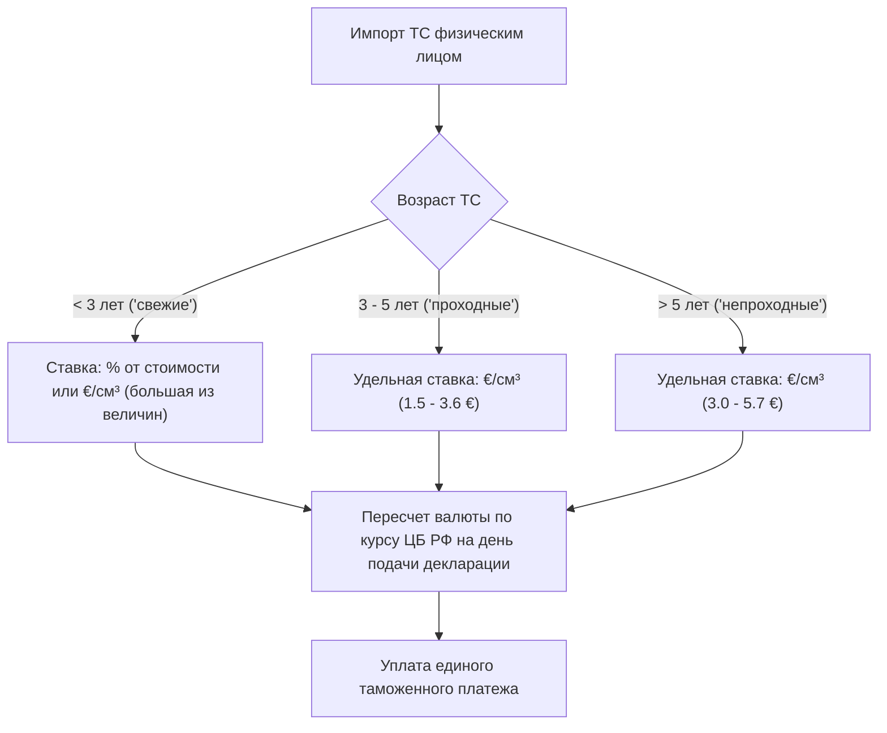
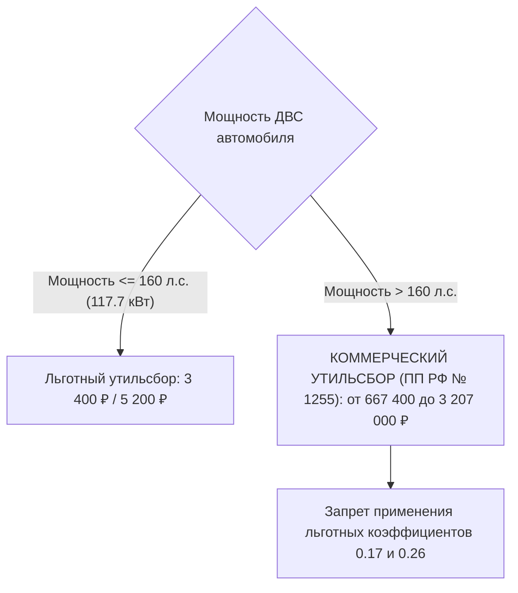
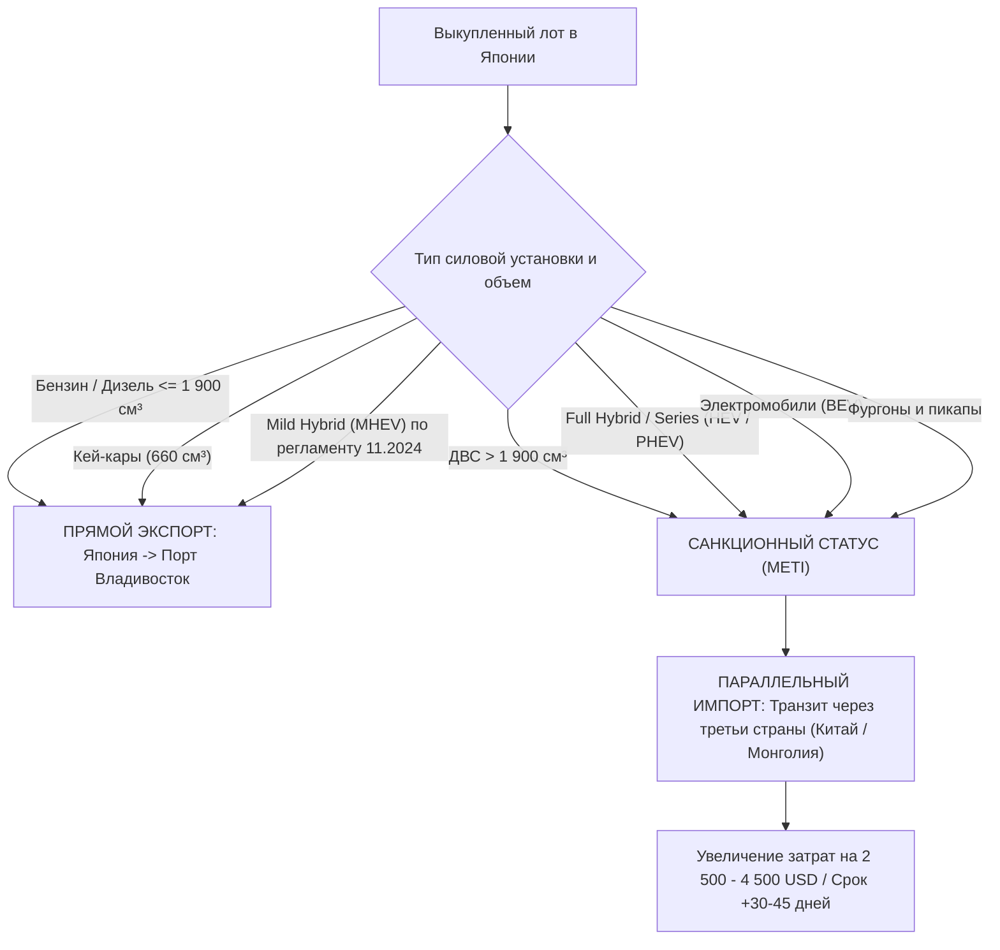
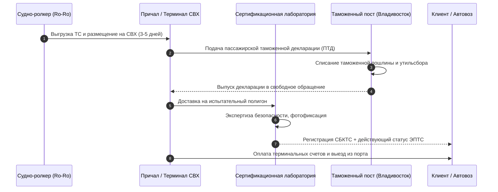

# Том 2. Нормативно-правовая база таможенного регулирования, утилизационного сбора и экспортных санкций

> **Классификация документа:** Исследовательский отчет (Reference & Explanation).  
> **Юрисдикции:** Российская Федерация, Евразийский экономический союз (ЕАЭС), Япония (METI).  
> **Статус верификации:** Нормативные акты и тарифные сетки актуальны на 2026 год.

---

## Аннотация

В отчете систематизированы нормативно-правовые акты, регулирующие импорт легковых автомобилей физическими лицами через таможенные органы РФ. Приведены формулы и математические матрицы расчета ввозных таможенных пошлин ЕАЭС, сетка утилизационного сбора по ПП РФ № 1255 и № 1713 с учетом ограничения мощности 160 л.с., регламент экспортных санкций METI Японии с правилами допуска мягких гибридов (MHEV), а также калькуляция портовых и сертификационных расходов во Владивостоке.

---

## 1. Таможенные пошлины ЕАЭС (ТК ЕАЭС, Решение Совета ЕЭК № 107)

Таможенная очистка автомобилей физическими лицами для личного пользования регламентирована Приложением № 2 к Решению Совета ЕЭК от 20.12.2017 № 107.

### 1.1. Правила определения возраста автомобиля

Возраст транспортного средства отсчитывается строго со дня его изготовления до дня подачи пассажирской таможенной декларации (ПТД):
1. **Точная дата известна:** Возраст исчисляется по формуле календарной разности дат.
2. **Известен только месяц и год:** Днем изготовления признается **15-е число** указанного месяца.
3. **Известен только год:** Днем изготовления признается **1 июля** указанного года.

> **Критический риск перехода границы 5 лет:** Если автомобилю исполнилось 5 лет и 1 день, ставка пошлины автоматически пересчитывается по запретительной категории «старше 5 лет», что увеличивает сумму платежа на 70–120%.

---

### 1.2. Автомобили возрастом от 3 до 5 лет («Проходные»)

Базовая и самая массовая категория импорта из Японии. Ставка зависит исключительно от рабочего объема цилиндров двигателя.

| Рабочий объем двигателя (см³) | Единая ставка пошлины | Пример расчета пошлины (€) | Пример расчета в рублях (при курсе 95 ₽/€) |
| :--- | :---: | :---: | :---: |
| **До 1 000 см³** (включая кей-кары 660 см³) | **1.5 €** за 1 см³ | 660 см³ × 1.5 = 990 € | 94 050 ₽ |
| **От 1 000 до 1 500 см³** | **1.7 €** за 1 см³ | 1 496 см³ × 1.7 = 2 543.2 € | 241 604 ₽ |
| **От 1 500 до 1 800 см³** | **2.5 €** за 1 см³ | 1 797 см³ × 2.5 = 4 492.5 € | 426 788 ₽ |
| **От 1 800 до 2 300 см³** | **2.7 €** за 1 см³ | 1 998 см³ × 2.7 = 5 394.6 € | 512 487 ₽ |
| **От 2 300 до 3 000 см³** | **3.0 €** за 1 см³ | 2 493 см³ × 3.0 = 7 479.0 € | 710 505 ₽ |
| **Более 3 000 см³** | **3.6 €** за 1 см³ | 3 456 см³ × 3.6 = 12 441.6 € | 1 181 952 ₽ |

---

### 1.3. Автомобили возрастом старше 5 лет («Непроходные»)

Тарифная сетка носит заградительный фискальный характер.

| Рабочий объем двигателя (см³) | Единая ставка пошлины | Пример расчета пошлины (€) | Пример расчета в рублях (при курсе 95 ₽/€) |
| :--- | :---: | :---: | :---: |
| **До 1 000 см³** | **3.0 €** за 1 см³ | 660 см³ × 3.0 = 1 980 € | 188 100 ₽ |
| **От 1 000 до 1 500 см³** | **3.2 €** за 1 см³ | 1 496 см³ × 3.2 = 4 787.2 € | 454 784 ₽ |
| **От 1 500 до 1 800 см³** | **3.5 €** за 1 см³ | 1 797 см³ × 3.5 = 6 289.5 € | 597 503 ₽ |
| **От 1 800 до 2 300 см³** | **4.8 €** за 1 см³ | 1 998 см³ × 4.8 = 9 590.4 € | 911 088 ₽ |
| **От 2 300 до 3 000 см³** | **5.0 €** за 1 см³ | 2 493 см³ × 5.0 = 12 465.0 € | 1 184 175 ₽ |
| **Более 3 000 см³** | **5.7 €** за 1 см³ | 3 456 см³ × 5.7 = 19 699.2 € | 1 871 424 ₽ |

---

### 1.4. Автомобили возрастом до 3 лет («Свежие»)

Пошлина исчисляется по комбинированной ставке в зависимости от таможенной стоимости автомобиля в евро. Подлежит уплате большая из двух величин.

| Таможенная стоимость автомобиля (EUR) | Ставка пошлины (% от стоимости) | Минимальная удельная ставка |
| :--- | :---: | :---: |
| Не превышает 8 500 € | **54%** | не менее **2.5 €** за 1 см³ |
| От 8 500 до 16 700 € | **48%** | не менее **3.5 €** за 1 см³ |
| От 16 700 до 42 300 € | **48%** | не менее **5.5 €** за 1 см³ |
| От 42 300 до 84 500 € | **48%** | не менее **7.5 €** за 1 см³ |
| От 84 500 до 169 000 € | **48%** | не менее **15.0 €** за 1 см³ |
| Превышает 169 000 € | **48%** | не менее **20.0 €** за 1 см³ |

---

### 1.5. Электромобили (BEV, код ТН ВЭД 8703 80 000 2)

Таможенная очистка электромобилей физическими лицами не подпадает под единые льготные ставки Решения Совета ЕЭК № 107. Расчет выполняется по совокупному таможенному платежу (СТП):

> **Формула совокупного таможенного платежа на электромобили (СТП):**  
> **Платеж_BEV** = **Пошлина_15%** + **Акциз** + **НДС_22%**

Где:
1. **Пошлина_15%** — 15% от декларируемой таможенной стоимости автомобиля.
2. **Акциз** — рассчитывается по прогрессивной шкале мощности электродвигателя согласно ст. 193 НК РФ (рублей за 1 л.с.).
3. **НДС_22%** — 22% от налоговой базы: (Таможенная_стоимость + Пошлина_15% + Акциз).

---

## 2. Утилизационный сбор РФ (ФЗ-89, ПП РФ № 1291, № 1255, № 1713)

Порядок уплаты регламентирован Постановлением Правительства РФ от 26.12.2013 № 1291.  
Базовая ставка для легковых автомобилей категории M1 фиксирована и составляет **20 000 ₽**.  
Сумма сбора рассчитывается по формуле:

> **Утильсбор** = **Базовая_ставка (20 000 ₽)** × **Коэффициент**

### 2.1. Льготный утильсбор для физических лиц (Личное пользование)

Применяется исключительно при одновременном соблюдении четырех условий:
1. Автомобиль ввозится физическим лицом для личных семейных нужд.
2. Автомобиль декларируется на имя ввозящего лица.
3. Право собственности сохраняется за декларантом **не менее 12 месяцев** с даты оформления ТПО.
4. **Мощность двигателя не превышает 160 л.с. (117.7 кВт)**.

| Категория возраста ТС | Коэффициент утильсбора | Сумма сбора к уплате |
| :--- | :---: | :---: |
| Автомобили возрастом **до 3 лет** | **0.17** | **3 400 ₽** |
| Автомобили возрастом **от 3 лет и старше** | **0.26** | **5 200 ₽** |

---

### 2.2. Ограничение мощности 160 л.с. (ПП РФ № 1713 от 01.11.2025)

Постановлением Правительства РФ № 1713 от 01.11.2025 введено строгое нормативное правило:

> **Правовая норма:** Если мощность автомобиля превышает 160 л.с. (117.7 кВт), применение льготных ставок 3 400 ₽ и 5 200 ₽ **законодательно запрещено**. Сбор рассчитывается исключительно по коэффициентам коммерческого тарифа (ПП РФ № 1255).

---

### 2.3. Сетка коммерческого утилизационного сбора (ПП РФ № 1255: 2024–2026 гг.)

Таблица коэффициентов и итоговых сумм коммерческого утилизационного сбора для легковых автомобилей (в рублях при базовой ставке 20 000 ₽):

| Объем цилиндров ДВС (см³) | Возраст ТС | Ставки 2024 г. (Коэфф. / Рубли) | Ставки 2025 г. (Коэфф. / Рубли) | Ставки 2026 г. (Коэфф. / Рубли) |
| :--- | :---: | :---: | :---: | :---: |
| **До 1 000 см³** | До 3 лет | 7.51 / **150 200 ₽** | 9.01 / **180 200 ₽** | 10.81 / **216 200 ₽** |
| | Старше 3 лет | 19.37 / **387 400 ₽** | 23.24 / **464 800 ₽** | 27.89 / **557 800 ₽** |
| **От 1 000 до 2 000 см³** | До 3 лет | 27.81 / **556 200 ₽** | 33.37 / **667 400 ₽** | 40.04 / **800 800 ₽** |
| | Старше 3 лет | 48.91 / **978 200 ₽** | 58.70 / **1 174 000 ₽** | 70.44 / **1 408 800 ₽** |
| **От 2 000 до 3 000 см³** | До 3 лет | 78.14 / **1 562 800 ₽** | 93.77 / **1 875 400 ₽** | 112.52 / **2 250 400 ₽** |
| | Старше 3 лет | 98.63 / **1 972 600 ₽** | 118.35 / **2 367 000 ₽** | 142.02 / **2 840 400 ₽** |
| **От 3 000 до 3 500 см³** | До 3 лет | 89.47 / **1 789 400 ₽** | 107.36 / **2 147 200 ₽** | 128.83 / **2 576 600 ₽** |
| | Старше 3 лет | 114.16 / **2 283 200 ₽** | 136.99 / **2 739 800 ₽** | 164.39 / **3 287 800 ₽** |
| **Свыше 3 500 см³** | До 3 лет | 114.26 / **2 285 200 ₽** | 137.11 / **2 742 200 ₽** | 164.53 / **3 290 600 ₽** |
| | Старше 3 лет | 133.62 / **2 672 400 ₽** | 160.35 / **3 207 000 ₽** | 192.42 / **3 848 400 ₽** |
| **Электромобили (BEV)** | До 3 лет | 33.37 / **667 400 ₽** | 33.37 / **667 400 ₽** | 40.04 / **800 800 ₽** |
| | Старше 3 лет | 58.70 / **1 174 000 ₽** | 58.70 / **1 174 000 ₽** | 70.44 / **1 408 800 ₽** |

---

### 2.4. Регламент отчуждения «Капкан 12 месяцев»

В соответствии с п. 6 Правил взимания утилизационного сбора (в ред. ПП РФ № 1255):
* В случае продажи, дарения или переоформления ТС в органах ГИБДД в течение **12 календарных месяцев** со дня таможенного оформления декларанту направляется требование ФТС об уплате недоимки.
* Сумма доначисления рассчитывается по формуле:

> **Сумма доначисления** = **Коммерческий_утильсбор** - **Ранее_уплаченный_льготный_утильсбор**

* На неуплаченную сумму начисляются пени за каждый календарный день просрочки по ставке 1/300 ключевой ставки ЦБ РФ.

---

## 3. Экспортные санкции Японии (METI Japan)

Министерство экономики, торговли и промышленности Японии (METI) 09 августа 2023 года ввело экспортные ограничения в рамках 750-й директивы.

### 3.1. Перечень запрещенных категорий ТС для прямого экспорта в РФ
1. Автомобили с бензиновыми и дизельными двигателями объемом более 1 900 см³.
2. Все гибридные автомобили (HEV, PHEV), включая параллельные гибриды (Toyota THS II) и последовательные гибриды (Nissan e-Power).
3. Все электромобили аккумуляторного типа (BEV).
4. Грузопассажирские фургоны, грузовики и пикапы (вне зависимости от объема ДВС).

### 3.2. Разрешенные категории прямого экспорта
1. Автомобили с традиционными ДВС объемом цилиндров до 1 900 см³ (включительно).
2. Кей-кары с объемом двигателя до 660 см³.
3. «Мягкие гибриды» (Mild Hybrid / MHEV) в соответствии с разъяснением METI от ноября 2024 года.

### 3.3. Разъяснение METI по мягким гибридам (Mild Hybrid) от ноября 2024 года
Японская таможня сняла запрет на оформление автомобилей с микрогибридными установками (MHEV) при соблюдении следующих технических признаков:
* В ТС используется вспомогательный 12V или 48V интегрированный стартер-генератор (ISG).
* Электродвигатель конструктивно не способен приводить автомобиль в движение исключительно на электротяге (отсутствует режим EV Mode).
* Высоковольтная тяговая батарея отсутствует.
* **Допущенные модели:** *Suzuki Solio / Swift / Hustler* (с маркировкой мотора mild hybrid), *Mazda 3 / CX-30* с установкой e-Skyactiv G, отдельные модификации *Nissan Dayz / Roox*.

---

## 4. Портовая логистика, сертификация и терминальные расходы во Владивостоке

При прибытии судна в порт Владивосток автомобиль проходит технологическую цепочку портовой перевалки, таможенного досмотра и сертификационной оценки безопасности конструкции.

### 4.1. Калькуляция сквозного портового пакета расходов (Владивосток)

Тарифы приведены на основании регламентов терминалов ПАО «ВМТП», ОАО «ВМПП» и испытательных лабораторий Приморского края:

| Статья расходов | Назначение платежа | Сумма (рубли / валюта) |
| :--- | :--- | :---: |
| **Морской фрахт (Ro-Ro)** | Морская перевозка Тояма/Майдзуру → Владивосток | **950 – 1 300 USD** (≈ 95 000 – 130 000 ₽) |
| **Таможенный сбор за оформление** | Фиксированный сбор ФТС (ПП РФ № 1637 / № 342) | **3 120 – 8 530 ₽** (в зависимости от стоимости) |
| **Терминал СВХ (Выгрузка и хранение)** | ПРР (погрузо-разгрузочные работы), досмотр, стоянка 7 суток | **35 000 – 48 000 ₽** |
| **Сверхнормативный простой СВХ** | Хранение свыше льготного периода (при задержках ПТД) | **1 500 – 2 500 ₽ / сутки** |
| **Лаборатория СБКТС + ЭПТС** | Испытания ТР ТС 018/2011, выпуск ЭПТС в базе АО «СЭП» | **30 000 – 42 000 ₽** |
| **Комиссия таможенного брокера** | Подача ПТД, представление интересов декларанта | **15 000 – 25 000 ₽** |
| **Временный учет и перегон** | Доставка автомобиля с СВХ в лабораторию и на автовоз | **5 000 – 8 000 ₽** |
| **ИТОГО сквозной бюджет порта** | Без учета таможенной пошлины и утилизационного сбора | **≈ 210 000 – 245 000 ₽** |

---

## 5. Выводы второго тома

1. Нормативная база ЕАЭС четко делит пошлины на возрастные категории, где коридор 3–5 лет является единственно экономически целесообразным для физлиц.
2. Введение отсечки 160 л.с. по ПП РФ № 1713 ликвидировало возможность льготного ввоза мощных японских автомобилей, увеличив их утильсбор в 100–300 раз.
3. Прямой экспорт санкционных ТС (гибриды, моторы свыше 1.9 л) запрещен директивами METI, что требует включения в калькулятор маршрутов параллельного импорта с надбавкой к смете в размере 2 500 – 4 500 USD.
