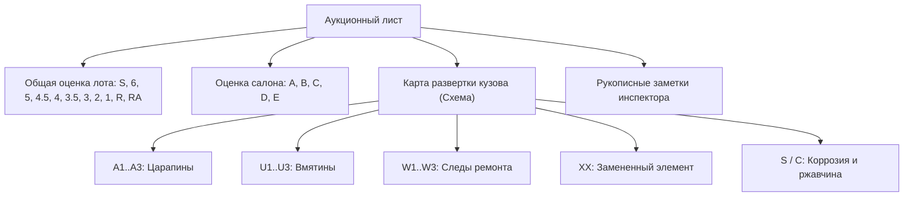
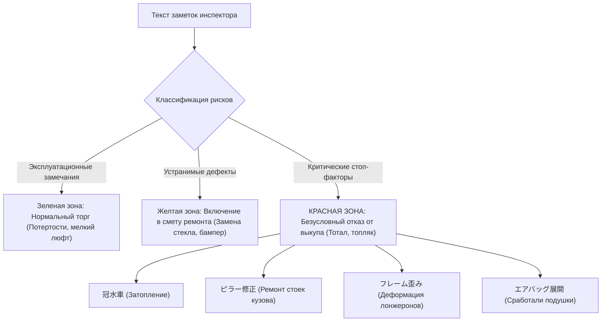

# Том 3. Методология дефектоскопии аукционных листов, лингвистический анализ и эконометрика кузовного ремонта

> **Классификация документа:** Исследовательский отчет (Explanation & Reference).  
> **Предмет анализа:** Стандарты дефектоскопии японских автоаукционов, лингвистический корпус инспекторских заметок и нормативная матрица кузовного ремонта во Владивостоке.  
> **Методы:** Компьютерное зрение (OCR/Vision), лингвистический разбор кандзи, эконометрический анализ стоимости восстановительного ремонта.

---

## Аннотация

В отчете представлена строгая классификация японских аукционных систем по индексу строгости инспекций. Систематизирована буквенно-цифровая нотация повреждений кузова с привязкой к физической глубине дефектов. Сформирован лингвистический словарь терминов инспекторских заметок и стоп-факторов конструктивной гибели ТС. Разработана экономическая модель расчета сметы кузовного ремонта во Владивостоке с использованием контрактных запчастей и нормативов СТО.

---

## 1. Систематизация аукционных домов и индекс строгости инспекций

Японский аукционный рынок неоднороден по критериям оценки лотов. Разница в регламентах инспекций формирует явление меж-аукционного арбитража: один и тот же автомобиль получает разные оценки в зависимости от площадки.

```mermaid
graph LR
    subgraph Strict ["Высокая строгость (Индекс 0.9 - 1.0)"]
        TAA["TAA (Toyota Auto Auction)"]
        HAA["Honda Auto Auction"]
        CAA["CAA (Chubu Auto Auction)"]
    end
    
    subgraph Medium ["Средняя строгость (Индекс 0.7 - 0.8)"]
        USS["USS Group (Noda / Nagoya / Yokohama)"]
        ORIX["ORIX Auto Auction"]
        ARAI["ARAI Group"]
    end
    
    subgraph Lenient ["Мягкая строгость (Индекс 0.5 - 0.6)"]
        JU["JU (Федерация дилеров Японии)"]
        Mirive["Mirive (BCB)"]
        KCAA["KCAA / Региональные залы"]
    end
    
    Strict -->|"Арбитраж: Скупка R / 3.0"| Medium
    Medium -->|"Перепродажа с завышением: Оценка 4.0"| Lenient
```

### 1.1. Классификатор аукционных систем Японии

| Аукционная группа | Объем рынка | Индекс строгости (I_strict) | Характер инспекции и специфические риски |
| :--- | :---: | :---: | :--- |
| **TAA (Toyota)** | 12% | **1.00** | Эталон рынка. Фиксируются малейшие следы окраса (`W1`), точки коррозии и минимальные царапины. Оценка `3.5` на TAA часто соответствует оценке `4.0` на USS. |
| **Honda AA** | 6% | **0.95** | Предельно строгая оценка лакокрасочного покрытия и состояния салона. Исключены лоты со скрытыми кузовными швами. |
| **CAA (Chubu)** | 8% | **0.90** | Партнер TAA. Высокая строгость проверки несущих элементов кузова (лонжероны, усилители). |
| **USS Group** | 42% | **0.75** | Крупнейший оператор. В связи с гигантским потоком (до 30 000 авто в день) осмотр занимает 5–7 минут. Возможен пропуск легких дефектов днища. |
| **ORIX / ARAI** | 10% | **0.75** | Корпоративные парки и лизинг. Прозрачная история регламентных ТО, но частый износ коммерческих салонов. |
| **JU Group** | 14% | **0.60** | Площадки ассоциаций дилеров Trade-In. Лояльный регламент. Распространен перевыставленный сток с завышением оценки на 0.5 балла. |
| **Mirive / KCAA** | 8% | **0.55** | Региональные залы. Высокая вероятность расхождения фактического состояния с бланком. Требуется обязательный кросс-аукционный аудит. |

---

## 2. Унифицированная шкала оценок и буквенно-цифровая нотация дефектов

Аукционный лист содержит комплексную оценку автомобиля, оценку интерьера и графическую карту развертки кузовных панелей.

### 2.1. Сводная шкала общей оценки лота

| Оценка | Состояние автомобиля | Пробег / Эксплуатация | Экономическая целесообразность |
| :---: | :--- | :--- | :--- |
| **S / 6** | Новый автомобиль из салона | До 5 000 км | Высокая цена, минимальный дисконт |
| **5.0** | Идеальное состояние | До 30 000 км, без следов ремонта | Переплата за состояние |
| **4.5** | Отличное состояние | До 60 000 км, единичные микроцарапины `A1` | Стандарт частного импорта без ремонта |
| **4.0** | Хорошее состояние | До 100 000 км, мелкие царапины `A2`, вмятины `U1` | Высокая ликвидность |
| **3.5** | Удовлетворительное состояние | Замечания по кузову (`A2..A3`, `W2`, `U2`), потертости | **Фокус максимального арбитража (-25% цены)** |
| **3.0** | Существенные дефекты | Глубокие вмятины, детали под замену (`X`), градобой | Требуется расчет сметы ремонта |
| **RA** | Легкий восстановительный ремонт | Замена съемных элементов без деформации силовой клетки | **Фокус арбитража (-30% цены)** |
| **R** | Аварийный автомобиль (ДТП) | Замена элементов, деформация лонжеронов, стапель | Высокий риск. Требуется проверка геометрии |
| **2.0 / 1.0**| Плохое состояние / Тотал | Следы затопления, пожар, сквозная гниль, распил | **Запрет к выкупу (Стоп-фактор)** |
| **** / 0**| Без гарантии инспекции | Снят с торгов, не заводится, сильные повреждения | Запрет к выкупу |

---

### 2.2. Матрица буквенно-цифровых обозначений дефектов кузова

| Код | Степень | Физическое описание повреждения | Технологический регламент устранения | Стоимость работ во Владивостоке |
| :---: | :---: | :--- | :--- | :---: |
| **A1** | 1 | Микроцарапина поверхностного лакового слоя (до 5 см) | Абразивная полировка детали пастой | **1 500 – 2 500 ₽** |
| **A2** | 2 | Царапина средней глубины с повреждением базовой эмали | Локальный ремонт или полный перекрас | **8 000 – 12 000 ₽** |
| **A3** | 3 | Глубокая царапина до металла/грунта более 15–20 см | Шпатлевание, грунтовка, полный перекрас | **10 000 – 14 000 ₽** |
| **U1** | 1 | Пологая вмятина размером меньше монеты (до 2–3 см) | Беспокрасочное выпрямление PDR | **1 500 – 3 500 ₽** |
| **U2** | 2 | Вмятина размером 5–15 см с заломом ребра жесткости | PDR-рихтовка с возможной подкраской | **4 000 – 7 000 ₽** |
| **U3** | 3 | Крупная вмятина более 20 см с деформацией металла | Металлообработка, споттер, перекрас | **12 000 – 18 000 ₽** |
| **W1** | 1 | Качественный заводской ремонт, визуально незаметен | Вмешательство не требуется | **0 ₽** |
| **W2** | 2 | Заметный вторичный окрас, разнотон, соринки, шагрень | Полировка или перекрас элемента при желании | **2 500 – 10 000 ₽** |
| **W3** | 3 | Грубый кустарный ремонт с толстым слоем шпатлевки | Снятие шпатлевки, рихтовка, перекрас | **14 000 – 20 000 ₽** |
| **XX** | — | Замененная кузовная деталь (крыло, дверь, капот) | Контроль геометрии проема и зазоров | **0 ₽** (если сделано качественно) |
| **X** | — | Деталь деформирована и подлежит обязательной замене | Покупка контрактной детали + окрас | **18 000 – 40 000 ₽** |
| **Y1..Y3**| 1–3 | Трещина или разрыв пластика бампера / спойлера | Пайка пластика бампера + окрас | **5 000 – 11 000 ₽** |
| **S1..S2**| 1–2 | Поверхностная ржавчина на подвеске или кромках | Пескоструйная зачистка, антикор | **4 000 – 9 000 ₽** |
| **C1..C2**| 1–2 | Сквозная коррозия, гниение порогов или арок | **Стоп-фактор.** Сварочные работы | **25 000 – 50 000 ₽** |
| **P** | — | Выгорание или отслоение прозрачного лака на солнце | Полный перекрас детали | **9 000 – 13 000 ₽** |
| **G** | — | Каменный скол на лобовом стекле | Заливка полимером или замена стекла | **2 000 – 12 000 ₽** |

---

## 3. Лингвистический корпус инспекторских заметок (Кандзи и стоп-факторы)

Рукописный блок заметок инспектора (検査員報告) содержит критическую информацию об агрегатном состоянии автомобиля, скрытых кузовных дефектах и истории аварий.

### 3.1. Словарь критических стоп-факторов (Red Flags)

При обнаружении данных иероглифов в листе покупка автомобиля категорически запрещена вне зависимости от дисконта:

| Японский термин | Транскрипция | Значение в автомобильной терминологии | Причина безусловного отказа |
| :--- | :--- | :--- | :--- |
| **冠水車 / 水没** | *Kansuisha / Suibotsu* | Автомобиль-топляк (следы затопления) | Необратимое окисление электропроводки, коррозия блоков ECU, запах тины в салоне. |
| **ピラー曲がり / 修正** | *Piraa magari / Shuusei* | Деформация или сварка центральных/передних стоек | Нарушение силовой клетки безопасности салона. Лобовое стекло трескается при движении. |
| **フレーム歪み / コアサポ** | *Fureemu hizumi / Koasapo* | Смещение геометрии лонжеронов, радиаторной рамки | Потеря курсовой устойчивости, невозможность выставить сход-развал, неравномерный жор резины. |
| **エアバッグ展開** | *Eabaggu tenkai* | Сработали подушки безопасности | Признак тяжелого фронтального или бокового удара. Высокая стоимость замены SRS. |
| **ひょう害車** | *Hyougaisha* | Автомобиль после крупного града | Сотни мелких вмятин по всей площади крыши, капота и стоек. Ремонт PDR нерентабелен. |
| **下回り酷い錆 / 腐食** | *Shitamawari hidoi sabi* | Сквозная коррозия днища и порогов | Отрыв рычагов подвески, невозможность фиксации домкрата на порогах. |

---

### 3.2. Словарь типовых эксплуатационных замечаний (Желтая зона)

| Термин | Перевод | Практическое значение во Владивостоке |
| :--- | :--- | :--- |
| **シートスレ / コゲ** | Потертость или прожог сиденья | Локальный ремонт обивки салона (2 000 – 4 000 ₽) |
| **天張り汚れ / タレ** | Загрязнение или провисание обшивки потолка | Химчистка потолка (3 000 – 5 000 ₽) |
| **飛び石** | Сколы от камней на кузове/стекле | Полировка или точечная подкраска кисточкой |
| **ドアミラー傷** | Царапины на корпусе зеркала | Локальный окрас накладки (2 000 – 3 000 ₽) |
| **ドライブシャフトブーツ破れ**| Порван пыльник ШРУСа | Замена пыльника с промывкой узла (2 500 – 4 500 ₽) |
| **オイルにじみ** | Масляное запотевание прокладки ДВС | Замена прокладки клапанной крышки (3 000 – 6 000 ₽) |

---

## 4. Экономическая модель расчета сметы кузовного ремонта во Владивостоке

Себестоимость кузовного ремонта рассчитывается на основе трудоемкости работ, стоимости расходных лакокрасочных материалов (ЛКМ) и цен контрактных автозапчастей на региональном агрегаторе *Farpost.ru / Drom Baza*.

### 4.1. Формула сметного расчета кузовного восстановления

> **Формула расчета сметы кузовного ремонта:**  
> **Смета_ремонта** = **Сумма_работ_по_деталям** + **Сумма_контрактных_запчастей** + **Финишная_полировка**

Где для каждого поврежденного элемента расчет включает:
* **Стоимость_окраса** — работа маляра по подготовке и окрасу элемента (4 500 – 6 500 ₽);
* **Стоимость_рихтовки** — выправление деформации споттером или PDR (2 000 – 7 000 ₽ по кодам A2, A3, U3);
* **Расходные_материалы_ЛКМ** — подбор эмали, грунта, лака и абразивов на деталь (3 500 – 5 000 ₽);
* **Контрактная_деталь** — цена б/у детали в цвет с авторазборок Farpost/Drom Baza (при замене по коду X или XX);
* **Монтажные_работы** — снятие, установка и подгонка зазоров (1 500 – 3 000 ₽);
* **Финишная_полировка** — финишная защитная полировка кузова после ремонта (8 000 – 15 000 ₽).

---

### 4.2. Алгоритм оптимизации сметы: ремонт против контрактной детали в цвет

При расчете сметы повреждений сервис применяет алгоритмическое правило оптимизации по типу элемента:

1. **Для съемных навесных элементов (дверь, переднее крыло, капот, крышка багажника, бампер):**
   * Система сопоставляет два сценария:
     * *Сценарий А (Восстановление):* Рихтовка + Подготовка + Окрас + ЛКМ.
     * *Сценарий Б (Замена в цвет):* Покупка контрактной детали в заводской цвет на Farpost + Монтаж.
   * **Правило выбора:** Калькулятор выбирает `мин(Стоимость_ремонта, Стоимость_детали_в_цвет)`.
   * **Экономический фактор:** Замена на контрактную деталь в заводской цвет сохраняет оригинальный слой ЛКП (100–120 мкм). Это исключает подозрения покупателя при проверке толщиномером и сохраняет максимальную ликвидность автомобиля.
2. **Для несъемных несущих элементов (заднее крыло, порог, колесная арка):**
   * Замена детали без распила кузова конструктивно невозможна.
   * Расчет выполняется строго по регламенту восстановления: локальная вытяжка, рихтовка споттером и окрас с плавным переходом по лаку (18 000 – 25 000 ₽).
3. **Для дефектов категории PDR (U1, U2 без повреждения ЛКП):**
   * Применяется беспокрасочное вакуумно-рычажное выпрямление без малярных работ (1 500 – 3 500 ₽ за элемент).

---

## 5. Сквозной инвестиционный кейс арбитража лота

Рассмотрен верифицированный расчет экономической целесообразности покупки популярного ликвидного универсала, полностью допущенного к прямому морскому экспорту из Японии без санкционных ограничений METI (чистый бензин, объем < 1.9 л, мощность < 160 л.с.):  
**Автомобиль:** *Toyota Corolla Touring W×B (кузов NRE210W, двигатель 1.2L Turbo 8NR-FTS, 116 л.с., 6MT, 2020 г.в., «проходной» возраст 3–5 лет)*.  
**Сравнение:** 
* **Вариант А (Целый):** Аукцион USS Tokyo (Лот #80215), оценка `4.5`, салон `B`, кузов `B`, пробег 44 110 км, дефекты: микроскол `A1` на бампере.
* **Вариант Б (С локальным дефектом):** Аукцион TAA Chubu (Лот #3142), оценка `3.5`, салон `C`, кузов `C`, пробег 58 240 км, дефекты: передний бампер царапина `A2`, переднее левое крыло вмятина `U2` (без излома ЛКП), водительская дверь притертость `A2`/`W1`. Техническое состояние узлов: `機関良好` (отличное).

> **Финансовый базис котировок (по данным сервиса «Деньги VL.ru» во Владивостоке):**  
> * Коммерческий курс безналичной иены (перевод в Японию через банки Приморья с учетом комиссии): **0.585 ₽ за 1 JPY** (58.50 ₽ за 100 JPY);  
> * Таможенный курс евро ЕАЭС: **95.00 ₽ за 1 EUR**;  
> * Курс доллара США (морской фрахт Ro-Ro): **85.00 ₽ за 1 USD**.

| Статья расходов | Вариант А (Оценка 4.5, целый) | Вариант Б (Оценка 3.5, под ремонт) | Дельта экономии | Примечания и нормативная база |
| :--- | :---: | :---: | :---: | :--- |
| **Аукционная ставка (Hammer Price)** | 1 420 000 JPY (≈ 830 700 ₽) | 1 060 000 JPY (≈ 620 100 ₽) | **+210 600 ₽** | Статистика USS Tokyo / TAA Chubu (дельта 360 000 JPY) |
| **Расходы по Японии (FOB)** | 95 000 JPY (≈ 55 575 ₽) | 95 000 JPY (≈ 55 575 ₽) | 0 ₽ | Аукционный сбор, доставка в порт, экспортный сертификат, радиация |
| **Морской фрахт Ro-Ro во Владивосток** | 97 750 ₽ ($1 150 по 85 ₽/$) | 97 750 ₽ ($1 150 по 85 ₽/$) | 0 ₽ | Прямой рейс Тояма/Майдзуру → Владивосток (без третьих стран) |
| **Таможенная пошлина ЕАЭС (1 196 см³)** | 193 154 ₽ (2 033.20 € по 95 ₽/€) | 193 154 ₽ (2 033.20 € по 95 ₽/€) | 0 ₽ | Ставка 1.7 €/см³ для возраста 3–5 лет (1 196 × 1.7 €) |
| **Таможенный сбор за оформление** | 3 120 ₽ | 3 120 ₽ | 0 ₽ | Фиксированная ставка ФТС РФ при стоимости ТС до 1.2 млн ₽ |
| **Утилизационный сбор РФ (116 л.с.)** | 5 200 ₽ (льготный) | 5 200 ₽ (льготный) | 0 ₽ | ПП РФ № 1291/1713: физлицо, для себя, мощность <= 160 л.с. |
| **Порт: СВХ + СБКТС + ЭПТС + Брокер** | 99 000 ₽ | 99 000 ₽ | 0 ₽ | Терминал ВМТП (38 000 ₽), лаборатория (35 000 ₽), брокер (20 000 ₽), перегон (6 000 ₽) |
| **Смета кузовного ремонта во Владивостоке**| 0 ₽ | **31 000 ₽** | -31 000 ₽ | Смета по базе Farpost: PDR крыла (4 500 ₽) + окрас бампера (14 000 ₽) + полировка двери (3 500 ₽) + арматурные работы (9 000 ₽) |
| **ИТОГО себестоимость под ключ** | **1 284 499 ₽** | **1 104 899 ₽** | **+179 600 ₽** | Полная себестоимость на стоянке во Владивостоке со всеми документами |
| **Рыночная цена на Drom.ru во Владивостоке** | 1 520 000 ₽ | 1 520 000 ₽ | — | Средняя цена Corolla Touring W×B 2020 г.в. без пробега по РФ в наличии |
| **Чистая прибыль / Экономия инвестора** | **+235 501 ₽** | **+415 101 ₽** | **+179 600 ₽** | **Эффект арбитража: рост чистой выгоды в 1.76 раза** |

---

### 5.1. Анализ сметы локального ремонта по Farpost Владивосток (Лот Б)

Все повреждения Лота Б классифицированы инспекцией как поверхностные дефекты навесных элементов без затрагивания силового каркаса (`A2`, `U2`, `A2/W1`):
1. **Переднее левое крыло (`U2`):** дефект представляет собой плавную вмятину диаметром до 8 см без нарушения лакокрасочного слоя. Применяется технология беспокрасочного выпрямления **PDR** (Paintless Dent Repair). Стоимость работ во Владивостоке: **4 500 ₽** (срок 2–3 часа, сохраняется 100% заводской окрас).
2. **Передний бампер (`A2`):** локальная царапина пластика до 12 см с задиром внешнего лакового слоя. Восстановление: снятие/разборка, локальная полимерная шпатлевка пластика, грунтовка, точечный окрас с переходом по лаку и полировка: **14 000 ₽**.
3. **Водительская дверь (`A2/W1`):** продольная царапина верхнего слоя лака без повреждения базовой эмали. Устраняется глубокой абразивной полировкой пастами Menzerna/Koch Chemie с нанесением керамического силанта: **3 500 ₽**.
4. **Арматурные и расходные работы:** частичный демонтаж подкрылка, крепежные клипсы, подбор краски по коду `070` (White Pearl Crystal Shine): **9 000 ₽**.

> **Экономический вывод арбитража:** инвестиция **31 000 ₽** в локальный восстановительный ремонт во Владивостоке позволяет сэкономить **210 600 ₽** на аукционной стоимости покупки в Японии, обеспечивая инвестору **чистую дельту доходности +179 600 ₽** при абсолютной юридической чистоте и отсутствии санкционных рисков третьих стран.

---

## 6. Выводы третьего тома

1. Аукционная оценка `3.5` генерирует максимальную доходность арбитража, снижая цену выкупа в Японии на 30–35% при затратах на локальный ремонт не более 35 000 – 50 000 ₽.
2. Компьютерное зрение и OCR должны фокусироваться на сопоставлении меток карты кузова со словарем стоп-факторов рукописных заметок для отсева скрытых тоталов.
3. Интеграция с базой запчастей Владивостока позволяет заменять поврежденные детали категории `X` и `XX` оригинальными контрактными элементами без увеличения общего бюджета ремонта.
