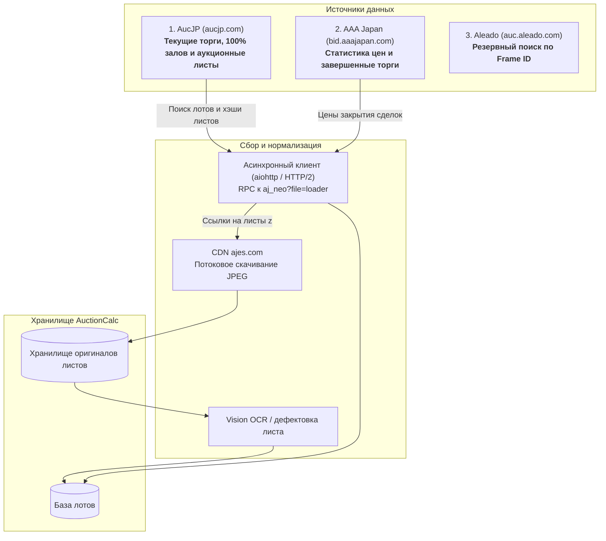
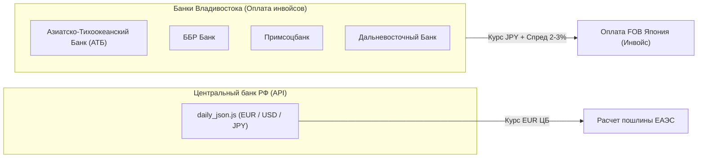

# Том 4. Реестр инфраструктурных шлюзов, первичных источников и нормативно-правовых актов

> **Классификация документа:** Справочник и реестр источников (Reference & Specification).  
> **Назначение:** Каталогизация внешних API, аукционных систем, финансовых каналов, портовой логистики и нормативной базы для интеграции в программные модули `AuctionCalc`.  
> **Статус верификации:** Все URL-адреса, протоколы и реквизиты законов проверены на актуальность.

---

## 1. Японские оригинальные автоаукционы

Прямые шлюзы доступа к торговым площадкам, аукционным каталогам и закрытым терминалам ставок:

| Аукционная группа | Специализация и масштаб | Открытый портал / Инфо (Live) | Терминал для участников / Ставки (B2B) |
| :--- | :--- | :--- | :--- |
| **USS Group (Used Car System Solutions)** | Крупнейшая сеть (~40% рынка Японии, 19 залов). Базовые терминалы: Tokyo (Noda), Nagoya, Yokohama, Osaka. | [ussnet.co.jp (Portal)](https://www.ussnet.co.jp/) [ussnet.co.jp/en (English)](https://www.ussnet.co.jp/en/index.html) [uss-group.com (Holding)](https://www.uss-group.com/en/) | [ussnet.co.jp/member](https://www.ussnet.co.jp/) |
| **TAA (Toyota Auto Auction)** | Аукционная сеть концерна Toyota. Высочайшая строгость инспекций. Kanto, Chubu, Kansai, Kyushu, Hiroshima. | [toyota-usec.co.jp (Организатор)](https://www.toyota-usec.co.jp/) | [taacaa.jp (Система TC-webΣ)](https://taacaa.jp/) |
| **CAA (Chubu Auto Auction)** | Стратегический партнер Toyota. Площадки: Tokyo, Chubu, Gifu, Tohoku. | [caanet.jp (Официальный сайт)](https://caanet.jp/) | [taacaa.jp (Система TC-webΣ)](https://taacaa.jp/) |
| **JU (Japan Used Car Dealers Association)** | Федерация дилерских ассоциаций (более 40 залов: JU Tokyo, JU Aichi, JU Fukuoka и др.). Источник trade-in лотов. | [juaa.or.jp (Федерация JU)](https://www.juaa.or.jp/) | [ju-janaito.com (B2B Терминал)](https://www.ju-janaito.com/) |
| **Honda AA (Honda Auto Auction)** | Аукционы официальных дилерских центров Honda (Tokyo, Kansai, Nagoya, Kyushu, Sendai, Hokkaido). | [honda-uc.com/auction (Honda U-TEC)](https://www.honda-uc.com/auction/) | [honda-uc.com (H@Live Терминал)](https://www.honda-uc.com/auction/) |
| **ARAI (Arai Auto Auction)** | Специализация: коммерческий транспорт (Probox, Hiace), внедорожники 4WD и спецтехника. Oyama, Bayside, Sendai. | [araiaa.jp (Официальный сайт)](https://www.araiaa.jp/) [araiaa.jp/en (English Landing)](https://www.araiaa.jp/en/) | [araiaa.jp (Терминал AI-NET)](https://www.araiaa.jp/) |
| **ORIX Auto Auction (OAA)** | Лизинговый и корпоративный сток с идеальной сервисной книжкой. Atsugi, Kobe, Fukuoka. | [orixcar.jp/auto-plaza (Orix Car)](https://www.orixcar.jp/auto-plaza/) | [orixcar.jp/auto-plaza](https://www.orixcar.jp/auto-plaza/) |
| **Mirive (бывший BCB)** | Аукционы в центральной части Японии (Saitama, Aichi, Osaka). | [mirive.co.jp (Официальный сайт)](https://www.mirive.co.jp/) | [mirive.co.jp (Система M-Web)](https://www.mirive.co.jp/) |
| **Aucnet** | Старейшая система дистанционных цифровых и спутниковых онлайн-торгов без единого физического зала. | [aucnet.co.jp (Официальный сайт)](https://www.aucnet.co.jp/) | [aucnet.co.jp/car/ (Каталог)](https://www.aucnet.co.jp/car/) |
| **KCAA (Kyushu Chuo)** | Крупнейшая региональная сеть острова Кюсю (Fukuoka, Minami-Kyushu, Yamaguchi). | [kcaa.co.jp (Официальный сайт)](https://www.kcaa.co.jp/) | [kcaa.co.jp (K-NET)](https://www.kcaa.co.jp/) |
| **LAA (Light Auto Auction)** | Сеть аукционов западной Японии (Kansai, Shikoku, Okayama). | [laa-group.com (Официальный сайт)](https://www.laa-group.com/) | [laa-group.com (LAA-NET)](https://www.laa-group.com/) |
| **ZIP (ZIP Auto Auction)** | Специализированные торги импортных европейских и редких автомобилей в Токио и Осаке. | [zipco.co.jp (Портал ZIP-NET)](https://www.zipco.co.jp/) | [zipco.co.jp (ZIP-NET)](https://www.zipco.co.jp/) |
| **AS-NET (Auto Server Gateway)** | Единый B2B-шлюз и межсетевой агрегатор (доступ к лотам USS, TAA, CAA, JU в одном окне). | [asnet.jp (Прямой вход в систему)](https://www.asnet.jp/asnet/authentication/login) | [asnet.jp/asnet/authentication/login](https://www.asnet.jp/asnet/authentication/login) |
| **Yahoo! Auctions Japan** | Главная C2C/B2C онлайн-площадка битых машин, аварийных лотов и контрактных машинокомплектов. | [auctions.yahoo.co.jp (Раздел Авто)](https://auctions.yahoo.co.jp/category/list/26318/) | [auctions.yahoo.co.jp](https://auctions.yahoo.co.jp/) |

> [!NOTE] Прямое подключение к аукционам может не открываться
---

## 2. Источники данных для парсинга лотов и аукционных листов

**Главный вывод (BLUF):** Для сбора текущих лотов и аукционных листов используем `aucjp.com`. Сайт агрегирует 100% аукционных площадок Японии (122 зала, около 70 000 машин в неделю). В отличие от головного сервиса Aleado, площадка отдает оригиналы аукционных листов бесплатно и без лимитов на просмотры.

### Сравнение источников

| Параметр | 1. AucJP ([aucjp.com](https://aucjp.com/)) | 2. AAA Japan ([aaajapan.com](https://aaajapan.com/)) | 3. Aleado ([aleado.com](https://aleado.com/)) |
| :--- | :--- | :--- | :--- |
| **Основной URL** | `https://aucjp.com/japan` | `https://bid.aaajapan.com/st?classic` | `https://auc.aleado.com/auctions` |
| **Роль в проекте** | **Основной источник:** активные лоты, характеристики, оригиналы листов. | **Статистика продаж:** калибровка цен закрытия и дисконтов за повреждения. | **Резервный архив:** точечная ручная проверка истории авто по номеру кузова. |
| **Охват аукционов** | 100% рынка Японии: 122 площадки (USS, TAA, CAA, JU, Honda, NAA, ORIX). | Крупные залы: USS, TAA, CAA, JU, ARAI. | 100% рынка Японии (первоисточник базы). |
| **Доступ к листам** | Бесплатный, прямой доступ к CDN без водяных знаков. | Открытый просмотр части листов, есть фото с площадки. | Платный просмотр листов по счетчику, гостевой доступ закрыт. |
| **Защита от ботов** | WAF, Cloudflare и капчи отсутствуют. Простой Nginx. | Базовая защита по заголовкам, работает через стандартные прокси. | Закрытые сессии, WebSocket Centrifugo, бан за частые запросы. |
| **Формат отдачи** | Внутренний AJAX RPC (массив JavaScript/JSON). | Серверный HTML. | Серверный HTML с редиректами. |

---

### Факты и параметры интеграции с AucJP (`aucjp.com`)

1. **Архитектура платформы**
   * Работает на движке Aleado (`avto.jp`). База данных синхронизируется с японским шлюзом ASNET.
   * Кодировка страниц и ответов: строго `windows-1251` (CP1251). Любой сетевой клиент обязан декодировать ответы в этой кодировке.
   * Активный объем лотов: 65 000–75 000 автомобилей еженедельно. Торги идут с понедельника по субботу.

2. **Протокол выдачи данных**
   * Поисковый запрос отправляется методом `POST` на эндпоинт `https://aucjp.com/aj_neo?file=loader&Q={model}&ajx={id}-form`.
   * Тело запроса требует формат `multipart/form-data` и обязательное проверочное поле формы:
     `lose_time_here_buT_not_buy_servlce_for_100_usd_monthly_here_http_avto_jp = http://avto.jp/specification.html`.
   * Параметр `list_size = 50` увеличивает выдачу на одну страницу с 20 до 50 лотов. Это сокращает число запросов к каталогу до ~1 400 на всю Японию.

3. **Режимы доступа к лотам**
   * **Гостевой режим (без авторизации):** открывает ~60% лотов. Карточки доступны по прямым ссылкам `https://aucjp.com/aj-{token}.htm`.
   * **Авторизованный режим (бесплатный аккаунт):** открывает 100% лотов. В ответе поиска поле `z` сразу содержит хэш аукционного листа. Это исключает необходимость переходить на отдельные страницы каждого авто.
   * Авторизация выполняется отправкой формы на `https://aucjp.com/set` (`username`, `password`, `is_login=1`, `ref=aj_neo`). Сессия сохраняется в стандартных cookies.

4. **Хранилище аукционных листов и фотографий**
   * Изображения физически лежат на серверах CDN `ajes.com`.
   * Запрос к `https://8.ajes.com/imgs/{hash}` возвращает HTTP `302 Found` и перенаправляет на ноды `10.ajes.com`–`14.ajes.com`.
   * Итоговый файл: полноразмерный JPEG (~200–300 КБ) без сжатия и без водяных знаков.
   * Клиент скачивает лист обычным `GET`-запросом с поддержкой редиректов. Заголовки авторизации и Referer для картинок не требуются.

---

### Требования к реализации парсера

* **Сетевой клиент:** Асинхронный стек `aiohttp` или `httpx` с поддержкой HTTP/2. Синхронный `requests` не использовать из-за блокирующего ввода-вывода и отсутствия HTTP/2.
* **Пул загрузки изображений:** Очередь `asyncio.Queue` и пул из 30–50 воркеров с семафором. Это защищает от превышения лимита дескрипторов и отдачи ошибок 429 со стороны CDN.
* **Сохранение на диск:** Асинхронный потоковый стриминг чанками через `aiofiles` без удержания файлов в оперативной памяти.

---

## 3. Дополнительные российские аналитические агрегаторы и таможенные порталы

| Платформа | URL-адрес | Функционал для сопоставления данных |
| :--- | :--- | :--- |
| **Pravto.ru** | [pravto.ru](https://pravto.ru) | Поиск лотов по кузовам и годам, архив ставок, русифицированный каталог аукционов. |
| **Drom.ru Аукционы** | [auto.drom.ru/deals/auctions/](https://auto.drom.ru/deals/auctions/) | Каталог текущих лотов на Дроме, подбор по кодам кузовов, статистика цен в РФ. |
| **Drom Таможня** | [drom.ru/customs/cartable.html](https://www.drom.ru/customs/cartable.html) | Бенчмарк-калькулятор таможенных платежей физических лиц. |
| **TKS.ru (Таможня)** | [tks.ru/auto/calc/](https://www.tks.ru/auto/calc/) | Профессиональный таможенный калькулятор с нормативными сносками ТН ВЭД. |

---

## 4. Финансовые шлюзы, курсы валют и банки Владивостока

Таможенные платежи РФ исчисляются в евро по курсу ЦБ РФ, а оплата аукционных инвойсов в Японию осуществляется в японских иенах через уполномоченные банки Дальнего Востока.

### 4.1. Спецификация API Центрального Банка РФ
* **Официальный JSON API:** `https://www.cbr-xml-daily.ru/daily_json.js`
* **Официальный XML сервис ЦБ:** `https://www.cbr.ru/scripts/XML_daily.asp`
* **Периодичность обновления:** Ежедневно в 11:30 по московскому времени (кроме выходных).
* **Или сервис VL.RU Деньги:** `https://www.vl.ru/dengi/`
* **Контролируемые валютные пары:**
  * `Valute.EUR`: курс евро для расчета таможенных пошлин ЕАЭС.
  * `Valute.JPY`: номинальный курс японской иены (за 100 иен).
  * `Valute.USD`: курс доллара США для пересчета морского фрахта.

### 4.2. Реестр банков Владивостока для международных расчетов в JPY
1. **Азиатско-Тихоокеанский Банк (АТБ):** [atb.su](https://www.atb.su) | Прямые корреспондентские счета в иенах, переводы в японские банки.
2. **ББР Банк:** [bbr.ru](https://bbr.ru) | Специализированный валютный оператор для автоимпортеров Приморского края.
3. **Примсоцбанк:** [pskb.com](https://pskb.com) | Обслуживание физических лиц и брокеров, конверсионные операции JPY/RUB.
4. **Дальневосточный Банк (ДВБ):** [dvbank.ru](https://www.dvbank.ru) | Валютный контроль внешнеторговых контрактов.

---

## 5. Морские перевозчики и портовые терминалы СВХ во Владивостоке

### 5.1. Судоходные линии (Морской фрахт)
* **SLK (Си Лайн Контейнер):** [slk.su](https://slk.su) — регулярные ролкерные рейсы (Ro-Ro) из портов Тояма, Майзуру, Отару.
* **FESCO (Транспортная группа FESCO):** [fesco.ru](https://fesco.ru) — морские перевозки автотехники в контейнерах и судами Ro-Ro.
* **Carbo (Карбо Шиппинг):** [carbo.ru](https://carbo.ru) — чартерные рейсы под автоимпорт из портов Японии.

### 5.2. Терминалы складов временного хранения (СВХ)
1. **ПАО «Владивостокский морской торговый порт» (ВМТП):** [vmtp.ru](https://vmtp.ru) | Крупнейший терминал порта. Высокая пропускная способность, автоматизированная выдача пропусков.
2. **ОАО «Владивостокский морской рыбный порт» (Владморрыбпорт):** [fishport.ru](https://fishport.ru) | Специализированные причалы перевалки колесной техники.
3. **ОАО «Владивостокский морской пассажирский порт» (ВМПП):** [vmpp.ru](https://vmpp.ru) | Быстрая выгрузка судов Ro-Ro в центре города.
4. **АО «Центр судоремонта „Дальзавод“» (СВХ Дальзавод):** [dalzavod.ru](https://dalzavod.ru) | Причальный фронт для накопления и таможенного досмотра автопартий.

---

## 6. Органы оценки соответствия и государственные реестры

| Институт / Система | Портал / Реестр | Назначение |
| :--- | :--- | :--- |
| **АО «Электронный паспорт» (СЭП)** | [elpts.ru](https://elpts.ru) | Федеральная государственная база электронных паспортов транспортных средств (ЭПТС). Проверка действующего статуса паспорта перед постановкой на учет в ГИБДД. |
| **Реестр аккредитованных лабораторий** | [fsa.gov.ru](https://pub.fsa.gov.ru/ral) | Национальная база Федеральной службы по аккредитации (Росаккредитация). Проверка легитимности лаборатории выдачи СБКТС. |
| **ИЛ «Проммаш Тест» (Владивосток)** | [prommash-test.ru](https://prommash-test.ru) | Испытательная лаборатория безопасности конструкции колесных ТС (ТР ТС 018/2011). |
| **ИЛ «Тест-Спб» (Филиал ДВ)** | [test-spb.ru](https://test-spb.ru) | Оформление свидетельств БКТС на правый руль. |
| **ИЛ «Элмас»** | [elmas.su](https://elmas.su) | Лабораторные замеры шума, тормозной динамики, проверка русификации оптики. |

---

## 7. Каталоги контрактных деталей, дубликатов и авторемонт (Владивосток)

* **[Farpost.ru — Автозапчасти](https://www.farpost.ru/vladivostok/auto/packs/):** Главный классифайд и база контрактных запчастей Дальнего Востока. Поиск кузовных элементов в цвет по номеру кузова (`Frame ID`).
* **[Drom.ru — База автозапчастей](https://baza.drom.ru/vladivostok/):** Крупнейший федеральный маркетплейс б/у и новых деталей.
* **[Japancar.ru](https://www.japancar.ru):** Исторический каталог контрактных двигателей, трансмиссий и кузовщины во Владивостоке.
* **[Amayama.com](https://www.amayama.com):** Оригинальные каталоги OEM-запчастей Японии (Toyota, Nissan, Honda, Subaru, Mazda) с взрыв-схемами узлов.

---

## 8. Полный свод первичных нормативно-правовых актов

1. **Таможенный кодекс ЕАЭС:** Приложение № 1 к Договору о ТК ЕАЭС. Статьи 266–271 (Особенности перемещения товаров для личного пользования).
2. **Решение Совета ЕЭК от 20.12.2017 № 107:** «Об отдельных вопросах, связанных с товарами для личного пользования». Приложение № 2 (Единые ставки таможенных пошлин).
3. **Федеральный закон от 24.06.1998 № 89-ФЗ:** «Об отходах производства и потребления». Статья 24.1 (Утилизационный сбор).
4. **Постановление Правительства РФ от 26.12.2013 № 1291:** «Об утилизационном сборе в отношении колесных транспортных средств».
5. **Постановление Правительства РФ от 13.09.2024 № 1255:** «Об утверждении коэффициентов утилизационного сбора на период 2024–2030 гг.».
6. **Постановление Правительства РФ от 01.11.2025 № 1713:** «О внесении изменений в критерии применения льготного утилизационного сбора для физических лиц (введение ограничения мощности 160 л.с.)».
7. **Постановление Правительства РФ от 26.03.2020 № 342:** «О ставках и базе для исчисления таможенных сборов за совершение таможенных операций».
8. **Технический регламент ТР ТС 018/2011:** «О безопасности колесных транспортных средств» (Порядок оформления СБКТС).
9. **Директива Министерства экономики, торговли и промышленности Японии (METI):** Экспортный регламент от 09.08.2023 (Пакет запрета гибридов и двигателей свыше 1.9L) и Разъяснение METI от 08.11.2024 по допуску ТС категории Mild Hybrid (MHEV).
