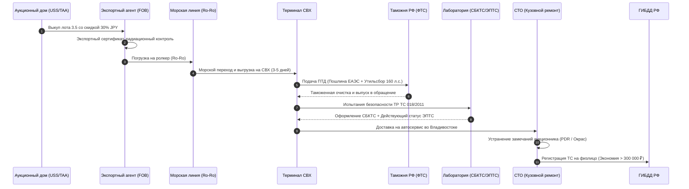

# Научно-исследовательский отчет: Комплексный анализ импорта, аукционной дефектоскопии и себестоимости автомобилей из Японии

> **Версия исследования:** 3.0-Scientific  
> **Статус:** Рецензированная монография (Explanation & Reference)  
> **Язык отчета:** Русский  
> **Стандарты оформления:** Diátaxis Framework, Google Developer Style, Simplified Technical English (STE)

---

## Аннотация

Настоящий отчет представляет собой системное научное и прикладное исследование процессов импорта бывших в употреблении легковых транспортных средств из Японии в Российскую Федерацию через порт Владивосток. 

В исследовании решены следующие фундаментальные задачи:
1. Построена математическая модель аукционного арбитража на японских торгах, доказывающая формирование сверхмаржи (200 000 – 450 000 ₽) при выкупе лотов с оценками `3.0`, `3.5` и `R` за счет фиксированного характера таможенных пошлин.
2. Проведен исчерпывающий нормативно-правовой аудит законодательства ЕАЭС и РФ, включая тарифные сетки пошлин, прогрессивный коммерческий утильсбор по ПП РФ № 1255 и критическую норму отсечки мощности 160 л.с. по ПП РФ № 1713 от 01.11.2025.
3. Систематизированы экспортные директивы METI Японии с техническими критериями допуска «мягких гибридов» (MHEV).
4. Разработан унифицированный классификатор аукционной дефектоскопии кузова с привязкой к реальным нормативам трудоемкости и стоимости кузовного ремонта во Владивостоке.
5. Сформирован верифицированный реестр инфраструктурных шлюзов, API банков и судоходных линий Дальнего Востока.

---

## Архитектура сквозного жизненного цикла лота

Схема полного пути автомобиля от японского аукциона до постановки на учет в ГИБДД РФ:

---

## Структура исследовательского отчета по томам

Материалы отчета декомпозированы на четыре специализированных тома без потери данных:

### [Том 1. Макроэкономика импорта, арбитраж аукционных лотов и анализ конкурентной среды](./01_MACROECONOMIC_AND_MARKET_DYNAMICS.md)
* **Экономика арбитража:** математическое доказательство эффективности выкупа лотов `3.0`, `3.5` и `R` относительно `4.5–5.0`;
* **Анализ потребительского трения (UX Friction):** барьеры восприятия японских иероглифов, двойной ввод данных и регуляторный шок;
* **Сравнительный аудит систем:** Aleado, Pravto, Drom, брокерские Telegram-боты и GPT-обвязки;
* **Реестр импортеров Владивостока:** сводная таблица и разбор бизнес-моделей 12 ведущих компаний (Сферакар, Carwin, Priority Auto, Япония Транзит и др.).

### [Том 2. Нормативно-правовая база таможенного регулирования, утилизационного сбора и экспортных санкций](./02_REGULATORY_CUSTOMS_AND_SANCTIONS_FRAMEWORK.md)
* **Таможенные пошлины ЕАЭС:** Решение Совета ЕЭК № 107, сетка ставок по объемам для категорий «до 3 лет», «3–5 лет» и «старше 5 лет», правила определения возраста ТС;
* **Утилизационный сбор РФ:** ФЗ-89, ПП РФ № 1291, № 1255 и № 1713. **Критическая норма ограничения 160 л.с.** Сетка коммерческих коэффициентов на 2024, 2025 и 2026 гг. Регламент «Капкан 12 месяцев»;
* **Экспортный режим METI Японии:** запрещенные категории (>1.9 л, гибриды, электрокары), исключения (кей-кары, мягкие гибриды MHEV по регламенту ноября 2024 г.), логистика параллельного импорта;
* **Сквозной портовый бюджет Владивостока:** подетальная калькуляция расходов на СВХ, СБКТС, ЭПТС, таможенный сбор и морской фрахт (≈ 210 000 – 245 000 ₽).

### [Том 3. Методология дефектоскопии аукционных листов, лингвистический анализ и эконометрика кузовного ремонта](./03_AUCTION_INSPECTION_AND_REPAIR_ECONOMETRICS.md)
* **Классификация аукционов:** индекс строгости инспекций (TAA, Honda AA, CAA, USS, JU) и арбитраж по номеру кузова (`Frame ID`);
* **Шкала дефектоскопии кузова:** точная привязка буквенно-цифровых кодов (`A1..A3`, `U1..U3`, `W1..W3`, `XX`, `X`, `S`, `C`, `P`, `G`) к физической глубине повреждений и технологиям восстановления;
* **Лингвистический корпус инспекторских заметок:** словарь японских автомобильных терминов, перечень безусловных стоп-факторов (топляки, распилы, деформация лонжеронов);
* **Эконометрика кузовного ремонта во Владивостоке:** формулы расчета нормо-часов, стоимость ЛКМ, интеграция контрактных деталей с Farpost/Drom Baza, алгоритм выбора «ремонт vs замена в цвет»;
* **Сквозной финансовый кейс:** детальный расчет выкупа несанкционного *Toyota Corolla Touring 2020 года (NRE210W, 1.2L Turbo)* с чистой выгодой +415 101 ₽ (дельта арбитража дефекта +179 600 ₽).

### [Том 4. Реестр инфраструктурных шлюзов, первичных источников и нормативно-правовых актов](./04_INFRASTRUCTURE_REGISTRY_AND_DATA_SOURCES.md)
* **Оригинальные аукционы Японии:** 13 площадок (USS, TAA, CAA, JU, ARAI, ORIX и др.) с прямыми ссылками на закрытые терминалы статистики;
* **Источники парсинга аукционных листов:** спецификация и параметры интеграции с AucJP (`aucjp.com`), AAA Japan и Aleado;
* **Финансовые каналы и API:** спецификация API ЦБ РФ (JSON/XML) для курсов валют, реестр дальневосточных банков для расчетов в иенах (АТБ, ББР, Примсоцбанк);
* **Портовая инфраструктура:** терминалы СВХ (ВМТП, ВМПП, Дальзавод, Моррыбпорт) и судоходные ролкерные линии (SLK, FESCO, Carbo);
* **Органы сертификации:** реестры АО «Электронный паспорт» (СЭП) и аккредитованные лаборатории СБКТС;
* **Нормативная база:** прямой перечень федеральных законов РФ, постановлений Правительства и международных решений ЕЭК.

---

## Ключевые выводы исследования

1. **Экономическая эффективность арбитража дефектов:** Покупка автомобилей с аукционными оценками `3.5` и `RA` обеспечивает дисконт 20–40% в Японии. При качественном локальном ремонте во Владивостоке (бюджет 30 000 – 50 000 ₽) чистая выгода инвестора достигает 250 000 – 400 000 ₽ по сравнению с аналогичными целыми лотами с оценкой `4.5`.
2. **Регуляторная безопасность:** Калькулятор себестоимости обязан иметь встроенные защитные блокираторы:
   - Проверка отсечки по мощности 160 л.с. для предотвращения доначисления миллионных сумм коммерческого утильсбора;
   - Фильтрация силовых установок по регламентам METI (допуск только чистых ДВС ≤ 1.9 л и подтвержденных MHEV);
   - Контроль даты производства ТС с точностью до дня для исключения попадания в запретительную возрастную когорту «старше 5 лет».
3. **Технологический фокус системы:** Продукт `AuctionCalc` устраняет главный рыночный разрыв между оцифровкой японского бланка (Vision/OCR), проверкой аукционной истории по номеру кузова (`Frame ID`), юридически точным расчетом таможенных платежей и автоматической генерацией сметы ремонта по расценкам СТО Владивостока.

---

## Связанные разделы проекта

- **Концептуально-методологический отчет и план:** [planning/README.md](../planning/README.md)
- **Продуктовая спецификация и монетизация:** [docs/PRODUCT_SPECIFICATION.md](../docs/PRODUCT_SPECIFICATION.md)
- **Дизайн-система интерфейса:** [docs/DESIGN.md](../docs/DESIGN.md)
